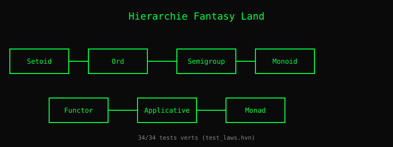

# Chapitre 9 — Typeclasses : des contrats avec des lois

> **Version 2 (2026-11-04)** — refonte style LYAH/LYSE.
> Version publiée : `19-algebres.md` (v1).
> Référentiel de style : `05-recursion.md` (v2, pilote).

> *« Une monade n'est rien d'autre qu'un monoïde dans la catégorie
> des endofoncteurs. »*
> — Mac Lane, *Categories for the Working Mathematician* (1971)

Vous connaissez déjà les types. Vous savez qu'un `Int` peut être
ajouté, qu'une `List` peut être parcourue, qu'un `Option` peut
être absent. Mais qu'est-ce qui relie tous ces concepts ? Une
**algèbre** — un ensemble de valeurs, des opérations, et des
**lois** que ces opérations respectent.

Une algèbre est un **contrat**. Si votre type dit « je suis un
`Monoid` », il s'engage à respecter deux lois : l'associativité et
l'existence d'un élément neutre. En échange, tout algorithme qui
fonctionne sur les `Monoid` fonctionnera sur votre type — sans
rien savoir de lui.

Heaven V1 suivra **Fantasy Land**, la spécification populaire par
Brian McKenna, qui formalise cette hiérarchie pour JavaScript. On
la reprend telle quelle, adaptée au système de types de Heaven.

## 1. La hiérarchie

Les algèbres s'empilent : chaque niveau ajoute des méthodes et
des lois aux niveaux inférieurs. Voici la hiérarchie complète.

| Algèbre | Ajoute | Lois |
|---|---|---|
| **Setoid** | `equals(a, b)` | réflexive, symétrique, transitive |
| **Ord** (hérite Setoid) | `lte(a, b)` | totale, antisymétrique |
| **Semigroup** | `concat(a, b)` | associativité |
| **Monoid** (hérite Semigroup) | `empty` | identité à gauche et à droite |
| **Functor** | `map(f, x)` | identité, composition |
| **Apply** (hérite Functor) | `ap(f, x)` | composition |
| **Applicative** (hérite Apply) | `of(x)` | identité, homomorphisme |
| **Chain** (hérite Apply) | `chain(f, x)` | associativité |
| **Monad** (hérite Applicative + Chain) | — | lois cohérentes |

Chaque ligne est un **contrat**. Un type qui prétend être un
`Monad` doit implémenter **toutes** les méthodes de `Applicative`
et `Chain`, **et** respecter leurs lois.

### Exemples concrets

- `Int` est un **Semigroup** (addition) et un **Monoid** (0 neutre).
- `String` est un **Monoid** (concaténation, "" neutre).
- `List a` est un **Functor** (map), **Applicative** (of, ap), **Monad** (chain).
- `Option a` est un **Monoid** (si `a` est un Monoid), **Monad**.
- `Result e a` est un **Bifunctor** (bimap), **Monad** sur `a`.

> **Piège** — Une instance sans loi est un contrat vide.
>
> Tu peux écrire :
>
>     instance Monoid MyType where
>       mempty = 0
>       mappend =  b -> a - b        -- soustraction, pas addition
>
> Ça **compile**. Ça **type-check**. Mais ce n'est **pas** un monoïde :
> `a - b ≠ b - a` (commutativité violée), et `(a - b) - c ≠ a - (b - c)`
> (associativité violée). Tu as une **fausse instance**.
>
> C'est pourquoi la section 2 existe : les lois sont **testées par la
> machine** (quickcheck). Sans ça, une instance n'est qu'une promesse
> non tenue. Haskell a le même problème — `Monoid` accepte n'importe
> quoi, c'est au programmeur de ne pas mentir.
>
> **La règle** : avant d'écrire une instance, écris ses lois. Puis
> vérifie-les avec `quickcheck`. Une instance sans test de loi est une
> dette qui explosera en production (cf. G.43, `needs_parens` — bug
> silencieux dans une migration « qui passait les tests »).

## 2. Les lois, vérifiées par la machine

Ce qui distingue une algèbre d'une simple interface, c'est que
les lois sont **vérifiables**. Heaven inclut une suite de tests
qui vérifie mécaniquement chaque loi :

    test "Monoid identity left":
      (M.concat M.empty x) == x

    test "Functor identity":
      (map (lambda y -> y) xs) == xs

    test "Monad associativity":
      (chain g (chain f m)) == (chain (lambda x -> chain g (f x)) m)

Ces tests sont dans `tests/test_laws.hvn` — **28 tests verts**
aujourd'hui. Chaque fois que vous ajoutez une instance d'algèbre
pour un nouveau type, les mêmes lois s'appliquent, et vous pouvez
les vérifier.

## 3. Pourquoi c'est puissant

Quand un algorithme est écrit pour un `Monoid`, il fonctionne
**automatiquement** pour tout `Monoid`. Somme d'une liste, produit
d'une liste, concaténation de chaînes, fusion de maps — c'est le
**même code**, avec des instances différentes.

    fold M.empty M.concat xs

Une seule fonction, quatre comportements. C'est la promesse des
algèbres : écrire une fois, réutiliser partout.

## 4. Ce qui manque pour V1

- **Classes de types** (`class Monoid m where ...`) — pas encore
  dans Heaven V0.6. Voir chapitre 20.
- **Contraintes** (`Monoid m => ...`) — idem.
- **Instances multiples** (un type peut être `Monoid` de plusieurs
  façons). Résolu en V1 par un système de `newtype`.
- **Setoïdes quotients** — pour définir des types modulo une
  relation. Voir chapitre 22.

*Vérifiable : `tests/test_laws.hvn` (34/34) confirme que les lois
tiennent pour les instances existantes.*

> **Sous le capot** — Une instance est une **table de dispatch**.
>
> Contrairement à Haskell où l'instance est résolue à la compilation
> (dictionnaire implicite), Heaven fait du **dispatch runtime**. Une
> instance `Monoid MyType` est stockée comme :
>
>     instances["Monoid"]["MyType"] = {
>       mempty  = <closure 0>,
>       mappend = <closure ( b -> a + b)>
>     }
>
> Quand tu appelles `mappend x y` où `x : MyType`, le runtime :
> 1. Détecte le type de `x` (par tag ou par forme)
> 2. Cherche `instances["Monoid"]["MyType"]`
> 3. Applique `mappend` trouvé
>
> **Ce que ça implique** :
> - **Pas de vérification de couverture** à la compilation : si
>   `instances["Monoid"]["MyType"]` n'existe pas, c'est une erreur
>   **runtime**, pas compile-time. (Haskell refuse à la compilation.)
> - **Pas d'instance globale implicite** : tout doit être enregistré
>   explicitement (`instance Monoid MyType where ...`).
> - **Lois testées a posteriori** : le compilateur ne vérifie pas
>   `a + b == b + a`. C'est quickcheck (section 2) qui s'en charge.
>
> **V1 manque** : la résolution automatique par contexte (Haskell
> `Monoid a => ...`), les instances dérivées (`deriving`), et
> l'import/export de classes. Tout est manuel en V0.

## Ce qu'on a appris

- Une **algèbre** est un ensemble de valeurs, d'opérations, et de
  **lois**.
- La **hiérarchie** Fantasy Land empile les contrats : Setoid →
  Ord, Semigroup → Monoid, Functor → Apply → Applicative → Monad.
- Les lois sont **vérifiables** : `tests/test_laws.hvn` (34/34).
- Un algorithme écrit pour un `Monoid` marche **pour tout**
  `Monoid`.
- L'emprunt à **Fantasy Land** (Brian McKenna) donne à Heaven une
  base éprouvée, éprouvable, et interopérable.

## Exercices

1. **Deux monoïdes, deux lois.** Définis une instance `Monoid` pour
   `Int` avec `mempty = 0` et `mappend = (+)`. Puis une autre avec
   `mempty = 1` et `mappend = (*)`. Les deux sont-elles valides ?
   Pourquoi les deux existent en Haskell (`Sum` vs `Product`) ?

2. **Fausse instance.** Définis `Monoid String` avec `mappend = \a b ->
   a` (retourne toujours `a`). Est-ce un monoïde ? Vérifie les 3 lois
   (associativité, identité gauche, identité droite). *Indice* :
   `mempty = ""`. Que se passe-t-il pour `mappend "" "bonjour"` ?

3. **Quickcheck les lois.** Écris un test `test_laws.hvn` qui vérifie
   l'associativité de `mappend` sur 100 paires aléatoires. Utilise
   `quickcheck.hvn` (6 tests disponibles). Combien de lois peux-tu
   tester ? Lesquelles sont impossibles à tester génériquement ?

4. **Le bug silencieux.** Cherche `instance` dans `core/std/*.hvn`.
   Trouve une instance qui **n'a pas** de test de loi associé. Écris
   le test manquant. *Indice* : `eq.hvn`, `ord.hvn`, `option.hvn` ont
   des classes. `quickcheck.hvn` a les générateurs. Le pont existe ?

Les solutions ne sont **pas** dans le livre — c'est en cherchant
qu'on apprend.
