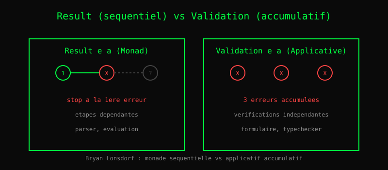

# Chapitre 19 — Validation : accumuler les erreurs

> **Version 2 (2026-11-04)** — refonte style LYAH/LYSE.
> Version publiée : `23-validation.md` (v1, sections 1-4).
> Les outils de test (mocker, smocker, quickcheck, fuzzer, loadtest) sont au chapitre 19b.
> Référentiel de style : `05-recursion.md` (v2, pilote).

> *« Une monade s'arrête à la première erreur. Un applicatif les
>  accumule toutes. »*
> — Bryan Lonsdorf

Imaginez un formulaire avec 5 champs. L'utilisateur tape mal son
email, oublie son âge, et met un mot de passe trop court. Quelle
erreur afficher ?

**Option 1 — Séquentielle** : on arrête à la première erreur.
« Email invalide. » L'utilisateur corrige, retente, découvre
l'erreur suivante. Frustrant.

**Option 2 — Accumulative** : on vérifie tous les champs, on
collecte **toutes** les erreurs. « Email invalide, âge manquant,
mot de passe trop court. » L'utilisateur corrige tout d'un coup.

C'est la distinction entre **Monad** (séquentiel) et
**Applicative** (parallèle). Bryan Lonsdorf (Dr. Boolean,
auteur de *Mostly Adequate Guide to Functional Programming*) a
popularisé cette distinction.

## 1. Result : la monade séquentielle

    Result e a = Ok a | Err e

Avec `chain`, on enchaîne :

    parse_email(s) : Result String Email
    parse_age(s)   : Result String Int
    validate(p) :
      parse_email(p.email) |> chain (lambda email ->
        parse_age(p.age) |> chain (lambda age ->
          Ok (Pair email age)))

Dès la première `Err`, on s'arrête. Les étapes suivantes ne
tournent pas.

## 2. Validation : l'applicatif accumulatif

    Validation e a = Valid a | Invalid (List e)

Avec `ap`, on **combine** :

    validate(p) :
      ap (ap (ap (Valid (lambda e a -> Pair e a))
                  (parse_email(p.email)))
                  (parse_age(p.age)))
                  (parse_password(p.password))

Les trois parsers tournent. Si l'un échoue, son erreur est
**ajoutée** à la liste. Si deux échouent, on a deux erreurs.

> **Piège** — `Validation` n'est pas un `Monad`.
>
> `Result` (ch8) est un **Monad** : `(and_then r f)` chaîne, et
> s'arrête à la **première** erreur. `Validation` est un
> **Applicative** : `(combine v1 v2)` accumule **toutes** les erreurs.
>
>     -- Result : s'arrête à la première erreur
>     (and_then (err "nom vide") (λ_. (err "âge invalide")))
>     -- → err "nom vide" (la seconde erreur est PERDUE)
>
>     -- Validation : accumule
>     (combine (invalid ["nom vide"]) (invalid ["âge invalide"]))
>     -- → invalid ["nom vide"; "âge invalide"] (les deux)
>
> **Ce qui surprend** : `Validation` **n'est pas** une `Monad`. Tu
> ne peux pas écrire `(and_then v f)` avec `v : Validation a e` qui
> utiliserait `a` dans `f` — parce qu'il n'y a **pas** de `a` si
> `v` est `Invalid`. Le typage l'interdit.
>
> **Conséquence** : `Validation` est **moins puissante** que `Result`
> (pas de dépendance entre étapes), mais **plus utile** pour la
> validation de formulaires (toutes les erreurs d'un coup, pas une
> par une).
>
> **Règle** : si tu as besoin de **enchaîner** des calculs qui
> dépendent du précédent → `Result` (`and_then`). Si tu as besoin de
> **valider en parallèle** des champs indépendants → `Validation`
> (`combine`).
>
> **Cas vécu** : `tests/test_validation.hvn` (à vérifier — peut ne
> pas exister). Si le test n'existe pas, écris-le : 3 champs, 2
> invalides, vérifie que `combine` accumule les 2. `Result` n'en
> garderait qu'un.

## 3. Quand utiliser quoi

| Cas | Utiliser |
|---|---|
| Chaîne d'opérations dépendantes | `Result` (Monad) |
| Vérifications indépendantes | `Validation` (Applicative) |
| Parseur qui compose | `Result` |
| Formulaire utilisateur | `Validation` |
| Typechecker | `Validation` (accumuler toutes les erreurs) |
| Évaluation d'AST | `Result` (s'arrêter à la première) |

**Règle** : si les étapes sont **indépendantes**, utilisez
`Validation`. Si elles sont **dépendantes**, utilisez `Result`.

## 4. Impact sur Heaven

Heaven utilise cette distinction :

- Le **parser** renvoie `Result` : première erreur de syntaxe,
  on s'arrête.
- Le **typechecker** utilisera `Validation` : accumuler toutes
  les erreurs de type d'un module.
- Le **proof checker** est `Result` : premier but échoué, on
  arrête.

C'est un choix d'ergonomie. L'utilisateur d'un formulaire veut
**toutes** ses erreurs. L'utilisateur d'un parseur veut **la**
première, pour corriger au plus tôt.

> **Sous le capot** — `Validation` se simule avec `Result` + un
> accumulateur.
>
> En Haskell, `Validation e a = Failure e | Success a` est un type
> **distinct** de `Either e a` (dont `Result` est l'équivalent).
> En Heaven V0, pas de type `Validation` natif — il faut le
> **simuler** avec `Result` et un accumulateur :
>
>     data Validation e a = Invalid e | Valid a
>
>     combine (Invalid e1) (Invalid e2) = (Invalid (append e1 e2))
>     combine (Invalid e1) (Valid _)     = (Invalid e1)
>     combine (Valid _) (Invalid e2)     = (Invalid e2)
>     combine (Valid a) (Valid b)        = (Valid (pair a b))
>
> **Ce que ça implique** :
> - **Pas de `Functor`/`Applicative` natif** : `combine` est une
>   fonction **manuelle**, pas une instance. Chaque type d'erreur
>   (String, liste, etc.) a son `combine` (ou un `Semigroup` à
>   définir, ch9).
> - **Pas d'accumulation automatique** : `combine` doit être appelé
>   explicitement. Pas de `(sequence [v1, v2, v3])` qui accumule
>   les erreurs.
> - **Pas de lois vérifiées** : `combine` doit être **associatif**
>   (`combine v1 (combine v2 v3) == combine (combine v1 v2) v3`),
>   mais le compilateur ne le vérifie pas. Quickcheck peut le tester
>   (18b, `quickcheck.hvn`).
>
> **Lien avec `handle`/`perform`** (ch16) : `Validation` est une
> **structure de données** (Result-like), pas un effet. Les effets
> (`perform "Invalid"`) sont une **autre** façon de gérer les
> erreurs, plus dynamique (le handler décide). `Validation` est plus
> **statique** (le type dit ce qui peut échouer). Les deux coexistent
> en Heaven.
>
> **Ce qui manque pour un vrai `Validation`** : HKT (ch15) + instances
> `Functor`/`Applicative` (ch9). C'est la roadmap `_hkt_v1b_plan.md`
> — 2 sessions après le noyau. En V0, `combine` manuel, c'est tout.

## Ce qu'on a appris

- **Result** (Monad) est **séquentiel** : première erreur, stop.
- **Validation** (Applicative) est **accumulatif** : toutes les
  erreurs en un coup.
- Les deux ont leur place : parser → Result, formulaire → Validation.
- Cette distinction vient de **Bryan Lonsdorf** et de la
  communauté Fantasy Land.
- Heaven utilise `Result` pour le parser et `Validation` pour le
  futur typechecker.

## Exercices

1. **Form vs Result.** Écris un formulaire à 3 champs (nom, email,
   âge), chacun validé séparément. Version `Result` : `and_then`
   chaîné, s'arrête à la première erreur. Version `Validation` :
   `combine` des trois, accumule les erreurs. Compare le nombre
   d'erreurs remontées quand les 3 sont invalides. *Piège* : la
   version `Result` ne peut pas remonter les 3.

2. **`combine` associatif.** Vérifie que `combine` est associatif :
   `(combine a (combine b c)) == (combine (combine a b) c)`.
   Teste sur 3 `Validation` avec erreurs distinctes. *Indice* :
   `append` sur les listes d'erreurs est associatif — `combine` qui
   utilise `append` l'est donc aussi. La preuve est **structurelle**,
   pas par test exhaustif.

3. **Validation imbriquée.** Définis `validate_user` qui combine
   `validate_name`, `validate_email`, `validate_age`. Chacune
   retourne `Validation (List String) a`. `validate_user` doit
   accumuler les erreurs des 3. Teste avec un user invalide sur les
   3 champs. *Piège* : l'ordre des erreurs dépend de l'ordre des
   `combine` — pas de tri automatique.

4. **Les outils de test.** Le chapitre 19b présente `mocker`,
   `smocker`, `quickcheck`, `fuzzer`, `loadtest`. Pour chacun, dis
   en une phrase **quand** l'utiliser et **quand** ne pas l'utiliser.
   *Indice* : `mocker` = dépendance externe (HTTP, DB). `smocker` =
   vérifier qu'un appel a eu lieu. `quickcheck` = propriétés
   universelles (lois). `fuzzer` = entrées aléatoires (crashs).
   `loadtest` = performance.

Les solutions ne sont **pas** dans le livre — c'est en cherchant
qu'on apprend.
