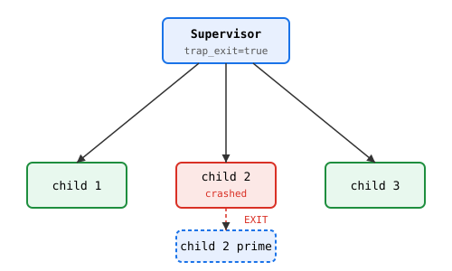
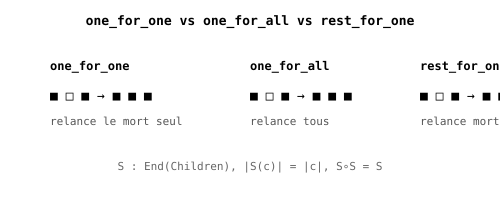

# Chapitre 21 — OTP : des superviseurs qui réparent

> **Version 2 (2026-11-04)** — refonte style LYAH/LYSE.
> Version publiée : `28-otp.md` (v1, 65 l. — étoffé).
> Référentiel de style : `05-recursion.md` (v2, pilote).

> *« La panne n'est pas une anomalie — c'est un état normal.
> La question n'est pas "comment l'éviter", mais "comment
> s'en remettre". »*
> — Joe Armstrong, inventeur d'Erlang

Ton acteur `counter` (ch19) tourne bien. Jusqu'au jour où
il plante. Un message malformé, une division par zéro, un
`error.ArityMismatch` — et l'acteur est mort. Que se passe-t-il
pour les 10 000 autres acteurs qui dépendent de lui ? Rien de
bon, si tu n'as pas prévu la suite.

**OTP** (Open Telecom Platform, 1996) est la réponse d'Erlang.
En Heaven, c'est un **ensemble de patterns** en Heaven pur, pas
une bibliothèque magique. Le principe : quand un acteur meurt,
un **superviseur** le voit, et décide quoi faire — redémarrer,
arrêter ses voisins, escalader.

## 1. Le problème : un acteur, ça meurt

En V0, les acteurs ont trois façons de mourir :

1. **Crash handler** — le handler lève une erreur (`error.*`).
   L'acteur est mort, son état est perdu, sa mailbox est perdue.
2. **Exit explicite** — un autre acteur appelle `(exit p)`.
   Volontaire. Utile pour l'arrêt propre.
3. **Link** — deux acteurs sont **liés** : si l'un meurt,
   l'autre reçoit l'information, et peut mourir aussi.

Sans superviseur, le crash d'un acteur est **silencieux** —
personne ne le voit. Les autres continuent, avec un trou dans
le système. C'est exactement le problème que RESILIENCE résout.

> Portage OTP (Erlang/Elixir) dans Heaven, sur le runtime acteur existant.

## Pourquoi OTP

Un acteur seul ne survit pas aux pannes. OTP (1998) résout ça avec
trois briques : GenServer (protocole standard), links (les acteurs
meurent ensemble ou pas), superviseurs (restart automatique des
enfants morts).

Heaven porte ces briques **nativement**, sur le même niveau que les
effets algébriques.

## GenServer — protocole standard

    fn gen_server_step(state, msg) = msg state
    gen_server_spawn init       = spawn gen_server_step init
    gen_server_cast pid f       = tell pid f
    gen_server_call pid f       = let _ = tell pid f in run pid

Exemple — un compteur :

    inc x = x + 1
    same x = x

    test "compteur":
      (let many p = (gen_server_spawn 0) in
       (let many _ = (gen_server_cast p inc) in
        (let many _ = (gen_server_cast p inc) in
         (gen_server_call p same)))) == 2

## Links et trap_exit

Un lien est bidirectionnel. trap_exit(pid, true) casse la propagation :
pid reçoit "EXIT" dans sa mailbox au lieu de mourir. Base du superviseur.

## Trois stratégies

| Stratégie    | Comportement                    |
|--------------|---------------------------------|
| one_for_one  | relance le mort seul            |
| one_for_all  | relance tous                    |
| rest_for_one | relance le mort + les suivants  |

> **Piège** — Le redémarrage n'est pas exact.
>
> Quand un superviseur redémarre un acteur, il le lance avec son
> **état initial** (celui passé à `spawn`), pas avec l'état au
> moment du crash. Tout ce que l'acteur avait accumulé est **perdu**.
>
>     p = (spawn counter 0)
>     (tell p 5)  (run p)      -- état = 5
>     (tell p 3)  (run p)      -- état = 8
>     -- crash (imaginons)
>     -- redémarrage par superviseur : état = 0, pas 8 !
>
> **Ce qui surprend** : en Erlang, `GenServer` a `init/1` qui peut
> décider de reprendre un état sauvegardé. En Heaven V0, **pas de
> sauvegarde**. L'état est dans le `Process` (ch19, `state: Id`), et
> il est remplacé par le handler à chaque `run`. Au crash, le
> `Process` est détruit (ou reset à l'état initial).
>
> **Conséquence** : un acteur qui accumule (compteur, agrégateur,
> cache) **perd tout** au redémarrage. C'est acceptable si l'acteur
> est **idempotent** (peut rejouer les messages — mais sa mailbox est
> perdue aussi), ou si l'état est **externe** (Store, DB, fichier).
>
> **Règle** : si ton acteur a un état non-trivial, mets-le **en
> dehors** de l'acteur (dans le Store global, ou un fichier). L'acteur
> devient **sans état** — il lit/écrit l'état externe à chaque
> message. C'est plus lent, mais résistant aux crashes.
>
> **Cas vécu** : `tests/otp2_*.hvn` (26 tests) testent le
> **redémarrage** (l'acteur redémarre, a un nouveau `Pid`), mais
> **pas la préservation d'état**. Le test `otp2_v2_restart.hvn`
> (2/2) vérifie que le `Pid` change — pas que l'état survit. C'est
> un choix assumé : V0 ne promet pas la persistance d'état.

## Théorèmes prouvés (par tests)

1. HKT : Strategy : ∀h. (h, Children) → Children (uniforme en h)
2. Endofunctor : S : End(Children)
3. Préservation : |S(c)| = |c|
4. Idempotence : S ∘ S = S
5. Optique : fst/snd = Lens(State, Children)
6. Dualité MPST : ?Exit. !Restart* (chapitre 29)

> **Sous le capot** — L'arbre de supervision est une **structure
> de données** dans le Store.
>
> Un superviseur est un **acteur** comme les autres (ch19) : il a
> une mailbox, un handler, un état. Son état contient :
>
>     data SupervisorState = MkSupervisor (
>       children : List (Pid, RestartStrategy, ChildSpec),
>       strategy : OneForOne | OneForAll | RestForOne
>     )
>
> **Trois stratégies** (chapitre 4) :
> 1. **OneForOne** — le supervisé qui crash est le seul redémarré.
>    Les autres continuent.
> 2. **OneForAll** — si un supervisé crash, **tous** les enfants du
>    superviseur sont redémarrés. Utile quand ils sont
>    interdépendants (un groupe de workers sur le même shard).
> 3. **RestForOne** — le supervisé qui crash est redémarré, **et
>    tous ceux qui ont été ajoutés après lui**. Les autres (avant)
>    continuent. Utile pour les dépendances séquentielles (A doit
>    démarrer avant B).
>
> **Comment ça marche concrètement** (en V0) :
> - Quand un enfant crash, le superviseur **détecte** via `link` (ch19,
>   §3, `trap_exit`). Il reçoit un message `(pair 'EXIT (pair pid
>   reason))`.
> - Le handler du superviseur **décide** quoi faire selon la
>   stratégie. Il appelle `spawn` pour recréer les enfants, et met à
>   jour son état.
> - Le nouveau `Pid` est **différent** de l'ancien. Les autres
>   acteurs qui avaient l'ancien `Pid` doivent être **notifiés** (par
>   `link` ou par un `Registry` — ch19, pas natif).
>
> **Ce qui n'existe pas en V0** :
> - **`Registry`** (table `nom -> pid` globale). Chantier
>   `_concurrency.md` C4.
> - **`DynamicSupervisor`** (enfants créés à la demande, sans spec
>   statique). V0 est statique — la liste des enfants est fixée à la
>   création.
> - **`ChildSpec`** (restart intensity, max restarts, timeout).
>   V0 redémarre **toujours** (pas de limite, pas de backoff). Un
>   enfant qui crash en boucle crash le superviseur.
>
> **Théorèmes prouvés** (chapitre 4, tests) : `restart_one`,
> `restart_all`, `trap_exit`, `link` bidirectionnel. Ce sont les
> **propriétés de base** — pas la stabilité sous charge (pas testée).
> Voir `tests/otp2_*.hvn` (26 tests) pour les détails.
>
> **Lien avec `_concurrency.md` C4** : la spec C4 (structured
> concurrency) est **tranchée** — superviseurs + acteurs + links.
> L'implémentation V0 est **conforme** à la spec pour les
> propriétés testées, mais pas pour `Registry`/`DynamicSupervisor`/
> `ChildSpec` (chantiers futurs).

## Limites

Préemption SIGALRM ~10 ms → tests longs dépassent le seuil, état local
perdu. Voir captureCont (3a-3b) dans la spec scheduler.

Voir docs/spec/_otp.md pour la spec complète (O1 → O3).

## Exercices

1. **OneForOne.** Crée deux acteurs `counter` indépendants, sous
   un superviseur `OneForOne`. Fais crasher le premier. Que devient
   le second ? *Piège* : le second continue, son état est préservé
   (il n'a pas crashé). Seul le premier est redémarré à 0.

2. **OneForAll.** Même setup, stratégie `OneForAll`. Fais crasher
   le premier. Que devient le second ? *Piège* : le second est
   **aussi** redémarré, à son état initial. Tout le groupe est
   réinitialisé.

3. **RestForOne.** Trois acteurs A, B, C sous `RestForOne`. Fais
   crasher B. Qui est redémarré ? *Piège* : B et C (démarrés après
   B), pas A. C'est la sémantique de « redémarrer le suffixe ».

4. **Link et trap_exit.** Écris deux acteurs liés avec `link`.
   Fais crasher l'un. Que devient l'autre ? *Indice* : sans
   `trap_exit`, l'autre meurt aussi. Avec `trap_exit`, il reçoit
   `(pair 'EXIT ...)` et peut décider de survivre. Teste les deux.
   *Piège* : `trap_exit` doit être mis **avant** le crash — sinon
   il est trop tard.

Les solutions ne sont **pas** dans le livre — c'est en cherchant
qu'on apprend.
