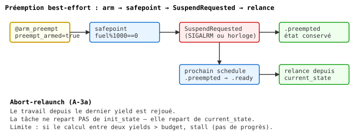

# Chapitre 21b — Préemption et fair scheduling

> **Version 2 (2026-11-04)** — refonte style LYAH/LYSE.
> Version publiée : `13-concurrency.md` (v1, section préemption).
> Le mode coopératif est au chapitre 21a.
> Référentiel de style : `05-recursion.md` (v2, pilote).

## La préemption (2026-10)

Le scheduler coopératif décrit ci-dessus ne peut pas interrompre une
tâche qui ne rend jamais la main. Depuis octobre 2026, Heaven dispose
d'une **préemption best-effort** :

- `(@arm_preempt 0)` active la préemption. À chaque safepoint
  (`fuel % 1000 == 0`), le moteur vérifie un flag (`SIGALRM` en natif,
  ou l'horloge après 10 ms en WASI) et lève `error.SuspendRequested`.
- `(@disarm_preempt 0)` désactive la préemption (symétrique,
  réversible).
- Une tâche préemptée passe `.preempted` (distinct de `.blocked`) et
  est **relancée depuis son dernier `yield`** au prochain `schedule`
  — pas depuis `init_state`. C'est le modèle *abort-relaunch*.
- Validé sur native (SIGALRM + horloge) et WASI (`wasmtime`, fallback
  horloge ; `hasClock()` est `true` pour `wasm32-wasi`).

Limitation assumée : si le calcul entre deux `yield` dépasse le budget
par itération, la tâche est ré-exécutée en boucle sans progresser.
La reprise exacte demanderait des continuations (A-3b, cf.
`docs/spec/_capture_eval.md`).

### Modes de préemption (2026-10-27)

Depuis `E4/3.3-pre`, `@arm_preempt` accepte un mode explicite :

    (@arm_preempt)              -- 0 arg = "both" (compat historique)
    (@arm_preempt "both")       -- timer + fuel (defaut)
    (@arm_preempt "fuel")       -- quota fuel seul (portable partout)
    (@arm_preempt "timer")      -- setitimer/SIGALRM (Linux seulement)

**`.fuel`** : aucune horloge, aucun signal. À chaque safepoint
(`fuel % 1000 == 0`), le moteur décrémente le budget de la tâche
courante ; si zéro, `SuspendRequested`. C'est **la seule voie
portable** pour WASI, wasm-freestanding, iOS, Android.

**`.timer`** : `setitimer`/`SIGALRM` à 10 ms en natif Linux, no-op
sur wasm (garde comptime). Donne une vraie préemption entre deux
safepoints, mais dépend de l'OS.

**Régression connue** : `(@arm_preempt 0)` (ancienne forme) retourne
désormais `error.TypeError`, car l'argument doit être une string.
Compat 0 → `.both` à rétablir en dette 3.4b-bis.

### Boucle native `@loop_until` (2026-10-28)

Le TCO de Heaven (self-tail-call detection dans `engine_expr.zig`)
traverse `if/then/else` mais **ni `let` ni `seq`**. Conséquence :
`server_loop` ne peut pas être une récursion terminale. Tests :

    loop_if_then_else 500   → OK     (if pur est TCO'd)
    loop_let_500            → SIGSEGV (`let _ = A in B` casse le TCO)
    loop_if_seq_500         → SIGSEGV (`seq` casse le TCO)

Pour les boucles serveur, on utilise `@loop_until(cond_thunk, body_thunk)`,
un magic qui implémente une **vraie boucle Zig** (while), zéro
stack growth. Premier client : `core/http_server.hvn` (500 requêtes
HTTP sans crash).

    server_loop cap listen_fd =
      (@loop_until (lambda _ (@exiting)) (lambda _ (handle_client cap listen_fd)))

Le **vrai fix** (Phase 7) = étendre la détection TCO pour traverser
`let` et `seq`. `@loop_until` est un contournement **documenté**,
pas un workaround caché. Voir aussi `core/std/loadtest.hvn` limité à
50 iters et `core/std/fuzzer.hvn` qui utilise `Q.check` au lieu d'une
récursion manuelle — même dette.
