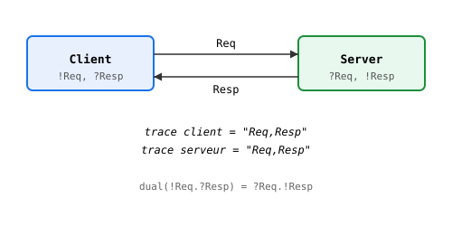

# Chapitre 22 — MPST : des protocoles qui parlent d'eux-mêmes

> **Version 2 (2026-11-04)** — intro from scratch + §2-6 repris
> de `29-mpst.md` (v1, 47 l. — étoffé). V2a (multipartite +
> `project_mult`) livré le 2026-11-04 (`stdlib/mpst.hvn`,
> 14 tests).
> Référentiel de style : `05-recursion.md` (v2, pilote).

> *« Un protocole, c'est une promesse sur le futur. »*
> — Robin Milner, *Communication and Mobile Systems*

Chapitre 19 : les acteurs s'envoient des messages. Chapitre 20 :
les superviseurs les réparent. Mais **qui vérifie que les
messages sont les bons** ? Si `A` envoie `"Hello"` à `B`, et que
`B` attend `"World"`, le programme ne plante pas — il attend un
message qui ne viendra jamais. **Deadlock silencieux.**

**MPST** (Multiparty Session Types, Honda-Yoshida-Carbone 2008)
est la réponse théorique. Un **protocole** décrit les messages
autorisés, dans l'ordre. Chaque participant a une **projection
locale** — ce qu'il voit du protocole. Et le runtime **vérifie**
que la trace correspond.

Heaven implémente MPST en deux couches (`stdlib/mpst.hvn`) :
1. **Protocole binaire** (V0) : `STSend`/`STRecv`, dualité,
   `check` sur trace.
2. **Multipartite** (V2a, 2026-11-04) : `STMulti`, `project_mult`
   vers le binaire, exemples 3-party.

Le chapitre explique les deux, avec le **runtime** (trace) et la
**théorie** (dualité).

## 1. Le problème : un message peut se perdre sans erreur

En V0, `tell p "Hello"` ajoute `"Hello"` à la mailbox. `recv p`
retire le **premier** message. Si `B` attend `"World"` mais que
`A` a envoyé `"Hello"`, `B` reçoit `"Hello"` — pas d'erreur.
Le programme continue, avec un message **faux**.

MPST impose un **ordre** et un **label**. Si la trace ne
correspond pas, `check` renvoie `false` — l'erreur est **explicite**.

> Vérification comportementale des protocoles d'acteurs.

## Deux couches coexistent

- stdlib/mpst.hvn : algèbre binaire (STSend, STRecv, dual, check).
  9 tests verts. Prédécesseur (Honda 1993).
- core/std/otp/protocol.hvn : helpers OTP-spécifiques sur
  mpst_trace(pid) — check_no_trace, check_has_trace,
  check_protocol, check_dual.

## Mécanisme

Chaque tell/recv accumule les labels (chaînes) dans proc.trace.
mpst_trace(pid) retourne "Req,Resp". Comparaison à une spec.

    check_protocol pid expected = (mpst_trace pid) == expected
    check_no_trace pid          = (mpst_trace pid) == ""
    check_has_trace pid         = (string_length (mpst_trace pid)) > 0
    check_dual c s c_exp s_exp  = (and ((mpst_trace c) == c_exp)
                                       ((mpst_trace s) == s_exp))

## Exemple

    test "proto_req":
      (let many p = (spawn step 0) in
       (let many _ = (tell p "Req") in
        (check_has_trace p))) == true

## Dualité

Pas d'inversion automatique (la trace est syntaxique, la dualité est
sémantique). On déclare les deux specs :

    check_dual client server "!Req,?Resp" "?Req,!Resp"

> **Piège** — `dual` ne marche que sur du **binaire** symétrique.
>
> Le chapitre 3 définit `dual` : `STSend l rest` devient `STRecv l
> (dual rest)`, et inversement. C'est parfait pour deux parties
> (client/serveur), où l'un envoie ce que l'autre reçoit.
>
> En **multipartite** (3+ parties), `dual` ne suffit pas. Exemple
> 3-party (A→B→C→A) :
>
>     A → B "Hello"
>     B → C "World"
>     C → A "Done"
>
> `dual(proto)` **n'a pas de sens** — ce n'est pas une symétrie à
> deux, c'est un cycle à trois. Il faut `project_mult role proto`
> (V2a, 2026-11-04) qui extrait le **point de vue** de chaque
> partie.
>
> **Ce qui surprend** : en binaire, `dual(dual p) == p` (involution).
> En multipartite, `project_mult A (project_mult A p)` n'a **pas**
> de sens — la projection perd l'information des autres parties.
> Une projection n'est **pas** inversible.
>
> **Conséquence** : ne confonds pas les deux outils.
> - **Binaire** (2 parties) : `dual` pour générer le protocole
>   opposé, `check` sur trace.
> - **Multipartite** (3+ parties) : `project_mult role p` pour
>   extraire le point de vue local, puis `check` sur la **trace
>   locale** de ce rôle.
>
> **Cas vécu** : `tests/test_mpst_multipartite.hvn` (14 tests,
> 2026-11-04) teste exactement cette distinction. `proj_unknown`
> vérifie qu'un rôle inconnu retourne `STEnd` (pas une erreur).
> `proj_A` / `proj_B` / `proj_C` vérifient les 3 projections du même
> protocole. C'est ce qui rend le multipartite **utilisable** — sans
> `project_mult`, `dual` serait inutile dès 3 parties.
>
> **Limite V0** : `project_mult` ne gère **que** `STMulti` (pas de
> récursion `μX`, pas de choix paramétré). Pour les protocoles
> récursifs (`μX. ... X`), c'est le chantier V2c (roadmap, non
> implémenté).

> **Sous le capot** — `check` est **post-hoc**, pas en ligne.
>
> En MPST théorique, la vérification est **en ligne** : à chaque
> `send`/`recv`, le runtime compare le label au protocole courant.
> Si mismatch, il **refuse** le message (erreur immédiate).
>
> En Heaven V0, c'est **post-hoc** :
> - `tell p msg` ajoute le message à la mailbox **et** à
>   `proc.trace` (si c'est une string).
> - `check(proto, trace)` compare **après coup** : la trace entière
>   contre le protocole.
> - Si mismatch, `check` renvoie `false`. Le programme **a déjà
>   tourné**.
>
> **Ce que ça implique** :
> - **Détection tardive** : un message faux n'est pas arrêté, il
>   est **signalé**. Le programme peut continuer avec un état
>   corrompu. C'est un choix assumé — V0 ne casse pas le runtime
>   pour un message hors protocole.
> - **Trace optionnelle** : `trace` est stockée **en plus** de la
>   mailbox. Pas de coût si tu n'utilises pas MPST (le `check` est
>   optionnel).
> - **Traces locales** : chaque `Process` a sa trace. Pour un
>   protocole multipartite, il faut **collecter** les traces des
>   participants (via `mpst_trace(pid)` — magic engine, ch1).
>
> **`mpst_trace(pid)`** : magic qui retourne la trace d'un
> processus. C'est ce qui permet `check(project_mult role p,
> trace_of_string(mpst_trace(pid)))` — vérification **par rôle**.
>
> **Ce qui manque pour de l'en-ligne** : hook dans `tell`/`recv` qui
> vérifie le label **avant** l'ajout. C'est le chantier V2b
> (`_mpst_v2_plan.md`, bloqué par `_concurrency.md` C1-C5). V2a
> (multipartite + projection) est livré, V2b (en ligne + rôles
> runtime) est la prochaine étape.
>
> **Théorèmes prouvés** (tests) : `dual_involution` (binaire),
> `check_server_ok` (binaire), `proj_*` (multipartite). Ce sont les
> **propriétés de base** — pas la soundness complète (qui exigerait
> le chantier en-ligne).
>
> **Lien avec les chapitres 19-21** : les acteurs (19) envoient,
> OTP (20) supervise, MPST (22) **vérifie**. Les trois sont
> **indépendants** — tu peux utiliser les acteurs sans MPST, et
> MPST sans OTP. Mais ensemble, ils forment une pile complète :
> `spawn` → `tell` → `check` → `supervise`.

## Pourquoi runtime ?

Un typechecker MPST statique (Scribble, FuSe) est un projet à part.
Heaven choisit le runtime — cohérent avec QTT, effects, préemption
runtime. Moins fort qu'Agda, plus direct.

Voir docs/spec/_mpst_plan.md et _mpst_v2_plan.md.

## Exercices

1. **Protocole binaire simple.** Écris `proto_client` (Send "Req",
   Recv "Resp", End) et `proto_server` (dual). Lance un client et
   un serveur (ch19), échange 3 fois. Vérifie que
   `(check proto_client (trace_of_string (mpst_trace client)))` est
   `true`. Puis envoie un mauvais label — `check` doit dire `false`.
   *Piège* : `check` est post-hoc — le programme tourne quand
   même.

2. **Multipartite 3-party.** Reprends `proto_3` (A→B→C→A,
   2026-11-04). Extrais les 3 projections avec `project_mult`.
   Lance 3 acteurs (A, B, C), fais les 3 `tell` dans l'ordre. Vérifie
   que chaque trace locale est conforme à sa projection. *Piège* :
   `dual` ne marche pas — il faut `project_mult` pour chaque rôle.

3. **Dual involution.** Vérifie que `(dual (dual proto))` est
   égal à `proto` pour 3 protocoles différents (avec `STSend`,
   `STRecv`, `STSeq`). *Indice* : `tests/test_mpst.hvn` a déjà
   `dual_involution` sur `proto_client`. Généralise à 2 autres.

4. **Le piège du rôle inconnu.** Que fait `(project_mult "D" proto_3)`
   ? *Piège* : V0 retourne `STEnd` (tolérance), pas une erreur.
   Est-ce le bon choix ? Propose une alternative (`InvalidRole`,
   `None`, exception). Argumente en 3 paragraphes. *Indice* :
   `tests/test_mpst_multipartite.hvn` `proj_unknown` teste
   exactement ce cas.

Les solutions ne sont **pas** dans le livre — c'est en cherchant
qu'on apprend.
