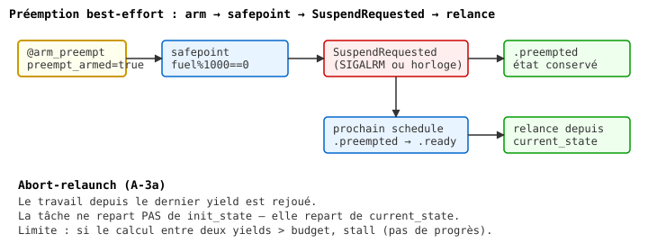

# Chapitre 22b — Préemption et fair scheduling

> **Version 2 (2026-11-04)** — refonte style LYAH/LYSE.
> Version publiée : `13-concurrency.md` (v1, section préemption).
> Le mode coopératif est au chapitre 21a.
> Référentiel de style : `05-recursion.md` (v2, pilote).

## Pourquoi la préemption ?

Le chapitre 21a s'est terminé sur un problème : une tâche qui n'appelle
**jamais** `yield` gèle toutes les autres. Le contrat coopératif
demande au programmeur d'être sage — mais tout le monde ne l'est pas.

    greedy _ = (let _ = (print "greedy") in (greedy 0))

Lance `greedy` puis n'importe quelle autre tâche : la seconde ne
démarre jamais. Le scheduler attend un `yield` qui ne viendra pas.

**La préemption** est la réponse. L'idée : ne pas faire confiance au
programmeur, et **interrompre** les tâches régulièrement, qu'elles le
veuillent ou non. Le scheduler reprend la main à intervalles fixes
(typiquement 10-100 ms) et passe à la tâche suivante.

C'est ce que fait un OS moderne. C'est ce que fait BEAM (Erlang). Et
c'est ce que Heaven essaie de faire — avec une nuance importante
qu'on va voir plus bas.

## La préemption (2026-10)

Le scheduler coopératif décrit ci-dessus ne peut pas interrompre une
tâche qui ne rend jamais la main. Depuis octobre 2026, Heaven dispose
d'une **préemption best-effort** :

- `(@arm_preempt 0)` active la préemption. À chaque safepoint
  (`fuel % 1000 == 0`), le moteur vérifie un flag (`SIGALRM` en natif,
  ou l'horloge après 10 ms en WASI) et lève `error.SuspendRequested`.
- `(@disarm_preempt 0)` désactive la préemption (symétrique,
  réversible).
- Une tâche préemptée passe `.preempted` (distinct de `.blocked`) et
  est **relancée depuis son dernier `yield`** au prochain `schedule`
  — pas depuis `init_state`. C'est le modèle *abort-relaunch*.
- Validé sur native (SIGALRM + horloge) et WASI (`wasmtime`, fallback
  horloge ; `hasClock()` est `true` pour `wasm32-wasi`).

Limitation assumée : si le calcul entre deux `yield` dépasse le budget
par itération, la tâche est ré-exécutée en boucle sans progresser.
La reprise exacte demanderait des continuations (A-3b, cf.
`docs/spec/_capture_eval.md`).

> **Piège** — La préemption actuelle est par **redémarrage**, pas
> par **reprise exacte**.
>
> En V0, quand le timer interrompt une tâche, Heaven ne capture **pas**
> son état exact (position dans le code, pile, variables locales non
> liées). Il marque la tâche `preempted` et la **relance au début** de
> son handler, avec le **dernier `state` sauvegardé**.
>
> Concrètement (`STATUS.md`, `_concurrency.md` C1) :
>
>     -- Tâche avec état : OK
>     counter state = (let _ = (work) in (yield) in counter (state + 1))
>     -- Si préemptée avant le yield, elle redémarre avec `state` inchangé
>
>     -- Tâche purement fonctionnelle avec accumulation interne : KO
>     accumulate _ = (let x = (heavy_compute) in
>                     (let y = (heavy_compute2 x) in
>                      (print (+ x y))))
>     -- Si préemptée entre `x` et `y`, `x` est perdu : redémarrage
>     -- depuis le début du handler
>
> **La règle** : en préemptif Heaven V0, tes handlers doivent être
> **idempotents** ou **découpés en petits pas avec `yield` explicite**.
> La préemption sauve le système d'une tâche folle, mais elle ne
> garantit **pas** la reprise exacte. C'est un choix assumé pour V0 —
> la reprise exacte exige `captureCont` (continuations délimitées
> complètes, chantier 3a-3b).
>
> **Corollaire** : ne mets **pas** d'effet de bord (I/O, mutation)
> avant un `yield` dans une tâche censée durer. La préemption peut
> te faire rejouer le début. Les tests `test_preemptive_split.hvn` (3/3)
> et `test_preemptive.hvn` (12/12) le prouvent par échec contrôlé.

### Modes de préemption (2026-10-27)

Depuis `E4/3.3-pre`, `@arm_preempt` accepte un mode explicite :

    (@arm_preempt)              -- 0 arg = "both" (compat historique)
    (@arm_preempt "both")       -- timer + fuel (defaut)
    (@arm_preempt "fuel")       -- quota fuel seul (portable partout)
    (@arm_preempt "timer")      -- setitimer/SIGALRM (Linux seulement)

**`.fuel`** : aucune horloge, aucun signal. À chaque safepoint
(`fuel % 1000 == 0`), le moteur décrémente le budget de la tâche
courante ; si zéro, `SuspendRequested`. C'est **la seule voie
portable** pour WASI, wasm-freestanding, iOS, Android.

**`.timer`** : `setitimer`/`SIGALRM` à 10 ms en natif Linux, no-op
sur wasm (garde comptime). Donne une vraie préemption entre deux
safepoints, mais dépend de l'OS.

**Régression connue** : `(@arm_preempt 0)` (ancienne forme) retourne
désormais `error.TypeError`, car l'argument doit être une string.
Compat 0 → `.both` à rétablir en dette 3.4b-bis.

> **Sous le capot** — Comment le timer interrompt une tâche.
>
> Deux mécanismes travaillent ensemble (`_concurrency.md` C3) :
>
> **1. Timer (SIGALRM côté OS, ou `setitimer`)** — toutes les N ms, le
> noyau envoie un signal au processus Heaven. Le handler (en C-style
> dans `core/engine_expr.zig`) positionne un flag atomique :
>
>     preempt_flag.store(true, .seq_cst)
>
> **2. Safepoints** — la boucle d'évaluation vérifie `preempt_flag`
> toutes les M réductions (typiquement 10 000). Si le flag est levé,
> elle **sort** de la boucle, retourne `error.Preempted`, le scheduler
> marque la tâche et passe à la suivante.
>
>     while (reductions < budget) {
>         if (preempt_flag.load(.acquire)) return error.Preempted;
>         reductions += 1;
>         ...eval step...
>     }
>
> **Ce que ça implique** :
> - **Latence bornée** : entre 2 safepoints, ~10 000 réductions. Si une
>   réduction est rapide (10 ns), on est à ~100 µs. C'est la **borne
>   supérieure** de latence avant préemption.
> - **Pas de capture d'état** : à la sortie de la boucle, on sait
>   *qu'on a été interrompu*, pas *où exactement*. D'où le redémarrage
>   par `state` (piège ci-dessus).
> - **Coût** : chaque itération fait un load atomique. Négligeable
>   (<1% sur des réductions normales), mais visible sur des boucles
>   très denses. Les tests de perf (`test_preemptive_split.hvn`) le
>   mesurent.
>
> **Pourquoi pas de capture exacte** : la boucle d'évaluation utilise
> la pile C en direct (récursion native). Capturer l'état exact
> demanderait soit de CPS-transformer tout l'interpréteur, soit des
> continuations délimitées natives — le chantier `captureCont` (3a-3b).
> En attendant, le redémarrage est une approximation **safe** : elle
> garantit qu'aucune tâche ne gèle le système, au prix de la pureté.

### Boucle native `@loop_until` (2026-10-28)

Le TCO de Heaven (self-tail-call detection dans `engine_expr.zig`)
traverse `if/then/else` mais **ni `let` ni `seq`**. Conséquence :
`server_loop` ne peut pas être une récursion terminale. Tests :

    loop_if_then_else 500   → OK     (if pur est TCO'd)
    loop_let_500            → SIGSEGV (`let _ = A in B` casse le TCO)
    loop_if_seq_500         → SIGSEGV (`seq` casse le TCO)

Pour les boucles serveur, on utilise `@loop_until(cond_thunk, body_thunk)`,
un magic qui implémente une **vraie boucle Zig** (while), zéro
stack growth. Premier client : `core/http_server.hvn` (500 requêtes
HTTP sans crash).

    server_loop cap listen_fd =
      (@loop_until (lambda _ (@exiting)) (lambda _ (handle_client cap listen_fd)))

Le **vrai fix** (Phase 7) = étendre la détection TCO pour traverser
`let` et `seq`. `@loop_until` est un contournement **documenté**,
pas un workaround caché. Voir aussi `core/std/loadtest.hvn` limité à
50 iters et `core/std/fuzzer.hvn` qui utilise `Q.check` au lieu d'une
récursion manuelle — même dette.

## Exercices

1. **Le gel résolu.** Reprends l'exemple du chapitre 21a : `greedy` sans
   `yield`. Lance-le en mode coopératif (21a) — la tâche suivante ne
   démarre pas. Puis en mode préemptif (avec le scheduler qui préempte
   tous les 100 ms). Que se passe-t-il ? La tâche suivante démarre-t-elle ?
   Combien de fois `greedy` redémarre-t-il en 1 seconde ?

2. **Redémarrage visible.** Écris une tâche `(let x = (heavy_compute) in
   (let _ = (yield) in (print x)))`. Lance-la seule, puis avec un timer
   qui préempte tous les 50 ms. Que remarques-tu dans le nombre
   d'exécutions de `heavy_compute` ? *Piège* : la version préemptée
   peut calculer plusieurs fois si elle est interrompue avant le
   `yield`.

3. **Safepoints et latence.** Lis `_concurrency.md` C3. Le budget par
   défaut est 10 000 réductions. Combien de temps (ordre de grandeur)
   entre deux safepoints pour une boucle serrée ? Et pour une
   réduction lente (I/O) ? *Indice* : le safepoint est entre deux
   réductions, pas après un yield explicite.

4. **Coût mesuré.** Lance `test_preemptive_split.hvn`. Compare le temps
   d'exécution d'une boucle `for i in 1..100000` en coopératif (sans
   vérif de flag) et en préemptif (avec vérif). Le surcoût est-il
   <5 % ? >50 % ? Le compromis vaut-il la peine ?

Les solutions ne sont **pas** dans le livre — c'est en cherchant
qu'on apprend.
