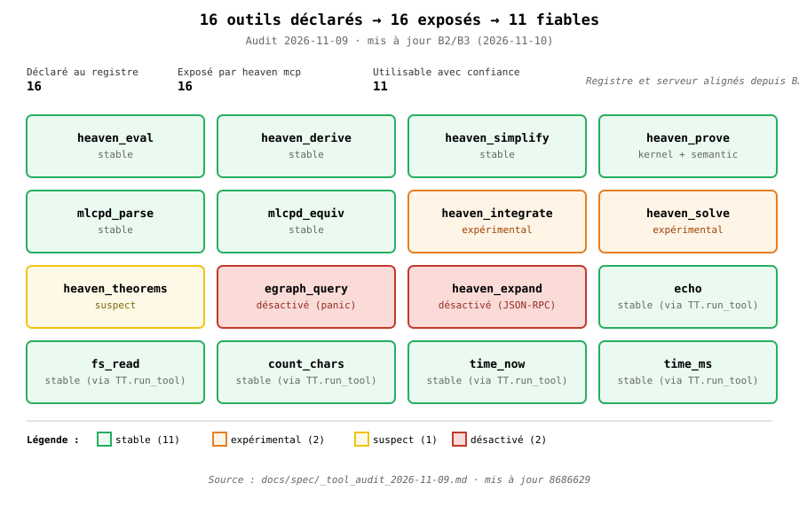

# Chapitre 26 — Outils : Heaven parle à lui-même

> **Piège d'entrée.** Vous vous attendez à ce qu'un langage en développement ait
> des outils écrits dans son langage hôte (Zig, pour Heaven). C'est vrai pour le
> compilateur. C'est **partiellement vrai** pour les outils — le LSP est en
> Heaven pur (`lib/lsp/`), et le MCP a deux implémentations : `lib/mcp/` en
> Heaven pur et `src/runtime/mcp_server.zig` en Zig. La commande `heaven mcp`
> lance la seconde. Ce chapitre explique pourquoi, comment, et où est la
> frontière.

## 1. L'auto-hébergement partiel

Heaven a deux couches :

| Couche | Langage | Rôle |
|---|---|---|
| Compilateur | Zig | parse, type-check, eval, compile |
| Outils | **Heaven (partiel)** | LSP en Heaven pur ; MCP a deux implémentations |

Le compilateur est en Zig parce qu'il faut un bootstrap — on ne peut pas écrire
le premier parseur en Heaven sans parser du Heaven. Les outils, eux, s'appuient
sur le compilateur (déjà là) et n'ont besoin que d'I/O et de JSON-RPC. Le LSP
suit cette logique : `lib/lsp/` est un ensemble de `.hvn` ordinaires. Le MCP
suit une logique **mixte** : `lib/mcp/` (5 outils) en Heaven pur, et
`src/runtime/mcp_server.zig` (11 outils) en Zig. La commande `heaven mcp` lance
le serveur Zig.

**Conséquence pratique** : un bug dans `lib/lsp/` se corrige en éditant un
`.hvn` et en testant (`heaven test tests/test_lsp.hvn`) ; un bug dans
`mcp_server.zig` requiert une recompilation Zig.

## 2. LSP en Heaven pur (`lib/lsp/`)

LSP (Language Server Protocol) est du JSON-RPC sur stdio, avec un framing
`Content-Length: N\r\n\r\n<body>`. Heaven implémente les deux côtés :

| Fichier | Lignes | Rôle |
|---|---|---|
| `frame.hvn` | 45 | encode/décode `Content-Length` |
| `stdio.hvn` | 12 | lecture/écriture sur stdin/stdout |
| `handlers.hvn` | 25 | dispatch des méthodes (`initialize`, `hover`, etc.) |
| `server.hvn` | 57 | boucle principale |

Total : **139 lignes de Heaven** pour un LSP fonctionnel. Le test
`tests/test_lsp.hvn` (10 l., 6 assertions) couvre le cœur : `frame`,
`parse_len`, `parse_body`.

```heaven
import "lib/lsp/frame.hvn" as F

(F.parse_len (F.frame "HELLO"))       -- => 5
(F.parse_body (F.frame "HELLO"))      -- => "HELLO"
```

`F.frame` construit la string complète, `parse_len` extrait N, `parse_body`
extrait le corps. C'est le minimum pour parler LSP.

## 3. MCP en Heaven pur (`lib/mcp/`)

MCP (Model Context Protocol) est le protocole qui permet à un LLM de découvrir
et d'appeler des outils. C'est du JSON-RPC, comme LSP, mais avec une API de
découverte (`tools/list`, `tools/call`).

Heaven implémente MCP **en .hvn pur** — le LLM peut donc appeler le compilateur
Heaven via des tools déclarés en Heaven.

| Fichier | Lignes | Rôle |
|---|---|---|
| `tools.hvn` | 72 | définition des tools (`run`, `test`, `parse`, …) |
| `server_tools.hvn` | 31 | dispatch tool → handler |
| `handlers.hvn` | 42 | handlers individuels |
| `server.hvn` | 62 | boucle JSON-RPC |
| `server_loop.hvn` | 6 | boucle externe |

Total : **213 lignes de Heaven**. Deux tests : `tests/test_mcp.hvn` (protocol)
et `tests/test_mcp_tools.hvn` (tools individuels).

## 3bis. Ce que `heaven mcp` expose vraiment (audit 2026-11-09)

> **Note d'audit (mise à jour 2026-11-10).** Le serveur MCP par
> défaut — celui que lance la commande `heaven mcp` — utilise
> `src/runtime/mcp_server.zig`. Depuis les commits `8113a49` (B2)
> et `8686629` (B3), ce serveur lit le registre
> `lib/tool_registry.hvn` : **16 outils listés, 16 callables**.
> Les 5 outils Heaven de `lib/mcp/` (`echo`, `fs_read`,
> `count_chars`, `time_now`, `time_ms`) sont intégrés au serveur
> via `TT.run_tool`. La table ci-dessous reflète l'état réel.



| Catégorie | Nombre | Outils |
|---|---|---|
| **Stable** (résultat correct) | 11 | `heaven_eval`, `heaven_derive`, `heaven_simplify`, `heaven_prove` (kernel + sémantique), `mlcpd_parse`, `mlcpd_equiv`, `echo`, `time_now`, `time_ms`, `fs_read`, `count_chars` |
| **Expérimental** (résultat faux) | 2 | `heaven_integrate`, `heaven_solve` |
| **Suspect** (résultat trivial) | 1 | `heaven_theorems` |
| **Désactivé** (`3f878fc`) | 2 | `egraph_query` (panic), `heaven_expand` (rupture JSON-RPC) |
| **Invisible** via `heaven mcp` | **0** | — (les 5 Heaven intégrés par `8113a49` / `8686629`) |

Voir `docs/spec/_tool_audit_2026-11-09.md` pour la méthodologie et
les traces. Les chantiers de correction (walker `check` v2,
`heaven_integrate`, kernel `heaven_prove`) sont documentés dans
`_check_v2_plan.md`, `_integrate_bug.md`,
`_heaven_prove_kernel_bug.md`.

## 4. Piège : outils ≠ compilateur

Vous pourriez croire qu'un LSP en Heaven signifie que **le compilateur** est en
Heaven. Non. Le LSP appelle le compilateur (`heaven parse`, `heaven check`) via
des subprocess, exactement comme un LSP Zig appellerait un compilateur Zig.

```
[LLM] --JSON-RPC--> [lib/mcp/server.hvn] --subprocess--> [bin/heaven Zig]
```

La frontière est là : **Heaven orchestre**, **Zig exécute**. Le jour où le
compilateur sera self-hosté, la flèche du milieu disparaîtra — mais ce n'est pas
aujourd'hui.

## 5. Les autres outils

En plus du LSP et du MCP, Heaven expose :

| Outil | Commande | État |
|---|---|---|
| Formatter | `heaven fmt <file>` | partiel (style infixe en migration) |
| Docgen | `heaven doc <file>` | stable, utilisé pour ce livre |
| Shell completions | `heaven --completions` | stable |
| Benchmarks | `heaven bench-{interp,qbe,wasm}` | stable |
| Transpiler | `heaven transpile --to c\|heaven\|latex` | expérimental |

Le `fmt` est partiel parce que le style infixe est en cours de migration
(ch. 4). `docgen` est en revanche mature : il génère le README et les
statistiques de ce livre — c'est lui qui a produit les chiffres du ch. 0.

## 6. Ce qui tourne vraiment (vs ce qui est cible)

Comme dans les chapitres 23 et 24, la frontière est explicite :

| Outil | Testé | Test |
|---|---|---|
| LSP frame | ✅ | `tests/test_lsp.hvn` (6 assertions) |
| LSP dispatch | ⚠️ | manuel, pas de test automatisé |
| MCP protocol | ✅ | `tests/test_mcp.hvn` |
| MCP tools | ✅ | `tests/test_mcp_tools.hvn` |
| LSP complet (avec éditeur) | ❌ | pas testé end-to-end |
| MCP avec un LLM réel | ❌ | cible, pas d'intégration |

**Lecture** : les **briques** LSP et MCP sont testées (framing, dispatch,
tools). L'**intégration** avec un éditeur ou un LLM n'est pas dans la CI —
c'est un test manuel, pas un test automatique. Ne confondez pas « les tests
passent » et « ça marche avec VS Code ».

## Exercices

### Ex. 1 — Frame LSP (guidé)

Implémentez `frame` et `parse_len` en partant de zéro. Format :

    Content-Length: 5\r\n\r\nHELLO

**Attendu** : `(frame "HELLO")` rend la string complète, `(parse_len str)` rend `5`,
`(parse_body str)` rend `"HELLO"`.

**Question** : que se passe-t-il si le body contient `\r\n` ?

### Ex. 2 — `parse_len` edge cases (libre)

Testez `parse_len` sur :
- un body de 0 caractère
- un body de 1000 caractères
- un header malformé (`Content-Length: abc`)

**Question** : que fait votre implémentation ? `parseInt` panique-t-il ? Retourne 0 ?

### Ex. 3 — MCP tool simple (libre)

Ajoutez un tool MCP `echo` qui prend une string et la retourne :
1. Déclarer dans `lib/mcp/tools.hvn`
2. Handler dans `lib/mcp/handlers.hvn`
3. Tester avec `tests/test_mcp_tools.hvn`

**Question** : comment vérifier que le tool est accessible sans LLM ?

### Ex. 4 — Le piège du selfhost (casse)

`heaven check` appelle `parse` + `typer` (Zig). Mais `lib/mcp/server.hvn` est en
Heaven. Que se passe-t-il si `heaven check` détecte une erreur (exit 1), que
`lib/mcp` reçoit le résultat via subprocess, et qu'un LLM appelle `tools/call`
pour `check` ?

**Question** : `exit 1` est-il un **succès** ou un **échec** pour MCP ?
(Indice : regardez `server_tools.hvn`, gestion de `exit_code`.)

---

## Capot final

Les outils sont **la partie du projet qui s'auto-héberge déjà**. 139 lignes
de LSP, 213 lignes de MCP — toutes en Heaven pur, testées. Le compilateur reste
en Zig, mais le jour où `heaven check` sera en Heaven, `lib/mcp/server.hvn`
n'aura pas à changer : la frontière Zig ↔ Heaven est **le subprocess**, pas le
protocole.

## Ce qu'il faut retenir

1. **Deux couches** : compilateur Zig, outils Heaven. Bootstrap, pas défaut.
2. **LSP** = framing + JSON-RPC + handlers. 139 lignes suffisent.
3. **MCP** = même chose, avec tools déclarés. 213 lignes.
4. **Outils ≠ selfhost** : appeler `heaven check` depuis Heaven via subprocess
   est normal. Le jour où le compilateur sera en Heaven, l'appel deviendra direct.
5. **Ce qui est testé** est le protocole (framing, dispatch). **Ce qui ne l'est
   pas** est l'intégration VS Code ou LLM réel.
