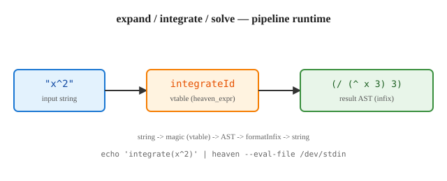

# Chapitre 28b — Algebre symbolique : expand, integrate, solve

> **Piege d'entree.** Vous vous attendez a ce qu'un interpreteur evalue
> `(+ 1 2)` en `3`. C'est vrai. Vous vous attendez aussi a ce qu'il
> **manipule des formules** — `integrate(x^2)` -> `x^3/3` — comme un CAS
> (computer algebra system). C'est vrai **aussi**, depuis novembre 2026.
> Ce chapitre explique comment trois *magics* transforment l'interpreteur
> en quelque chose de plus proche de Maxima ou SymPy, sans quitter le
> langage.

## 1. Pourquoi dans le langage

Les magics `expand`, `integrate`, `solve` ne sont pas des fonctions
utilisateur — ils sont **cables dans la vtable** de l'evaluateur. Ce
choix reflete un pari : l'algebre symbolique est une primitive de calcul
au meme titre que `+` ou `*`, pas une bibliotheque externe.

Trois raisons :

1. **Pas de dependance circulaire** — `lib/` peut les appeler sans importer
   un module lourd.
2. **Format uniforme** — toutes les operations rendent un `Id` AST,
   affiche en infixe par `formatInfix`.
3. **Extensible** — ajouter une operation (derivee, limites) suit le meme
   pattern vtable/backend/shell.

## 2. Les trois magics

| Magic | Entree | Sortie |
|---|---|---|
| `expand(<expr>)` | polynome | forme developpee |
| `integrate(<expr>)` | expression en `x` | primitive (constante `C` strippee) |
| `solve(<expr>)` | polynome en `x` | racines |

Exemples runtime (valides 2026-11-26) :

    echo 'expand((x+1)^2)' | heaven --eval-file /dev/stdin
    # -> (+ (+ (^ x 2) (* 2 x)) 1)

    echo 'integrate(x^2)' | heaven --eval-file /dev/stdin
    # -> (/ (^ x 3) 3)

    echo 'solve(x^2 - 4)' | heaven --eval-file /dev/stdin
    # -> (= (= x (2 ou x)) -2)

Le resultat est un AST, rendu en infixe. Le format de `solve` est encore
imparfait (voir §5) mais les racines `2` et `-2` sont correctes.

## 3. Trois couches

| Couche | Fichier | Role |
|---|---|---|
| vtable | `src/core/engine_expr.zig` | champs `integrateId` / `solveId` / `expandId` |
| backend | `src/core/heaven_expr.zig` | wrappent `Heaven.integrate/solve/expand`, strippent `+ C`, re-parsent |
| shell | `src/runtime/shell/commands.zig` | `cmdExpand` / `cmdIntegrate` / `cmdSolve`, formatent en infixe |

La separation permet de tester chaque couche isolement : la vtable via
`testHeavenVTable` (stubs `testIntegrate` / `testSolve` / `testExpand`),
le backend via les tests `heaven_expr.zig`, le shell via les tests
`commands.zig`.

## 4. Un cas concret : integrate(x^2)

1. **Parsing** — `parseExpression("x^2")` rend un `Id` pointant sur
   `(^ x 2)`.
2. **Stringification** — `expr.toString(store, id, alloc)` rend la string
   `"x^2"`.
3. **Backend** — `integrateIdHeavenExpr` appelle
   `Heaven.integrate("x^2", "x")` -> string `"x^3/3 + C"`.
4. **Strip** — `std.mem.endsWith(u8, s, " + C")` retire le suffixe ->
   `"x^3/3"`.
5. **Reparse** — `parseExpression("x^3/3")` -> AST `(/ (^ x 3) 3)`.
6. **Format** — `formatInfix(id)` -> `"(/ (^ x 3) 3)"`.

Six etapes, ~40 lignes de Zig. Le cout principal est le double parsing
(entree + sortie), qu'on pourrait eviter avec une API
`Heaven.integrate` qui prend/rend un `Id` directement — optimisation
future, pas besoin actuel.

## 5. Dettes connues

- **Format `solve`** — `(= (= x (2 ou x)) -2)` au lieu de `x = 2 | x = -2`.
  Correction dans `formatInfix` (noeuds `or`/`eq` imbriques), commit dedie
  a prevoir.
- **Multivarie** — variable `x` hardcodee. Ajouter un argument optionnel
  pour la variable serait trivial mais non demande.
- **Performance** — `integrate(x^1000)` peut prendre du temps. Pas de
  limite explicite ; utiliser `@budget_left` si necessaire.

## 6. Ce qu'on n'a pas fait

Pas de :

- **Limites** (`limit`, `taylor`) — necessiterait une notion de limite.
- **Equations differentielles** — hors scope.
- **Simplification canonique** — `expand` developpe, mais ne simplifie
  pas (`(+ x 0)` reste `(+ x 0)`).

Ces operations viendraient enrichir `Heaven.*` puis seraient exposees
comme magics dans un second temps.

---

*Reference code* : `src/core/engine_expr.zig` (vtable),
`src/core/heaven_expr.zig` (backend), `src/runtime/shell/commands.zig`
(shell). Spec formelle : `docs/spec/_magics.md`. Bug historique resolu :
`docs/spec/_integrate_bug.md`.
