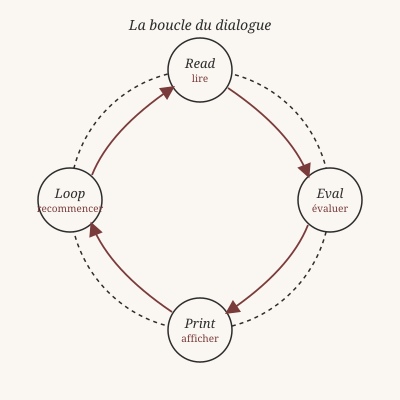
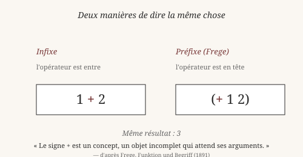
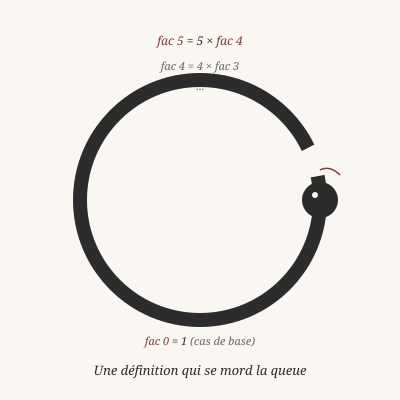

> *Ce chapitre suppose que tu sais déjà ce qu'est un programme, une
> fonction, ou un REPL. Si ce n'est pas le cas, lis d'abord le
> chapitre 0 (« Pourquoi Heaven ? »), qui introduit ces notions sans
> code et donne un glossaire de tous les termes techniques.*

# Chapitre 1 — Commencer : qu'est-ce qu'un calcul ?

> *« Ne pas penser, mais regarder. »*
> — Ludwig Wittgenstein, *Investigations philosophiques*, §66

## 1. Une question simple

Quand tu poses 3 + 4 sur une feuille de papier, que fais-tu ?

Tu ne **penses** pas à quelque chose. Tu **suis une règle**. Une
règle que tu as apprise enfant, qui dit : « pour additionner deux
nombres, écris-les côte à côte et applique la table d'addition. »
Tu regardes. Tu ne philosophes pas. Tu appliques.

C'est ce que Wittgenstein appelait un **jeu de langage** : une
activité humaine régie par des règles, où le sens des mots se
montre dans l'usage qu'on en fait — pas dans une définition
préalable. Une règle ne dit pas *ce qu'elle est*, elle dit *ce
qu'il faut faire*. Le sens d'une règle, c'est la pratique qu'elle
engendre.

Heaven est un jeu de langage. C'est un ensemble de règles pour
décrire des calculs. Ces règles, tu vas les apprendre comme on
apprend une langue — en écoutant, en répétant, en voyant ce qui
marche et ce qui ne marche pas. Pas besoin de comprendre *pourquoi*
ces règles ; au début, il suffit de **regarder**.

## 2. Le REPL : un dialogue socratique

Socrate ne donnait pas de cours. Il posait une question, écoutait
la réponse, et rebondissait. Le savoir émergeait du dialogue, pas
du monologue. C'est ce que Platon appelle la *maïeutique* :
l'art de faire accoucher les esprits — non de les remplir.

Le **REPL** fonctionne pareil. Le mot est un acronyme anglais :

- **R**ead — l'ordinateur *lit* ce que tu tapes
- **E**val — il *évalue* ce que ça vaut
- **P**rint — il *affiche* le résultat
- **L**oop — il *recommence*

C'est une boucle : lire, évaluer, afficher, recommencer. Un dialogue
où tu poses une question, l'ordinateur répond, tu enchaînes.

Pour lancer ce dialogue, ouvre un terminal et tape :

    $ ./zig-out/bin/heaven repl

Tu verras apparaître :

    Noyau opérationnel
    heaven>

Le `heaven>` est un **invite**. Il attend que tu parles.

Tape ceci :

    heaven> 1 + 2

L'ordinateur répond :

    3

Voilà. Tu as eu une conversation. Pas très profonde, mais c'est un
début.

*Vérifiable : cette commande fonctionne telle quelle dans le REPL.*

## 3. Deux notations pour dire la même chose

Heaven accepte deux façons de dire la même chose.

La première, celle qu'on vient d'utiliser, s'appelle la **notation
infixe** : l'opérateur `+` est *entre* ses deux arguments, comme
dans `1 + 2`. C'est ce que tu écris sur une feuille de papier.

La seconde vient d'un autre jeu de langage, né dans les années
1950 avec le langage **Lisp** (inventé par John McCarthy). On écrit :

    heaven> (+ 1 2)
    3

Ici, l'opérateur `+` est *au début*, comme un prédicat en logique
formelle. Le mathématicien Gottlob Frege, à la fin du XIXᵉ siècle,
avait déjà remarqué que la notation `+ 1 2` (sans infixe) est plus
**régulière** que `1 + 2` : elle ne souffre d'aucune ambiguïté.
C'est la notation qu'il utilisait dans sa *Begriffsschrift* (1879),
le livre qui a fondé la logique moderne.

Frege avait une idée profonde : le signe `+` n'est pas un objet,
c'est un **concept** — une fonction incomplète qui attend ses
arguments. `1 + 2` et `(+ 1 2)` sont deux manières de « remplir »
ce concept avec ses arguments.

Les deux notations se valent. C'est une affaire de **style**, pas de
**vérité**. Dans ce livre, on utilisera le plus souvent l'infixe,
plus familier. Mais tu verras parfois la notation de Frege, notamment
quand on parlera de fonctions qui prennent plusieurs arguments.

*Vérifiable : les exemples ci-dessus fonctionnent tels quels.*

## 4. Une fonction, c'est un concept

Rappelle-toi ce que Frege disait du signe `+` : c'est un **concept**,
c'est-à-dire une fonction incomplète qui attend un ou plusieurs
arguments. Pour lui, toute la logique et toute l'arithmétique
pouvaient s'écrire ainsi — comme des concepts appliqués à des
objets.

En Heaven, cette idée est prise au pied de la lettre. Une fonction
est une règle qui prend un argument et rend un résultat :

    heaven> inc x = x + 1
    ✓ clause enregistrée pour 'inc'

    heaven> inc 5
    6

La ligne `inc x = x + 1` dit : « pour tout `x`, `inc x` vaut `x + 1` ».
C'est une **définition**. Elle nomme un concept — `inc` — et le
définit par une règle.

On peut appliquer ce concept à n'importe quel objet :

    heaven> inc 42
    43

    heaven> inc 0
    1

Frege disait que le sens d'un concept, c'est **l'ensemble des objets
auxquels il s'applique**. Pour `inc`, ce serait l'ensemble des `x`
tels que `inc x = x + 1`. En programmation, on dit simplement : le
sens de `inc`, c'est ce que `inc` fait. Deux points de vue
équivalents.

## 5. La récursion : une définition qui se mord la queue

Voici une fonction qui calcule la factorielle d'un nombre :

    heaven> fac n = if (== n 0) 1 (* n (fac (- n 1)))
    ✓ clause enregistrée pour 'fac'

    heaven> fac 5
    120

Regarde bien la définition. `fac` appelle `fac`. La fonction se
définit **en s'appelant elle-même**. C'est ce qu'on appelle la
**récursion**.

Wittgenstein, dans les *Investigations philosophiques* (§185-§242),
a longuement médité sur ce phénomène étrange : comment sais-tu que
`fac 5` doit s'arrêter ? Rien dans la définition ne dit
« arrête-toi après 5 étapes ». Pourtant, la fonction s'arrête.
Parce que tu as posé une **règle de base** : `fac 0 = 1`. Sans
cette règle, la définition tournerait à l'infini, comme un serpent
qui se mord la queue sans jamais se dévorer complètement.

La récursion est partout en mathématiques et en philosophie. C'est
la manière la plus ancienne, la plus simple, de définir l'infini à
partir du fini. Elle traverse la logique (Frege, Russell), la
théorie des nombres (Peano, Dedekind), et la théorie de la
calculabilité (Turing, Church).

*Vérifiable : les exemples ci-dessus fonctionnent tels quels.*

## 6. Types et catégories

    heaven> 42
    42

    heaven> :type 42
    Int

    heaven> "bonjour"
    "bonjour"

    heaven> :type "bonjour"
    String

Le `:type` te dit dans quelle **catégorie** se range une valeur.
`42` est un `Int` (un entier). `"bonjour"` est un `String` (une
suite de caractères). C'est une étiquette que le langage attache
à chaque valeur.

Aristote, dans les *Catégories*, distinguait dix manières de dire
« ce que c'est » qu'une chose : substance, quantité, qualité,
relation, lieu, temps, position, avoir, action, passion. Ces dix
catégories ne sont pas des choses — ce sont des **manières de
classer** les choses. Des grilles pour penser.

Un **type**, dans un langage de programmation, est une catégorie
au sens d'Aristote. `Int` dit : « ceci est un nombre entier ».
`String` dit : « ceci est une suite de caractères ». `Bool` dit :
« ceci est un vrai ou un faux ».

Aristote faisait une distinction importante : entre ce qui **se dit
d'un sujet** (les catégories) et ce qui **est** le sujet. Un type
joue le rôle de la première chose : il dit *comment* on peut parler
d'une valeur, pas ce qu'elle est en soi. C'est une grille de
lecture, pas une essence cachée.

Heaven t'aidera à respecter ces catégories. Si tu écris :

    heaven> "42" + 1

Il refusera. Pourquoi ? Parce que `"42"` n'est pas dans la catégorie
des choses qu'on peut additionner à un nombre. C'est une chaîne de
caractères, pas un entier. Même si, visuellement, ils se
ressemblent.

Cette rigueur a un nom : le **typage**. On y reviendra longuement
au chapitre 2.

## 7. Pourquoi tout ce formalisme ?

Platon, dans le *Ménon*, pose une question restée célèbre : quelle
est la différence entre une **opinion vraie** et un **savoir** ?

Son exemple : un esclave, sans éducation, peut répondre
correctement à une question de géométrie. Il a une opinion vraie.
Mais peut-il la **justifier** ? Non. Il ne sait pas *pourquoi* sa
réponse est correcte. Il a une croyance vraie, pas une connaissance.

Un programme qui passe tous ses tests ressemble à l'esclave du
*Ménon*. Il **marche**. Il fait ce qu'il fait. Mais peut-on
*prouver* qu'il fait toujours ce qu'il prétend ? C'est une autre
question.

Heaven essaie de répondre à cette question. Il permet d'écrire
des programmes qu'on peut non seulement **exécuter**, mais
**prouver** corrects. C'est l'ambition du chapitre 8 (« Preuves et
théorèmes »).

Cette ambition n'est pas nouvelle. Elle traverse toute l'histoire
de la logique — de Frege à Gödel, de Hilbert à Turing. Elle a
connu des succès (la machine de Turing, les assistants de preuve
modernes) et des limites (le théorème d'incomplétude de Gödel).
Heaven s'inscrit dans cette tradition, avec les outils du
XXIᵉ siècle.

Pour l'instant, contente-toi de jouer avec le REPL. Casse des
choses. Tape `:help` pour voir les commandes disponibles. Tape
`Ctrl-D` pour sortir. Tape `Ctrl-C` pour interrompre un calcul qui
tourne trop longtemps.

À bientôt.

*Vérifiable : `:type 42` et `:type "bonjour"` fonctionnent dans
le REPL. `"42" + 1` produit une erreur de type.*

---

## Ce qu'on a appris

- Un **jeu de langage** (Wittgenstein) : des règles qu'on suit
  sans avoir besoin de les justifier.
- Un **REPL** : boucle interactive *lire-évaluer-afficher-recommencer*.
- Deux notations pour la même chose : **infixe** (`1 + 2`) et
  **préfixe** (`(+ 1 2)`, notation de Frege).
- Une **fonction** est un concept (Frege) : une règle qui prend
  un argument et rend un résultat.
- La **récursion** : une définition qui s'appelle elle-même,
  avec un cas de base pour s'arrêter.
- Les **types** sont des catégories (Aristote) : des grilles pour
  classer les valeurs.
- Le **formalisme** vise à distinguer l'opinion vraie du savoir
  (Platon, *Ménon*).

Au chapitre suivant, on plonge dans les types : ce que Heaven
sait, et comment il te le dit.
