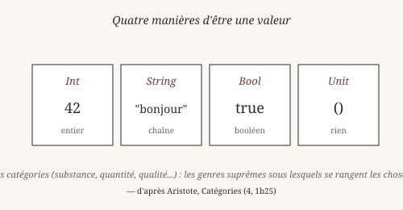
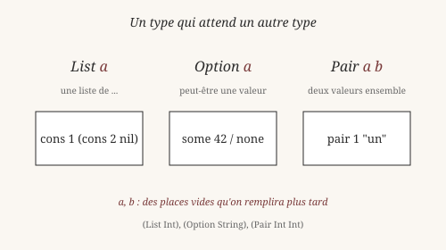
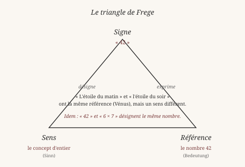

# Chapitre 2 — Types et catégories

> *« Les catégories ne sont pas des choses — ce sont des manières
> de classer les choses. »*
> — Aristote, *Catégories*

Au chapitre précédent, on a vu Heaven refuser `double "bonjour"` et
on a dit : « parce que `*` demande deux nombres ». Maintenant on va
voir pourquoi, et ce que Heaven sait vraiment.

## 1. Ce qu'on dit d'une chose

Aristote, dans les *Catégories*, distingue dix manières de dire
« ce que c'est » qu'une chose : substance, quantité, qualité,
relation, lieu, temps, position, avoir, action, passion. Ces dix
catégories ne sont pas des choses — ce sont des **manières de
classer** les choses. Des grilles pour penser.

Quand tu dis « Socrate est un homme », tu dis *ce qu'il est*
(substance). Quand tu dis « il mesure 1m70 », tu dis *combien*
(quantité). Ces deux phrases ne disent pas la même chose *de la
même manière*. Les catégories d'Aristote sont là pour rendre ces
distinctions explicites.

Un **type**, dans un langage de programmation, joue le même rôle
que les catégories d'Aristote. Il dit *comment* on peut parler
d'une valeur — pas ce qu'elle est en soi. C'est une **grille de
lecture**, pas une essence cachée.

    heaven> :type 42
    Int

    heaven> :type "bonjour"
    String

`42` est un `Int` (un entier). `"bonjour"` est un `String` (une
suite de caractères). Le type est l'étiquette que le langage
attache à chaque valeur.

## 2. Quatre manières d'être une valeur

Heaven a quatre types de base — quatre manières de classer les
valeurs :

    heaven> :type 42
    Int

    heaven> :type 3.14
    Float

    heaven> :type "bonjour"
    String

    heaven> :type true
    Bool

    heaven> :type ()
    Unit

- **Int** — un nombre entier (positif, négatif, ou zéro).
- **Float** — un nombre à virgule flottante (pour les calculs
  approchés).
- **String** — une suite de caractères.
- **Bool** — un booléen : `true` ou `false`.
- **Unit** — la valeur unique qui ne porte aucune information.
  Elle s'écrit `()` et se prononce « unit ».

Ces cinq types (dont on dit souvent quatre, car `Unit` est à part)
sont **de base** : on ne les définit pas, on les utilise. Tout le
reste — listes, options, paires, arbres, ce que tu voudras — se
construit à partir d'eux.

Note : `:type ()` et `:type Float` fonctionnent dans le REPL. Il
n'y a pas de type `Float` littéral ici, mais un calcul comme
`(/ 3 2)` en produit.

## 3. Le langage devine : l'inférence

Quand tu écris `42`, Heaven sait que c'est un `Int` sans que tu le
lui dises. C'est ce qu'on appelle l'**inférence de type**.

Regarde :

    heaven> inc x = x + 1
    ✓ clause enregistrée pour 'inc'

    heaven> :type inc
    Int -> Int

Tu n'as écrit *aucun type* dans la définition. Pas une seule fois
le mot `Int`. Pourtant, Heaven a déduit que `inc` prend un `Int`
et rend un `Int`. Comment ?

Parce que `+` est une fonction qui, appliquée à deux `Int`, rend un
`Int`. Et `1` est un `Int`. Donc `x + 1` est un `Int`. Donc `inc x`
est un `Int`. Donc `inc` prend un `Int` et rend un `Int`.

Cette déduction se fait **sans que tu aies à l'écrire**. C'est un
des apports majeurs de Haskell et de ses successeurs (dont Idris,
Agda, et Heaven). Le langage **devine** le type le plus général qui
convient.

Frege, à la fin du XIXᵉ siècle, parlait déjà de cela : une
expression a un **sens** (Sinn) — ce qu'elle signifie — et une
**référence** (Bedeutung) — l'objet qu'elle désigne. Un type, en
programmation, joue le rôle du sens : il dit *comment* on peut
utiliser une valeur, avant même de savoir *quelle* valeur c'est.
On y reviendra à la section 5.

## 4. Types paramétrés : les places vides

Voici une liste :

    heaven> cons 1 (cons 2 nil)
    cons 1 (cons 2 nil)

C'est une liste de deux entiers. Comment en écrire le type ?

    heaven> :type (cons 1 nil)
    List Int

    heaven> :type (cons 1 (cons 2 nil))
    List Int

`List Int` se lit « liste d'Int ». Mais il existe aussi des listes
de `String`, de `Bool`, de n'importe quoi :

    heaven> :type (cons "a" (cons "b" nil))
    List String

Le type `List` n'est **pas complet** tout seul. Il attend un autre
type — un type **paramètre**. On note `List a` où `a` est la place
vide. Quand on remplit la place avec `Int`, on obtient `List Int`.
Quand on la remplit avec `String`, on obtient `List String`.

Trois exemples courants en Heaven :

- **`List a`** — une liste (un nombre variable d'éléments).
- **`Option a`** — une valeur qui peut être absente (`none` ou
  `some x`).
- **`Pair a b`** — deux valeurs ensemble (`pair x y`), chacune
  pouvant être d'un type différent.

Aristote, encore : quand tu dis « trois », tu ne dis pas *quelle
chose est trois*, tu dis *combien* — la place vide de la substance.
Un type paramétré comme `List a` est pareil : `List` dit la *forme*
(une liste), `a` dit la *matière* (ce qu'il y a dedans). Les deux
se remplissent séparément.

*Vérifiable : les `:type` et les exemples ci-dessus fonctionnent
tels quels dans le REPL.*

## 5. Sens et référence

Gottlob Frege, dans un article célèbre de 1892 (« Über Sinn und
Bedeutung »), propose une distinction qui va nous aider à
comprendre les types.

Il prend l'exemple de deux expressions :

- **« l'étoile du matin »**
- **« l'étoile du soir »**

Ces deux expressions **désignent le même objet** : la planète
Vénus. Mais elles ont un **sens** différent. L'une dit *quand* on
la voit (le matin), l'autre dit *quand* (le soir). Deux sens, une
seule référence.

Frege en tire une distinction :

- Le **sens** (Sinn) — la manière de présenter l'objet.
- La **référence** (Bedeutung) — l'objet lui-même.

En programmation, cette distinction éclaire la différence entre
types et valeurs. Deux expressions peuvent avoir **la même valeur**
sans avoir **le même type** :

    heaven> 42
    42

    heaven> (+ 40 2)
    42

Les deux évaluent à `42`. Mais l'une est un `Int` direct, l'autre
est le résultat d'une opération. Le type reste `Int` — mais la
manière de le construire diffère. C'est exactement ce que Frege
appelait le sens.

Un autre exemple : `42` et `6 × 7` désignent le même nombre (la
référence), mais présentent le nombre différemment (le sens). Le
langage peut les distinguer si nécessaire — par exemple pour
prouver qu'ils sont égaux. C'est l'objet du chapitre 8.

Dans Heaven, les types sont notre **sens** principal : ils disent
comment présenter une valeur, avant même de savoir ce que la
valeur vaut. Frege avait vu cela en 1892.

## 6. Vers les types dépendants

Il y a une dernière idée, plus avancée, qu'on annonce ici : les
**types dépendants**. Ce sont des types qui **dépendent d'une
valeur**.

Exemple : le type `Vec n a` désigne un vecteur (une liste de
longueur fixe) contenant `n` éléments de type `a`. `Vec 3 Int`
est un vecteur de trois entiers. `Vec 5 String` est un vecteur de
cinq chaînes. Le type **contient** le nombre `n`.

C'est très puissant. On peut écrire une fonction `head : Vec
(succ n) a -> a` qui prend un vecteur **non vide** — le type
garantit qu'on ne peut pas l'appeler sur un vecteur vide. Pas
besoin de vérification à l'exécution : le type l'interdit.

Aristote aurait aimé. Sa distinction entre les catégories
(substance, quantité, relation) devient, dans un type dépendant,
une **structure interne** au type lui-même. Le type porte sa
propre substance.

Heaven supporte partiellement les types dépendants en V0 (via
`sig`, `data`, `Vec`). On en verra le détail au chapitre 8
(« Preuves et théorèmes »). Pour l'instant, retiens qu'un type
peut contenir une valeur, et que cette idée vient de la logique
de Frege, Russell et Martin-Löf.

## Ce qu'on a appris

- Un **type** est une catégorie (Aristote) : une manière de
  classer les valeurs, pas une essence cachée.
- Heaven a **cinq types de base** : `Int`, `Float`, `String`,
  `Bool`, `Unit`.
- Le langage **infère** les types : `inc x = x + 1` donne
  `Int -> Int` sans qu'on ait rien écrit.
- Les **types paramétrés** (`List a`, `Option a`, `Pair a b`)
  ont des places vides qu'on remplit plus tard.
- Frege distinguait **sens** (Sinn) et **référence**
  (Bedeutung) : deux expressions peuvent désigner la même chose
  par des chemins différents.
- Les **types dépendants** (`Vec n a`) portent une valeur dans
  leur structure.

Au chapitre suivant, on plonge dans le **pattern matching** :
comment écrire des fonctions qui prennent vraiment de la donnée
structurée, et comment la forme des arguments décide de leur
comportement.

*Vérifiable : tous les exemples `:type` et les constructions
montrées fonctionnent tels quels dans le REPL.*
