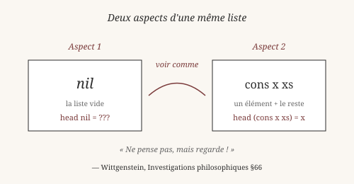
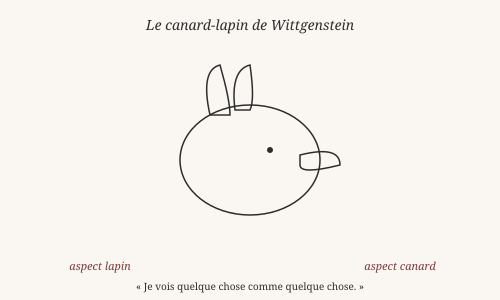
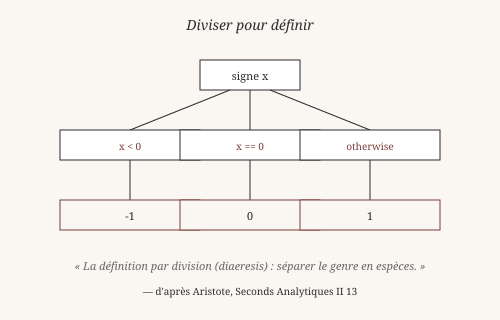

# Voir comme : le pattern matching

> *« Ne pas penser, mais regarder. »*
> — Ludwig Wittgenstein, *Investigations philosophiques*, §66

Au chapitre précédent, on a vu que Heaven infère les types. Maintenant
on va voir comment écrire des fonctions qui prennent *vraiment* de la
donnée structurée, et pas seulement des nombres.

## 1. Voir comme

Regarde une liste. Que vois-tu ?

Si tu la vois comme une **chose vide** ou comme **un élément suivi
d'un reste**, ce ne sont pas deux listes différentes. C'est la même
liste, vue sous deux aspects. Comme le canard-lapin de Wittgenstein :
une seule figure, deux lectures.

Wittgenstein, dans les *Investigations philosophiques* (II, xi),
utilise cette figure pour montrer quelque chose de profond : voir
n'est pas recevoir passivement une image. C'est **organiser**
activement ce qu'on voit. « Je vois quelque chose **comme** quelque
chose. »

Le **pattern matching**, c'est exactement cela. C'est l'art de
définir une fonction en disant : « si tu vois la donnée *comme ceci*,
fais cela ; si tu la vois *comme cela*, fais autre chose. »

## 2. Les deux formes d'une liste

En Heaven, une liste a deux constructeurs :

- `nil` — la liste vide.
- `cons x xs` — un élément `x` suivi d'une liste `xs`.

On peut définir une fonction qui distingue ces deux formes :

    heaven> head (cons x _) = x
    ✓ clause enregistrée pour 'head'

    heaven> head (cons 1 (cons 2 nil))
    1

La définition dit : « si tu vois la donnée comme `cons x _`, rends
`x` ». Le `_` est un **joker** : il signifie « peu importe ». On ne
veut pas savoir ce qu'il y a dans le reste de la liste, seulement
l'élément de tête.

Que se passe-t-il si on appelle `head nil` ? Heaven refuse — on n'a
pas défini ce cas. C'est une erreur, et elle est **utile** : elle
nous dit que la fonction n'est pas définie pour cette forme. On
pourrait ajouter une clause :

    heaven> head nil = 0
    ✓ clause enregistrée pour 'head'

Maintenant `head nil` rend `0`. Mais ce `0` est arbitraire. Est-ce
vraiment ce qu'on veut ? Peut-être que la bonne réponse est
d'utiliser `Option` (chapitre 2) pour dire honnêtement : « il n'y a
pas de tête ».

## 3. Définir ses propres formes

Le pattern matching devient vraiment intéressant quand on définit
ses propres types de données. Le mot-clé est `data`.

Prenons le plus simple : un type qui vaut soit une chose, soit une
autre.

    heaven> data Color = Red | Green | Blue
    ✓ data Color registered (3 constructors)

`Color` est un type. `Red`, `Green`, `Blue` sont ses trois
**constructeurs**. On les utilise comme n'importe quelle valeur :

    heaven> Red
    Red

On peut écrire une fonction qui les distingue :

    heaven> colorName Red = "rouge"
    ✓ clause enregistrée pour 'colorName'

    heaven> colorName Blue
    "bleu"

Mais on peut faire plus intéressant : des types **récursifs**, qui
se contiennent eux-mêmes. Les entiers naturels de Peano :

    heaven> data Nat = Zero | Succ Nat
    ✓ data Nat registered (2 constructors)

`Nat` a deux constructeurs : `Zero` (l'entier 0) et `Succ n` (le
successeur de `n`). `Succ Zero` est 1, `Succ (Succ Zero)` est 2,
et ainsi de suite.

On peut alors définir l'addition :

    heaven> add Zero n = n
    ✓ clause enregistrée pour 'add'

    heaven> add (Succ m) n = Succ (add m n)
    ✓ clause enregistrée pour 'add'

Deux clauses :

- Si le premier argument est `Zero`, rends le second.
- Si le premier argument est `Succ m`, rends `Succ (add m n)`.

Cette définition est **récursive** : `add` s'appelle elle-même dans
sa propre définition. C'est la structure même de l'addition de
Peano, publiée en 1889 dans ses *Arithmetices principia*.

Giuseppe Peano voulait **fonder l'arithmétique** sur une base
logique minimale : un élément de départ (`Zero`) et une opération
de succession (`Succ`). Tout le reste — addition, multiplication,
ordre — se dérive par récursion. Sa construction est toujours
enseignée aujourd'hui. Heaven l'accepte telle quelle.

*Vérifiable : les définitions `data Color` et `data Nat` ainsi que
les fonctions `colorName` et `add` fonctionnent dans le REPL.*

## 4. Diviser pour définir : les gardes

Aristote, dans les *Seconds Analytiques*, décrit une méthode pour
définir : la **division** (*diaeresis*). Pour définir un concept,
on sépare son genre en espèces, puis chaque espèce en sous-espèces,
et ainsi de suite. Par exemple : « animal » se divise en
« raisonnable » et « non raisonnable ». « Raisonnable » donne
« humain ».

Le pattern matching généralise cette méthode. Au lieu de distinguer
par la **forme** du constructeur (`Zero` ou `Succ`), on peut
distinguer par une **condition** — une garde.

Reprenons `signe` :

    heaven> signe x | x < 0 = 0 - 1
                    | x == 0 = 0
                    | otherwise = 1

Trois cas, séparés par des `|`. Chaque `|` introduit une garde (une
condition). Heaven essaie **dans l'ordre** :

- Si `x < 0`, rends `-1`.
- Sinon, si `x == 0`, rends `0`.
- Sinon (cas par défaut), rends `1`.

`otherwise` est un cas par défaut : il est toujours vrai. C'est
l'équivalent du « reste » dans une division exhaustive.

L'**ordre compte**. `signe 5` tombe dans la troisième garde. Si on
avait mis `otherwise` en premier, il aurait capté tous les cas et
les autres gardes n'auraient jamais été atteintes. La division
d'Aristote doit être **exhaustive et sans recouvrement**, sinon on
ne définit rien.

C'est une leçon philosophique autant que technique : *définir
proprement, c'est partitionner correctement*. Si les cas se
recouvrent, la définition est ambiguë. S'ils ne couvrent pas tout,
elle est incomplète.

## 5. Récursivité structurelle

Le pattern matching et la récursion vont ensemble. Voyons pourquoi.

    heaven> length nil = 0
    ✓ clause enregistrée pour 'length'

    heaven> length (cons _ xs) = 1 + (length xs)
    ✓ clause enregistrée pour 'length'

Deux clauses :

- Si la liste est vide, la longueur est 0.
- Si la liste a un élément de tête et un reste `xs`, la longueur
  est 1 + la longueur de `xs`.

La fonction `length` **suit la structure de la donnée**. La liste
est définie par deux cas (`nil` ou `cons x xs`), et `length` les
traite en miroir. On dit que la récursion est **structurelle** :
elle ne tourne pas dans le vide, elle **consomme** la structure.

Frege, à la fin du XIXᵉ siècle, avait déjà vu que les fonctions
récursives sur les entiers naturels suivaient la structure de
Peano. `add (Succ m) n = Succ (add m n)` : chaque étape réduit le
premier argument de `Succ`, jusqu'à ce qu'il soit `Zero`. La
récursion **mesure** la structure.

Cette idée sera formalisée au XXᵉ siècle par la théorie des
**schémas de récursion** (catamorphismes et anamorphismes), que
nous verrons au chapitre 14. Pour l'instant, retiens ceci : *une
bonne fonction récursive dit sa structure en même temps qu'elle
calcule*.

Wittgenstein, encore lui, aurait aimé : « ne pas penser, mais
regarder » — la forme de la fonction reflète la forme de la donnée.
Rien à comprendre, tout à voir.

## Ce qu'on a appris

- **Voir comme** (Wittgenstein) : une même donnée peut être lue
  sous plusieurs aspects. Le pattern matching est cette capacité
  de lecture.
- Les **deux formes** d'une liste : `nil` (vide) et `cons x xs`
  (élément + reste).
- On définit ses propres **types de données** avec `data`, en
  nommant ses constructeurs.
- Les types **récursifs** (`Nat = Zero | Succ Nat`) engendrent
  l'infini à partir du fini, comme l'arithmétique de Peano.
- Les **gardes** (`| x < 0 = ...`) divisent un cas en sous-cas,
  comme la *diaeresis* d'Aristote.
- La **récursivité structurelle** suit la forme de la donnée :
  la fonction reflète la structure.

Au chapitre suivant, on creusera la **récursion** proprement : ses
formes, ses pièges (la pile, la terminaison), et comment elle
exprime l'infini à partir du fini.

*Vérifiable : les définitions `signe` et `length` fonctionnent
telles quelles dans le REPL.*

