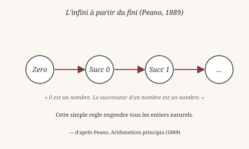
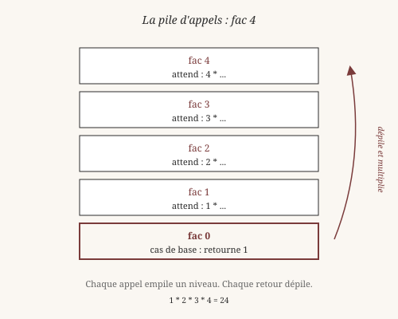
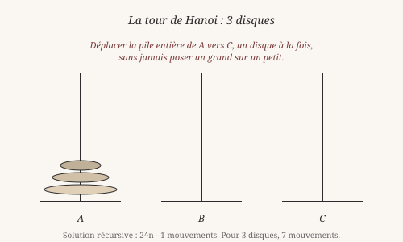

# Récursion : l'infini à partir du fini

> *« Pour comprendre la récursion, il faut d'abord comprendre la
> récursion. »*
>
> — Anonyme, mais probablement un étudiant en informatique.

La récursion est partout en programmation fonctionnelle. Pas parce
qu'elle est élégante (elle l'est), pas parce qu'elle est rapide (pas
toujours), mais parce qu'elle *correspond à la structure des
données*. Une liste est soit vide, soit un élément suivi d'une liste.
Une fonction qui traite une liste doit traiter ces deux cas. C'est
tout.

## 1. L'infini à partir du fini

En 1889, Giuseppe Peano publie ses *Arithmetices principia*, un petit
livre qui va fonder l'arithmétique sur une base logique minimale.
Son idée : au lieu de *postuler* l'existence des nombres (1, 2, 3…),
on la **construit** à partir de rien.

Deux règles suffisent :

- **`Zero`** est un nombre.
- Si `n` est un nombre, **`Succ n`** en est un autre.

C'est tout. À partir de ces deux règles, on engendre l'infini :
`Zero` (0), `Succ Zero` (1), `Succ (Succ Zero)` (2), et ainsi de
suite. L'infini émerge du fini, sans postulat supplémentaire.

Richard Dedekind, deux ans plus tôt (1888), avait formalisé la même
idée dans *Was sind und was sollen die Zahlen?*. Cette construction
est **récursive** : chaque nombre est défini en termes du précédent.

En Heaven, ces deux règles s'écrivent :

    heaven> data Nat = Zero | Succ Nat
    ✓ data Nat registered (2 constructors)

Deux constructeurs, une seule ligne. Tout le reste suivra par
récursion.

## 2. Cas de base et cas récursif

Toute fonction récursive a deux parties :

1. **Un cas de base** : quand s'arrêter.
2. **Un cas récursif** : comment progresser.

Prenons la factorielle, le classique. En mathématiques :

    n! = 1                si n = 0
    n! = n * (n-1)!       sinon

En Heaven, avec les entiers natifs :

    heaven> fac 0 = 1
    ✓ clause enregistrée pour 'fac'

    heaven> fac n = n * fac (n - 1)
    ✓ clause enregistrée pour 'fac'

    heaven> fac 5
    120

Heaven essaie la première clause. Si `n` vaut 0, elle s'applique et
rend 1. Sinon, il essaie la seconde, qui rappelle `fac` avec `n - 1`.

Vous remarquez ? La deuxième clause s'appelle elle-même. C'est la
récursion. La première clause est le **cas de base**.

Sans le cas de base, la fonction ne s'arrête jamais. C'est le
problème que Wittgenstein soulevait dans les *Investigations
philosophiques* (§185-§242) : une règle ne contient pas en
elle-même les conditions de son arrêt. C'est **l'application** de
la règle — l'acte de suivre une règle — qui introduit la
terminaison.

Un programme récursif doit **dire** quand il s'arrête. Sinon il ne
s'arrête pas.

## 3. Récursion structurelle

La récursion n'est pas qu'une technique. C'est une **manière de
voir** les données. Prenons `length` :

    heaven> length nil = 0
    ✓ clause enregistrée pour 'length'

    heaven> length (cons _ xs) = 1 + (length xs)
    ✓ clause enregistrée pour 'length'

Deux clauses, une par **forme** de liste. La fonction suit la
structure de la donnée :

- `nil` est vide → cas de base.
- `cons x xs` a un élément de tête → un + la longueur du reste.

On appelle cela une **récursion structurelle** : elle ne tourne pas
dans le vide, elle **consomme** la structure. Chaque appel réduit
la liste d'un cran. À la fin, la liste est vide, et la fonction
s'arrête.

C'est différent d'une boucle `while` qui tourne jusqu'à ce qu'une
condition devienne fausse. Ici, c'est la **forme de la donnée**
qui dicte la forme de la fonction. Pas de compteur externe, pas de
variable de contrôle. La terminaison est **garantie** par la
structure.

Frege avait vu cela : une fonction récursive sur `Nat` mesure la
structure de Peano. Une fonction récursive sur `List` mesure la
structure de la liste. La récursion **compte** la donnée, et c'est
ce compte qui la termine.

## 4. Récursion terminale : ne pas empiler

Regardez la pile d'appels pour `fact 4`. Chaque appel à `fact`
**empile** un niveau. Le niveau 4 attend le résultat du niveau 3,
qui attend le niveau 2, qui attend le niveau 1, qui attend le
niveau 0 (cas de base). Puis tout se **dépile** en multipliant.

C'est joli, mais ça coûte de la mémoire. Pour `fact 1000`, on
empile 1000 niveaux. Pour `fact 100000`, on déborde la pile
(*stack overflow*).

La **récursion terminale** évite ce problème. Une fonction
récursive est dite *terminale* si l'appel récursif est la
**dernière** opération de la fonction — rien à faire après, aucun
travail en attente. Dans ce cas, la pile n'a pas besoin de croître :
on peut « remplacer » le cadre courant par le suivant.

Réécrivons `fac` en version terminale avec un **accumulateur** :

    heaven> facAux 0 acc = acc
    ✓ clause enregistrée pour 'facAux'

    heaven> facAux n acc = facAux (n - 1) (n * acc)
    ✓ clause enregistrée pour 'facAux'

    heaven> fac n = facAux n 1
    ✓ clause enregistrée pour 'fac'

    heaven> fac 5
    120

Cette fois, l'appel récursif `facAux (n - 1) (n * acc)` est la
**dernière** chose que la fonction fait. Rien n'est en attente.
La pile **ne grandit pas**. `fac 100000` fonctionne — ou plutôt
fonctionnerait si les entiers natifs ne débordaient pas.

C'est la découverte centrale de la programmation fonctionnelle des
années 1970 : **la récursion terminale peut remplacer la boucle**.
Un langage qui optimise la récursion terminale (TCO, *Tail Call
Optimization*) peut écrire toutes ses boucles comme des fonctions
récursives sans coût.

Heaven supporte partiellement la TCO en V0. Pour les cas simples
(comme `facAux`), l'optimisation fonctionne. Pour les cas complexes
(arguments calculés, récursion mutuelle), elle reste incomplète —
un chantier ouvert, documenté dans `docs/ROADMAP.md`.

*Vérifiable : les définitions `fac`, `facAux` et `length`
fonctionnent telles quelles dans le REPL.*

## 5. La tour de Hanoi

La tour de Hanoi est un puzzle inventé par le mathématicien français
Édouard Lucas en 1883. Trois tiges, `n` disques de tailles
différentes, et une règle : on ne peut poser un disque que sur un
disque plus grand. Le but : déplacer toute la pile d'une tige à une
autre.

La solution est **récursive**, et elle est d'une élégance rare :

    heaven> hanoi 0 from to via = nil
    ✓ clause enregistrée pour 'hanoi'

    heaven> hanoi n from to via =
              append (hanoi (- n 1) from via to)
                     (cons (pair from to)
                           (hanoi (- n 1) via to from))
    ✓ clause enregistrée pour 'hanoi'

Trois idées, en une définition :

1. Si `n = 0`, rien à faire.
2. Sinon : déplacer `n - 1` disques de `from` vers `via`, en
   utilisant `to` comme intermédiaire.
3. Déplacer le plus grand disque de `from` vers `to`.
4. Redéplacer `n - 1` disques de `via` vers `to`, en utilisant
   `from` comme intermédiaire.

Chaque appel à `hanoi (- n 1)` fait exactement la même chose, sur un
problème plus petit. La **récursion** divise le problème en
sous-problèmes identiques, mais plus petits. C'est la stratégie
*diviser pour régner* — *divide et impera* — déjà décrite par
Machiavel, mais formalisée pour l'algorithmique au XXᵉ siècle.

Combien de mouvements faut-il ? Pour `n` disques, la réponse est
`2^n - 1`. C'est exponentiel : pour 64 disques (la légende dit que
des moines bouddhistes déplacent une telle tour depuis la nuit des
temps), il faudrait environ 585 milliards d'années. La fin du monde
attend.

## 6. Récursion mutuelle

Parfois, deux fonctions se définissent l'une par l'autre :

    heaven> isEven 0 = true
    ✓ clause enregistrée pour 'isEven'

    heaven> isEven n = isOdd (n - 1)
    ✓ clause enregistrée pour 'isEven'

    heaven> isOdd 0 = false
    ✓ clause enregistrée pour 'isOdd'

    heaven> isOdd n = isEven (n - 1)
    ✓ clause enregistrée pour 'isOdd'

`isEven` appelle `isOdd`, qui appelle `isEven`, etc. Aucune des
deux ne peut être définie seule. Elles forment un **cercle**.

Cette forme est appelée **récursion mutuelle**. Elle est moins
fréquente que la récursion simple, mais elle apparaît naturellement
quand on modélise des systèmes d'états qui alternent (pair/impair,
ouvert/fermé, actif/inactif). Le compilateur accepte ce cercle : il
n'exige pas qu'une fonction soit définie avant d'être utilisée,
juste qu'elle le soit **avant d'être appelée**.

Heaven supporte la récursion mutuelle en V0, mais avec une limite :
la **TCO mutuelle** (l'optimisation qui évite l'empilement entre
deux fonctions qui s'appellent) n'est pas complète. Pour de petites
valeurs, ça marche. Pour de grandes, ça déborde la pile. C'est un
chantier ouvert, comme la TCO simple.

## 7. Ce qu'on a appris

- **L'infini à partir du fini** (Peano, Dedekind) : deux règles
  suffisent à engendrer tous les entiers naturels.
- Une fonction récursive a toujours un **cas de base** et un
  **cas récursif**.
- La **récursivité structurelle** suit la forme de la donnée :
  chaque appel consomme un cran de structure.
- La **récursion terminale** place l'appel récursif en dernière
  position, ce qui évite d'empiler.
- **TCO** (*Tail Call Optimization*) transforme la récursion
  terminale en boucle sans coût mémoire.
- **La tour de Hanoi** illustre la stratégie *diviser pour régner* :
  un problème récursif se résout en sous-problèmes identiques plus
  petits.
- La **récursion mutuelle** autorise deux fonctions à se définir
  l'une par l'autre.

La récursion n'est pas qu'une technique. C'est une **manière de
penser** les données et les problèmes. Une liste, un arbre, un
entier naturel : tous ont une structure récursive. Une fonction qui
les traite peut refléter cette structure, et gagner en clarté ce
qu'elle perd en immédiateté.

Wittgenstein, encore lui, aurait dit : « la forme de la solution
est la forme du problème ». Une liste récursive appelle une fonction
récursive. Une tour de Hanoi récursive appelle une solution
récursive. Rien de plus, rien de moins.

Au chapitre suivant, on généralise : que se passe-t-il quand on
passe des **fonctions** elles-mêmes en argument ? C'est le monde des
**fonctions d'ordre supérieur** — `map`, `filter`, `fold`, `>>>` —
et c'est là que le code fonctionnel devient vraiment concis.

*Vérifiable : les définitions `hanoi`, `isEven`, `isOdd`
fonctionnent telles quelles dans le REPL (sauf la TCO mutuelle
pour de très grandes valeurs).*

