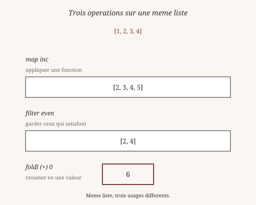
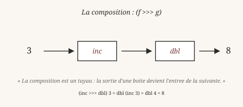
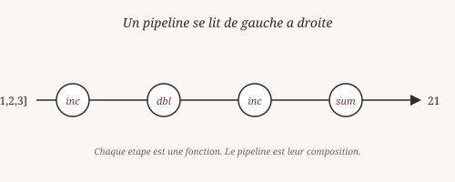

# Fonctions d'ordre supérieur

> *« Un concept de second ordre est un concept dont l'argument
> est lui-même un concept. »*
> — Gottlob Frege, *Fonction et concept* (1891)

Jusqu'ici, on a passé des nombres et des listes à nos fonctions. Mais
en fonctionnel, on peut aussi passer des **fonctions** elles-mêmes.
C'est ce qu'on appelle les fonctions d'ordre supérieur, et c'est là
que le style devient vraiment concis.

## 1. Une fonction, c'est une valeur

Frege, à la fin du XIXᵉ siècle, avait déjà distingué deux niveaux :

- Un **concept de premier ordre** prend un objet et rend une valeur
  de vérité. Exemple : « être rouge ».
- Un **concept de second ordre** prend un *concept* en argument.
  Exemple : « être un concept que Socrate satisfait ».

Cette hiérarchie — concepts de concepts — est l'ancêtre direct des
**fonctions d'ordre supérieur** en programmation.

En Heaven, cette idée est prise au pied de la lettre. Une fonction
peut être passée à une autre fonction :

    heaven> apply f x = f x
    ✓ clause enregistrée pour 'apply'

    heaven> inc x = x + 1
    ✓ clause enregistrée pour 'inc'

    heaven> apply inc 5
    6

`apply` prend deux arguments : une fonction `f` et une valeur `x`,
et rend `f x`. On dit que `apply` est d'**ordre supérieur** parce
qu'elle prend une fonction en argument.

C'est aussi simple que ça. Une fonction qui prend une fonction est
une fonction d'ordre supérieur. Voilà toute la définition.

## 2. `map` : transformer chaque élément

Prenons une liste. En Heaven, on l'écrit avec les constructeurs
`nil` et `cons` :

    heaven> maListe = (cons 1 (cons 2 (cons 3 (cons 4 nil))))

Comment ajouter 1 à **chaque** élément ? On écrit une fonction
récursive :

    heaven> map _ nil = nil
    ✓ clause enregistrée pour 'map'

    heaven> map f (cons x xs) = (cons (f x) (map f xs))
    ✓ clause enregistrée pour 'map'

    heaven> map inc maListe
    (cons 2 (cons 3 (cons 4 (cons 5 nil))))

`map` applique `f` à chaque élément. Elle est déjà dans
`core/std/list.hvn` (chargée au boot). C'est une fonction d'ordre
supérieur : son premier argument `f` est une fonction.

Trois lignes de définition. Le reste suit la structure de la liste.

## 3. `filter` : garder ceux qui satisfont

`filter` ne transforme pas les éléments : elle les **sélectionne**.
Ceux qui satisfont un prédicat sont gardés ; les autres sont jetés.

    heaven> filter _ nil = nil
    ✓ clause enregistrée pour 'filter'

    heaven> filter p (cons x xs) =
              if (p x)
                 (cons x (filter p xs))
                 (filter p xs)
    ✓ clause enregistrée pour 'filter'

    heaven> filter even maListe
    (cons 2 (cons 4 nil))

Le prédicat `p` est une fonction qui rend un `Bool`. `even` rend
`true` si son argument est pair. Donc `filter even maListe` garde
les nombres pairs.

Récursivement : soit la tête satisfait `p`, auquel cas on la garde
et on filtre le reste ; soit elle ne satisfait pas, auquel cas on
filtre juste le reste. Deux cas, une seule ligne par cas.

## 4. `fold` : résumer en une valeur

`map` transforme, `filter` sélectionne. `fold` — aussi appelé
`reduce` — **résume** une liste en une seule valeur. C'est le
couteau suisse des opérations sur les listes.

    heaven> foldl _ acc nil = acc
    ✓ clause enregistrée pour 'foldl'

    heaven> foldl f acc (cons x xs) = foldl f (f acc x) xs
    ✓ clause enregistrée pour 'foldl'

Le premier argument `f` combine l'accumulateur `acc` et l'élément
`x`. Le second argument est la valeur de départ. Le troisième, la
liste.

Exemple : la somme d'une liste.

    heaven> add a b = a + b
    ✓ clause enregistrée pour 'add'

    heaven> foldl add 0 maListe
    10

Déroulons pas à pas :

- `foldl add 0 (cons 1 (cons 2 (cons 3 (cons 4 nil))))`
- `foldl add (add 0 1) (cons 2 (cons 3 (cons 4 nil)))`
- `foldl add (add 1 2) (cons 3 (cons 4 nil))`
- `foldl add (add 3 3) (cons 4 nil)`
- `foldl add (add 6 4) nil`
- `add 6 4`
- `10`

`foldl` signifie *fold left* : on accumule de la gauche vers la
droite. Il existe aussi `foldr` (*fold right*) qui accumule dans
l'autre sens. Sur une liste finie, ils donnent souvent le même
résultat — mais pas toujours. On reviendra à cette distinction au
chapitre 14 (schémas de récursion).

En philosophie, `foldl` correspond à la notion de **synthèse** :
composer plusieurs éléments en un tout. Le terme est de Kant
(*Critique de la raison pure*) : la synthèse du divers par
l'entendement. Une liste `[1, 2, 3, 4]` devient le nombre `10` par
application successive de l'addition. Rien de magique, tout de
structure.

*Vérifiable : les définitions `apply`, `map`, `filter`, `foldl`
et les exemples fonctionnent tels quels dans le REPL.*

## 5. Composition : `f >>> g`

Passer une fonction en argument est une chose. **Combiner** deux
fonctions en est une autre. C'est ce qu'on appelle la
**composition**.

En mathématiques, la composition se note `f ∘ g` : appliquer `g`,
puis `f`. En Heaven, on écrit `f >>> g` — même idée, lecture de
gauche à droite :

    heaven> inc x = x + 1
    ✓ clause enregistrée pour 'inc'

    heaven> dbl x = x * 2
    ✓ clause enregistrée pour 'dbl'

    heaven> (inc >>> dbl) 3
    8

Déroulons :

- `inc 3 = 4`
- `dbl 4 = 8`
- Donc `(inc >>> dbl) 3 = 8`

L'opérateur `>>>` prend deux fonctions et rend une **nouvelle
fonction**. Cette nouvelle fonction est d'ordre supérieur par
construction — elle *est* une composition.

La composition est **associative** :

    (f >>> g) >>> h = f >>> (g >>> h)

C'est-à-dire : peu importe qu'on gagne à gauche ou à droite, le
résultat est le même. Cette loi est une des fondations de la
programmation fonctionnelle — elle vient de la **théorie des
catégories** (chapitre 17).

Wittgenstein aurait dit : composer `f` et `g`, c'est voir la
fonction résultante *comme* un seul objet, sans se soucier des
étapes intermédiaires. Une lecture nouvelle, plus compacte.

## 6. Pipeline : lire de gauche à droite

Une fois qu'on a `>>>`, on peut chaîner plusieurs opérations en un
**pipeline** :

    process xs = ((filter even) >>> (map inc) >>> (foldl add 0)) xs

Lisez de gauche à droite : garde les pairs, ajoute 1 à chacun, puis
somme. Chaque étape est une fonction. Le pipeline est leur
composition.

L'intérêt du style pipeline : **on sépare le quoi du comment**.
`(filter even)`, c'est le *quoi* — ne garder que les pairs. Le
`xs` final, c'est le *comment* — appliqué à cette liste-là. On peut
définir le pipeline une fois, l'appliquer à mille listes.

C'est une idée ancienne. Les chaînes de production fordiennes,
popularisées au début du XXᵉ siècle, reposent sur le même principe :
une suite d'opérations simples, chacune indépendante, appliquées à
un flux d'entrée. La programmation fonctionnelle n'a rien inventé —
elle a formalisé.

## 7. Curryfication : Schönfinkel et Curry

Il reste une dernière idée, plus subtile. En Heaven, une fonction
à plusieurs arguments peut être **appliquée partiellement** :

    heaven> add a b = a + b
    ✓ clause enregistrée pour 'add'

    heaven> add 1 2
    3

    heaven> addOne = (add 1)
    ✓ clause enregistrée pour 'addOne'

    heaven> addOne 5
    6

`add 1` ne renvoie pas une erreur « il manque un argument ». Il
renvoie une **nouvelle fonction** qui attend encore son second
argument. On dit que la fonction est **curryfiée** — du nom du
logicien Haskell Curry (1900-1982).

En réalité, l'idée vient de Moses Schönfinkel, qui l'a publiée en
1924, avant même la thèse de Church. Curry l'a popularisée dans les
années 1930 en développant le **lambda-calcul**, le formalisme qui
sert aujourd'hui de modèle à tous les langages fonctionnels.

La curryfication est profonde : elle dit qu'une fonction à deux
arguments **est** une fonction à un argument qui rend une fonction.
`add : Int -> Int -> Int` : prend un `Int`, rend une fonction
`Int -> Int`. La flèche `->` est **associative à droite** :
`a -> b -> c` se lit `a -> (b -> c)`.

Ce qui permet :

    heaven> apply (add 1) 5
    6

    heaven> apply (add 10) 32
    42

On peut passer une fonction partiellement appliquée à `apply`, à
`map`, à `filter` — à tout ce qui attend une fonction. C'est ce qui
rend le style concis : au lieu d'écrire `\x. x + 1`, on écrit
simplement `(add 1)`. Deux caractères contre cinq.

## Ce qu'on a appris

- Une **fonction d'ordre supérieur** prend une fonction en argument
  (Frege, concepts de second ordre).
- **`map`** transforme chaque élément d'une liste par une fonction.
- **`filter`** sélectionne les éléments qui satisfont un prédicat.
- **`fold`** résume une liste en une seule valeur (synthèse
  kantienne).
- La **composition** `f >>> g` combine deux fonctions en une seule,
  et elle est associative.
- Un **pipeline** chaîne plusieurs étapes, séparant le *quoi* du
  *comment*.
- La **curryfication** (Schönfinkel 1924, Curry 1930) permet
  d'appliquer partiellement une fonction. `add 1` est une fonction
  qui attend son second argument.
- La flèche `->` est **associative à droite** : `a -> b -> c` se
  lit `a -> (b -> c)`.

Wittgenstein, encore lui, aurait aimé ce chapitre. Une fonction
d'ordre supérieur, c'est une fonction qui **voit** une autre
fonction — non comme un objet opaque, mais comme une **règle
manipulable**. Composer `f` et `g`, c'est voir la règle de `f`
appliquée à celle de `g`, sans se soucier des valeurs concrètes.
Une abstraction sur les règles elles-mêmes.

Au chapitre suivant, on aborde une question qui hante la
programmation depuis les années 1960 : comment faire des effets
(lire, écrire, logger) sans polluer un langage qui se veut pur ?
La réponse de Heaven s'appelle les **effets algébriques**.

*Vérifiable : les définitions et exemples de composition, pipeline
et curryfication fonctionnent tels quels dans le REPL.*

