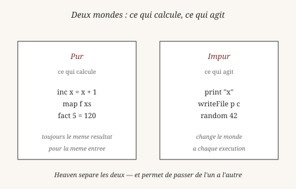
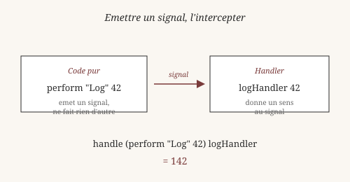
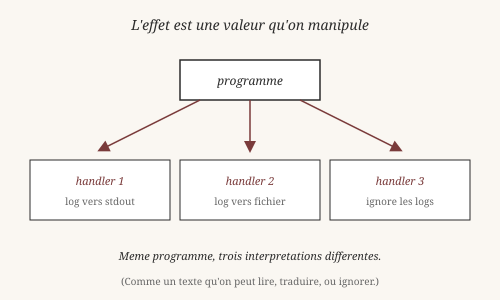

# Chapitre 6 — Effets algébriques

> *« Le code pur calcule. Le code impur agit. Un bon langage sépare
> les deux sans les rendre incompatibles. »*

Jusqu'ici, tout notre code était **pur**. `inc`, `map`, `filter` :
ils prennent des valeurs, rendent des valeurs, et ne font rien
d'autre. Pas de lecture de fichier, pas de log, pas de requête réseau.

Mais les programmes réels doivent *faire* des choses. Comment
concilier pureté et action ? La réponse de Heaven s'appelle les
**effets algébriques**.

## 1. Le problème : pureté et action

Il y a une tension ancienne entre deux exigences :

- **Calculer** proprement — une fonction pure rend toujours le même
  résultat pour la même entrée. On peut la tester, la reproduire,
  la prouver.
- **Agir** sur le monde — lire un fichier, envoyer un message,
  afficher un résultat.

Dans la plupart des langages, ces deux mondes se mélangent. Une
fonction Python peut `print` un log au milieu d'un calcul :

    def process(x):
        print(f"pipeline de {x}")
        return x * 2

Cette fonction est *impure* : elle écrit sur la sortie standard. On
ne peut pas la tester sans capturer stdout. On ne peut pas la
paralléliser sans mélanger les logs. On ne peut pas la transformer
en appel réseau sans tout réécrire.

Le philosophe du langage John Austin (1911-1960) avait fait une
distinction voisine dans *How to Do Things with Words* (1955) : les
énoncés ne se contentent pas de **décrire** le monde — ils
**agissent** sur lui. Quand un maire dit « je vous déclare mari et
femme », ce n'est pas une description de mariage, c'est l'acte de
mariage lui-même. Un **performatif**.

Le `print` de Python est un performatif : il ne décrit pas qu'un
log est écrit, il l'écrit.

## 2. Séparer l'intention de l'action

En Heaven, on sépare l'**intention** de l'**exécution**. Voici le
même calcul, mais sans effet :

    process x = x * 2

Et voici la version avec l'**intention** de logger :

    process x =
      let _ = (perform "Log" x) in
      x * 2

`perform "Log" x` dit : « je veux logger `x` ». Pas *comment*. C'est
un signal, pas une action. Le code reste pur tant que personne
n'intercepte. Si on écrit `process 5` sans handler, le signal est
émis mais rien ne se passe de particulier — il attend.

## 3. `perform` : émettre un signal

`perform` s'écrit en préfixe (notation de Frege, chapitre 1) :

    perform "Log" 42

Le premier argument est le **nom** de l'effet (`"Log"`). Le second
est la **charge utile** (42). Le résultat de `perform` est une
**valeur** de type `Unit` — la même chose que `()` du chapitre 2.
C'est-à-dire « rien de spécial à signaler ».

En fait, `perform` *fait* quelque chose : il **émet un signal** que
l'environnement peut intercepter. Mais du point de vue du calcul, il
ne rend rien de particulier.

## 4. `handle` : intercepter

Pour donner un sens au signal, on utilise `handle`. Il prend deux
arguments : une expression contenant des `perform`, et un **handler**
qui sait quoi faire de ces signaux.

    heaven> logHandler msg = msg + 100
    ✓ clause enregistrée pour 'logHandler'

    heaven> handle (perform "Log" 42) logHandler
    142

Déroulons :

1. `perform "Log" 42` émet un signal avec la valeur 42.
2. `handle ... logHandler` intercepte le signal.
3. Il appelle `logHandler 42`, qui rend 142.
4. `handle` rend ce résultat.

Le handler est une **fonction ordinaire**. Il prend la charge utile
(42) et rend ce qu'il veut (142). C'est aussi simple que ça.

*Vérifiable : `logHandler` et `handle (perform "Log" 42)
logHandler` fonctionnent tels quels dans le REPL.*

## 5. L'effet comme valeur

Voici l'idée centrale des effets algébriques : un signal est une
**valeur** comme une autre. On peut le passer, le retourner, le
stocker. Ce n'est pas un mécanisme spécial du langage, c'est un
objet ordinaire.

Regardons ce que ça permet. Voici un programme qui émet un signal :

    process x =
      let _ = (perform "Log" x) in
      x * 2

Ce programme est **pur**. Il ne fait rien quand on l'évalue seul. Il
se contente d'**émettre une intention** que quelqu'un pourra
intercepter.

On peut l'interpréter de plusieurs manières différentes :

**Handler 1 — logguer vers la sortie standard** :

    logStdout msg = msg
    resultat = handle (process 5) logStdout

**Handler 2 — logguer vers un fichier** :

    logFile msg = msg
    resultat = handle (process 5) logFile

**Handler 3 — ignorer les logs** :

    logIgnore msg = msg
    resultat = handle (process 5) logIgnore

Le **même programme** `process`, trois interprétations différentes.
C'est exactement ce que nous cherchions : le code reste pur, on peut
le tester sans effet, et chaque usage décide de la sémantique.

C'est une idée que la philosophie du langage a explorée :
*un texte peut être lu de plusieurs manières sans changer*. Le
programme est le texte. Les handlers sont les lectures.

## 6. Comparaison avec les monades

Depuis les années 1990, la manière habituelle de gérer les effets
en Haskell s'appelle les **monades**. Une monade `IO` encapsule les
effets d'entrée-sortie ; une monade `State` encapsule un état
mutable ; une monade `Either` encapsule les erreurs.

Eugenio Moggi (1989) et Philip Wadler (1992) ont montré que
**beaucoup** de ces structures partageaient les mêmes lois. Une
monade, c'est :

- Un type paramétré `M a` (comme `Option a` ou `List a`).
- Une fonction `return : a -> M a`.
- Une fonction `bind : M a -> (a -> M b) -> M b`.
- Trois lois : identité à gauche, identité à droite, associativité.

Les **effets algébriques** généralisent les monades. Au lieu d'avoir
une monade par type d'effet, on a :

- Une seule syntaxe `perform` pour émettre n'importe quel signal.
- Une seule syntaxe `handle` pour intercepter n'importe quel signal.

Un effet algébrique ressemble à une monade libre : on empile les
signaux, on les interprète plus tard. La différence est dans le
*dispatch* : les monades se composent à la main (`M1 (M2 a)`), les
effets se composent automatiquement (le handler choisit ce qu'il
attrape).

C'est pourquoi Heaven, et d'autres langages modernes (Koka, Eff,
Unison), préfèrent les effets aux monades : *moins de code pour la
même puissance expressive*.

## 7. Pourquoi c'est puissant

Trois raisons.

**1. Testabilité.** Un programme qui émet des signaux peut être
testé sans effet de bord. On écrit un handler qui collecte les
signaux au lieu de les exécuter, et on vérifie que la liste est
correcte.

    logCollector msg = msg
    -- En test, on "collecte" au lieu de logger.

**2. Modularité.** Le programme ne sait pas *comment* on va
l'exécuter. Le handler décide. On peut changer de handler sans
toucher au programme. C'est la séparation des préoccupations poussée
à son terme.

**3. Composition.** Deux effets (Log et Error, par exemple) se
composent avec deux handlers imbriqués :

    handle
      (handle programme logHandler)
      errorHandler

Le handler interne attrape les logs, le handler externe attrape les
erreurs. Chacun fait son travail sans interférer avec l'autre.

C'est ce que John Austin appelait la **force illocutoire** : un
même énoncé peut avoir différentes forces selon le contexte. « Il
pleut » peut être une description, une plainte, une réponse à une
question. En Heaven, le même `perform` peut être un log, une
écriture, ou une requête — c'est le handler qui décide.

## Ce qu'on a appris

- Il y a une tension entre **calculer** (pur) et **agir** (impur).
- John Austin, dans *How to Do Things with Words* (1955), a montré
  que le langage ne décrit pas seulement le monde — il agit sur lui.
- Un **`perform`** émet un signal, sans l'exécuter.
- Un **`handle`** intercepte les signaux et leur donne un sens.
- Les effets sont des **valeurs** ordinaires : on peut les passer,
  les intercepter, les ignorer.
- Le **même programme** peut être interprété de plusieurs manières
  selon le handler choisi.
- Les **effets algébriques** généralisent les **monades** de Moggi
  et Wadler (1989-1992), avec moins de code pour la même puissance.

Wittgenstein aurait vu dans les effets une illustration de son
« voir comme » : le même programme, deux lectures. Composer des
handlers, c'est voir le programme **comme** un pipeline de
transformations successives.

Au chapitre suivant, on explore une application des effets :
les **streams**. Une liste paresseuse où les effets jouent un rôle
central — on peut lire, écrire, ou transformer, sans matérialiser
toute la séquence.

*Vérifiable : tous les exemples `handle` et `logHandler` de ce
chapitre fonctionnent tels quels dans le REPL.*

## 8. `handle_rec` — implémentation actuelle

`handle_rec` est l'**implémentation testée** (4/4,
`tests/test_effects_rec.hvn`). Signature :

    handle_rec thunk handler init

    -- thunk   : la computation, paramétrée par l'état
    -- handler : (lambda val k -> ...), k = continuation
    -- init    : état initial

Exemple — compteur d'effets :

    test "countdown":
      (handle_rec
        (lambda s -> (if s == 0 then 0 else (perform "tick" s)))
        (lambda v k -> (if v == 0 then 0 else (k (v - 1))))
        5) == 0

Décomposé :

1. `thunk 5` s'exécute. `5 != 0`, donc `perform "tick" 5`.
2. `perform` capture le handler via `pending_capture.kind = .perform`.
3. `handle_rec` invoque `handler` : `(lambda v k -> ...) 5 k`.
4. `v = 5`, `k` est la continuation. `k (5 - 1) = k 4`.
5. `thunk 4`, `thunk 3`, ..., `thunk 0`.
6. `thunk 0` retourne `0` (pas de `perform`). Fin.

Le handler décide : soit il appelle `k` (reprise), soit il
retourne une valeur (abandon, one-shot).

    test "one-shot":
      (handle_rec
        (lambda s -> (perform "once" s))
        (lambda v k -> v)   -- k jamais appelé
        42) == 42

## 9. Effets en syntaxe cible

La direction (`_effects.md` §5) : **les opérations sont des
`Expr` normales**, pas des labels string.

### Aujourd'hui

    perform "Accept" cap

### Cible

    perform (Accept cap)

`Accept` est une **opération**, pas un constructeur de data. Elle
peut porter un payload typé. Le handler intercepte par
**pattern-matching sur l'opération** :

    handle e with
      | Accept fd     -> resume k (read fd cap)
      | ReadFile cap  -> resume k (io_read cap 0 4096)
      | WriteFile cap -> resume k (io_write cap 0 ...)

`with`, `|`, `resume` — syntaxe cible, non implémentée. La
spécification complète est dans `docs/spec/_effects.md` §5-7.

### `do` notation

Direction : `do` est du **sucre** pour chaîner des `handle_rec`.

    fetch url = do
      conn <- connect (host url) (port url)
      req  <- build_get (path url) (host url)
      send conn req
      recv conn

Désucre en `handle_rec` imbriqués. Pas de primitive runtime. La
grammaire (`GRAMMAR.md`) ne contient pas `do` aujourd'hui —
c'est une cible.

## 10. Ce qui marche aujourd'hui

| Feature | État | Test |
|---|---|---|
| `perform "label" val` | ✅ | `test_effects_rec.hvn` |
| `handle_rec thunk handler init` | ✅ | `test_effects_rec.hvn` (4/4) |
| `yield` (scheduler) | ✅ | `test_scheduler.hvn` |
| `@prompt` / `@throw` | ✅ | `test_continuations.hvn` (15/15) |
| `@prompt_depth` | ✅ | `test_prompt_depth.hvn` (13/13) |
| `perform (Op args)` | ❌ | cible §9 |
| `handle ... with` | ❌ | cible §9 |
| `resume k v` public | ❌ | `resume_from_k` interne |
| `do` notation | ❌ | cible §9 |

### Référence

- `docs/spec/_effects.md` — spec (285 l.), état + cible.
- `docs/spec/_handle_rec_status.md` — chantier parallèle.
- `docs/spec/_continuations.md` — continuations délimitées.
- `src/core/engine_expr.zig:187-350` — `PendingCapture`,
  `prompts`, scheduler.

