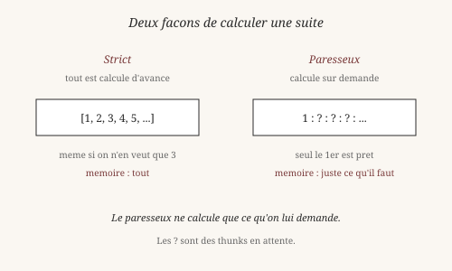
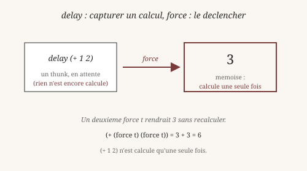
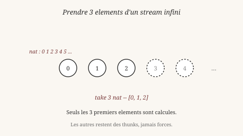

# Streams : calculer à la demande

> *« La paresse est parfois une vertu : elle économise le travail
> inutile. »*
> — Anonyme

Un **stream** est une suite d'éléments. Tu en as déjà vu dans les
chapitres précédents, sous forme de `Cons x rest | End`. Ce chapitre
montre ce qui les rend vraiment utiles : leur **paresse**.

## 1. Deux façons de calculer une suite

Imagine deux manières de calculer la suite des nombres :

**Version stricte** — on calcule *tout d'avance*. Si on demande les
10 000 premiers entiers, on les calcule tous, on les stocke tous, on
les rend tous. Même si on n'en veut que trois.

**Version paresseuse** — on calcule *à la demande*. On prépare le
premier élément, et un **plan** pour calculer les suivants. Si on ne
demande que trois éléments, on n'en calcule que trois. Le reste
attend.

C'est comme la différence entre :

- Écrire tous les chapitres d'un livre avant de le publier.
- Publier le premier chapitre, et n'écrire le suivant que si quelqu'un
  le demande.

Heaven utilise la seconde approche pour les streams.

Le philosophe et mathématicien Gottfried Wilhelm Leibniz (1646-1716)
avait déjà remarqué quelque chose de similaire dans sa *Monadologie*
(1714) : chaque monade contient virtuellement tout son avenir, mais
ne l'**actualise** que si quelque chose l'y pousse. La paresse en
programmation fonctionnelle suit cette idée : *les valeurs existent
en puissance, elles s'actualisent en acte*.

## 2. `delay` et `force` : capturer un calcul

Comment retarde-t-on un calcul ? Avec deux magics : `delay` et
`force`.

    delay expr      -- capture expr sans l'evaluer
    force t         -- evalue t (une seule fois, memoise)

`delay` produit un **thunk** : une valeur qui représente un calcul
en attente. `force` la déclenche. Le résultat est **mémorisé** : un
thunk n'est calculé qu'une fois, même si on le force plusieurs fois.

    heaven> let t = (delay (+ 1 2)) in
              (+ (force t) (force t))
    6

Déroulons :

- `delay (+ 1 2)` crée un thunk qui contient le calcul, pas son
  résultat. Rien n'est encore calculé.
- `(force t)` la première fois évalue `(+ 1 2)`, obtient 3, **stocke**
  ce 3 dans le thunk.
- `(force t)` la seconde fois voit que le thunk est déjà évalué, et
  rend directement le 3 sans recalculer.
- `(+ 3 3) = 6`.

C'est le principe de la **memoization** : un calcul n'est jamais
répété deux fois. Une forme de paresse **associée à la mémoire**.

## 3. Un stream paresseux

Maintenant, appliquons la paresse aux streams. Un stream **strict**
(`List`) est soit vide, soit un élément suivi d'un stream complet :

    data List a = nil | cons a (List a)

Un stream **paresseux** est soit vide, soit un élément suivi d'un
**thunk** qui produira le reste :

    heaven> data Stream a = Cons a (Stream a) | End
    ✓ data Stream registered (2 constructors)

La différence est subtile : `(Stream a)` dans le second constructeur
n'est pas évalué immédiatement. C'est un `delay` implicite.

Voici un stream infini — la suite des entiers naturels :

    heaven> nat n = (Cons n (delay (nat (+ n 1))))
    ✓ clause enregistrée pour 'nat'

    heaven> nat 0
    (Cons 0 (thunk ...))

`nat 0` ne calcule pas toute la suite. Il calcule le **premier**
élément (0), et prépare un thunk qui calculera `nat 1` si on le
force. La suite infinie est **représentée** en quelques octets.

C'est la beauté de la paresse : *l'infini devient fini*, tant qu'on
ne le consomme pas tout.

## 4. Prendre ce dont on a besoin

Un stream infini ne se termine jamais, mais on peut en prendre un
**préfixe fini** :

    heaven> streamTake 0 _ = nil
    ✓ clause enregistrée pour 'streamTake'

    heaven> streamTake n (Cons x rest) =
              (cons x (streamTake (- n 1) (force rest)))
    ✓ clause enregistrée pour 'streamTake'

    heaven> streamTake 3 (nat 0)
    (cons 0 (cons 1 (cons 2 nil)))

Trois éléments, pas plus. Le reste du stream infini est
**abandonné** : les thunks non forcés ne sont jamais calculés. On a
calculé exactement ce dont on avait besoin.

C'est la grande leçon de la paresse : *on ne paie que pour ce qu'on
consomme*. Le programme `nat` engendre l'infini, mais tant qu'on ne
le force pas, rien ne se passe.

Wittgenstein aurait vu là une illustration de son « voir comme » :
`nat 0` est à la fois *un stream infini* (vu de loin) et *le nombre
0 suivi d'un plan* (vu de près). Le même objet, deux aspects.

*Vérifiable : les définitions `nat` et `streamTake` fonctionnent
telles quelles dans le REPL.*

## 5. Composer : `map` sur un stream

Les streams paresseux supportent les mêmes opérations que les listes
— mais avec un avantage : elles ne calculent que ce dont on a besoin.

    heaven> streamMap _ End = End
    ✓ clause enregistrée pour 'streamMap'

    heaven> streamMap f (Cons x rest) =
              (Cons (f x) (delay (streamMap f (force rest))))
    ✓ clause enregistrée pour 'streamMap'

Regardez la clause récursive. Elle applique `f` au premier élément,
puis **retarde** l'application au reste. Le stream résultant est
paresseux de bout en bout : rien n'est calculé à l'avance.

Prenons la suite des entiers, multipliés par 2 :

    heaven> double x = (* x 2)
    ✓ clause enregistrée pour 'double'

    heaven> streamTake 3 (streamMap double (nat 0))
    (cons 0 (cons 2 (cons 4 nil)))

On a calculé :

- `nat 0` = 0 (pour le premier élément)
- `double 0` = 0
- `nat 1` = 1 (forcé par le take suivant)
- `double 1` = 2
- `nat 2` = 2 (forcé par le take suivant)
- `double 2` = 4

Puis on s'est arrêté. On n'a **pas** calculé `nat 3`, `nat 4`, etc.
Pourtant `nat` produit un stream infini. C'est la paresse qui rend
cela possible.

## 6. Pipeline paresseux

On peut chaîner plusieurs transformations :

    process xs = (streamTake 5 (streamFilter even (streamMap inc xs)))

Lisez de droite à gauche (ou de gauche à droite, peu importe dans ce
contexte) :

- On part d'un stream `xs`.
- On ajoute 1 à chaque élément (`streamMap inc`).
- On ne garde que les pairs (`streamFilter even`).
- On prend les 5 premiers (`streamTake 5`).

Le stream résultant contient 5 éléments. Le pipeline entier **n'a
calculé que les éléments nécessaires** pour en produire 5. Rien de
plus.

C'est différent d'une liste stricte. Sur une liste, chaque `map`,
chaque `filter` produirait une **copie intermédiaire** de la liste
entière. Sur un stream, chaque étape est un **pipeline** qui
transmet les éléments un par un.

C'est la même différence qu'entre :

- **Strict** : `[1, 2, 3, 4, 5]` — une liste complète en mémoire.
- **Paresseux** : `1 : ? : ? : ? : ...` — un élément, et un plan.

Le paresseux gagne en mémoire et en flexibilité. Il perd parfois en
performance brute (le coût du thunk). Le choix dépend du contexte.

## 7. Pourquoi c'est puissant

Trois raisons.

**1. Infini maîtrisé.** On peut représenter l'infini sans le
calculer. La suite des entiers, celle des nombres premiers, la suite
de Fibonacci : toutes sont des streams infinis qu'on peut
**consommer** par un préfixe, sans jamais matérialiser le tout.

**2. Composition.** Une fonction comme `streamFilter even` s'applique
à n'importe quel stream, fini ou infini. Elle ne se soucie pas de
savoir si ce qui suit est `[1, 2]` ou l'infinité des nombres. Elle
traite les éléments un par un, à la demande.

**3. Économie.** On ne calcule que ce qu'on consomme. Un calcul
partiel ne coûte que la part qu'on utilise. C'est une forme
d'**optimisation automatique** : le programmeur n'a pas à trier ce
qui est nécessaire de ce qui ne l'est pas. Le langage le fait pour
lui.

Leibniz, encore lui, aurait aimé. Sa *Monadologie* décrit des
substances qui contiennent virtuellement tout leur avenir, mais ne
l'actualisent que si quelque chose les y contraint. Un stream
paresseux est une monade au sens de Leibniz : toute la suite est en
lui, mais seul le présent est réalisé.

## Ce qu'on a appris

- Un **stream** est une suite d'éléments, potentiellement infinie.
- Deux stratégies de calcul : **stricte** (tout d'avance) et
  **paresseuse** (à la demande).
- **`delay`** capture un calcul sans l'évaluer. **`force`** le
  déclenche — une seule fois, avec **memoization**.
- Un **stream paresseux** est soit vide, soit un élément suivi d'un
  thunk qui produira le reste.
- On peut représenter l'**infini** en quelques octets, tant qu'on ne
  le consomme pas tout.
- Les opérations `map` et `filter` se **composent** sur les streams
  sans matérialiser d'intermédiaires.
- La **paresse** est une forme d'optimisation automatique :
  on ne paie que pour ce qu'on consomme.

Wittgenstein aurait vu là un nouveau « voir comme » : un stream
infini vu *comme* une suite totale (de loin), et vu *comme* un
élément suivi d'un plan (de près). Deux aspects, un seul objet.

Leibniz aurait ajouté : la paresse, c'est la différence entre *être
en puissance* et *être en acte*. Un stream non forcé est une
possibilité qui n'a pas encore été actualisée.

Au chapitre suivant, on plonge dans les **preuves**. C'est le
chapitre le plus ambitieux du livre : montrer que Heaven ne fait pas
que *calculer* — il **vérifie**. Un programme peut être *prouvé*
correct, pas seulement testé.

*Vérifiable : les définitions `nat`, `streamTake`, `streamMap` et
les exemples fonctionnent tels quels dans le REPL.*

