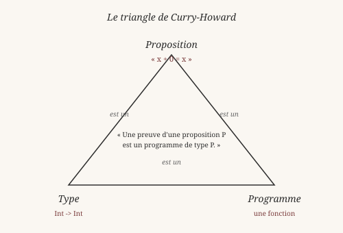
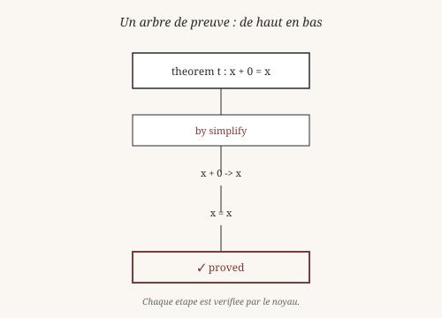
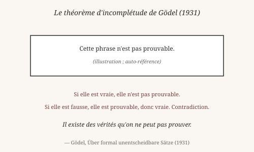

# Chapitre 8 — Preuves et théorèmes

> *« Prouver, c'est contraindre l'imagination à ne plus pouvoir
> douter. »*
> — Gottfried Wilhelm Leibniz

Heaven n'est pas qu'un langage de programmation. C'est aussi un
**assistant de preuve**. On peut y écrire des théorèmes
mathématiques, et le noyau **vérifie** que les preuves sont
correctes. Ce chapitre introduit ce monde.

## 1. Opinion vraie et savoir (rappel)

Platon, dans le *Ménon*, distinguait deux choses :

- Une **opinion vraie** — une croyance qui se trouve être correcte,
  mais dont on ne sait pas *pourquoi*.
- Un **savoir** — une croyance correcte qu'on peut **justifier**.

L'esclave du *Ménon* peut répondre correctement à une question de
géométrie. Il a une opinion vraie. Mais il ne peut pas **prouver**
sa réponse. Il ne sait pas ce qu'il sait.

Un programme qui passe tous ses tests ressemble à l'esclave. Il
**marche**. Il fait ce qu'il fait. Mais peut-on **prouver** qu'il
fait toujours ce qu'il prétend ? C'est une autre question.

Heaven essaie de répondre à cette question. Il permet d'écrire des
programmes qu'on peut non seulement **exécuter**, mais **prouver**
corrects.

## 2. Curry-Howard : preuves = programmes

En 1934, le mathématicien américain Haskell Curry (1900-1982)
remarque une correspondance frappante entre la logique et le calcul.
En 1969, William Alvin Howard la formalise dans un article resté
célèbre. Aujourd'hui, on l'appelle la **correspondance de
Curry-Howard** :

- Une **proposition** logique est un **type** en programmation.
- Une **preuve** de cette proposition est un **programme** de ce
  type.
- Vérifier une preuve, c'est **type-checker** un programme.

C'est une des découvertes les plus profondes du XXᵉ siècle. Elle
dit que la logique et le calcul ne sont pas deux mondes séparés —
ce sont **le même** monde, vu sous deux angles.

Un exemple simple :

- **Proposition** : `A → B → A` (de A on déduit B on déduit A).
- **Type** : `a -> b -> a`.
- **Preuve / programme** : `\x y. x` — une fonction qui rend son
  premier argument, quel que soit le second.

Le théorème logique et la fonction sont **le même objet**. C'est
pourquoi Heaven peut être à la fois un langage de programmation et
un assistant de preuve.

## 3. Le noyau CIC

Heaven repose sur un noyau mathématique : le **Calcul des
Constructions Inductives** (CIC), développé par Thierry Coquand et
Christine Paulin-Mohring en 1988. Le même noyau est utilisé par
l'assistant de preuve Coq (aujourd'hui appelé Rocq).

Le CIC a trois ingrédients :

- **Le lambda-calcul typé** — une manière d'écrire des fonctions
  avec leur type.
- **Les types dépendants** — des types qui dépendent d'une valeur
  (`Vec 3 Int`, comme au chapitre 2).
- **Les types inductifs** — des types définis par leurs
  constructeurs (`Nat = Zero | Succ Nat`, comme au chapitre 4).

C'est un système **petit** : quelques règles d'inférence, un nombre
fini de primitives. Mais il est **puissant** : toutes les
mathématiques usuelles peuvent s'y formaliser.

Heaven n'expose pas le CIC directement au programmeur. Il fournit
une **surface** plus accessible : `theorem`, `prove`, tactiques,
etc. Le CIC est le moteur sous le capot.

## 4. Théorème et tactiques

En Heaven, un **théorème** est une affirmation. Une **preuve** est
sa justification. On écrit :

    heaven> theorem add_zero : x + 0 = x
    ✓ theorem add_zero stated

    heaven> prove add_zero by simplify
    ✓ [add_zero] proved (simplify)

`theorem add_zero : x + 0 = x` déclare l'affirmation : « pour tout
`x`, `x + 0` égale `x` ». La formulation est naïve : `x` n'est pas
quantifié explicitement. Heaven comprendra que c'est « pour tout
`x` par défaut » — comme une convention.

`prove add_zero by simplify` demande au noyau de **vérifier** la
preuve en utilisant la tactique `simplify`.

Les **tactiques** sont des recettes pour prouver. Heaven en a
plusieurs :

- **`simplify`** — simplifie les deux côtés de l'équation et
  vérifie qu'ils deviennent identiques.

      heaven> theorem t1 : x * 1 = x
      heaven> prove t1 by simplify
      ✓ proved

- **`eval`** — évalue une expression constante et vérifie le
  résultat.

      heaven> theorem deux_plus_deux : 2 + 2 = 4
      heaven> prove deux_plus_deux by eval
      ✓ proved

- **`induction`** — raisonne par récurrence sur une variable.

      heaven> theorem add_comm : x + y = y + x
      heaven> prove add_comm by induction x
      ✓ proved

Chaque tactique produit une suite d'étapes vérifiables par le noyau.
La tactique `simplify` ne dit pas « c'est vrai, croyez-moi » — elle
transforme l'équation jusqu'à ce que les deux côtés soient
*identiques*, ce qui est vérifiable mécaniquement.

Le noyau CIC **ne fait pas confiance** aux tactiques. Il vérifie
chaque étape. Si une tactique produit une étape invalide, la preuve
est rejetée.

*Vérifiable : les théorèmes `add_zero`, `t1`, `deux_plus_deux` et
`add_comm` fonctionnent tels quels dans le REPL.*

## 5. Trou et raffinement

Une preuve se construit rarement d'un seul coup. On procède souvent
par **trous** : on écrit `_` à l'endroit où on ne sait pas encore
quoi mettre, et on remplit plus tard.

En Heaven :

    heaven> theorem t2 : x + 0 = x
    ✓ theorem t2 stated

    heaven> prove t2 by _
    ?0 : x + 0 = x
      not refined

Le `_` est un **trou** : un objectif non résolu. Heaven l'affiche
avec son type et son contexte. On peut alors **raffiner** :

    heaven> :refine 0 simplify
    ✓ hole 0 refined

    heaven> :hole
    ?0 : x + 0 = x
      refined to: ✓

La commande `:hole` affiche l'état des trous. `:refine <id> <tactique>`
applique une tactique à un trou spécifique. C'est une interaction
*pas à pas* — l'utilisateur guide, le noyau vérifie.

Cette approche est née avec les assistants de preuve modernes. Elle
vient d'**Idris** (Edwin Brady, 2007) et **Agda** (Ulf Norell, 2007),
eux-mêmes inspirés de **Coq**. Le nom **type-driven development**
(« développement guidé par le type ») vient de cette idée : *le type
te dit quoi faire, tu suis ses indications*.

Idris et Agda sont les langages qui ont le plus influencé Heaven.
Leur slogan commun : *les types ne sont pas une contrainte, ce sont
des guides*.

## 6. Ce qu'on peut prouver en V0

Il faut être **honnête** : Heaven V0 ne peut pas tout prouver. Voici
ce qui marche, et ce qui ne marche pas.

**Ce qui marche** :

- Les équations simples (`x + 0 = x`, `x * 1 = x`).
- Les réductions par `simplify`.
- Les évaluations constantes par `eval`.
- Les inductions sur les entiers naturels.
- Les théorèmes avec variable libre (quantification implicite).

**Ce qui ne marche pas encore** :

- Les **inégalités** (`2 < 3`, `x ≤ y`) comme théorèmes. Le noyau
  travaille sur l'**égalité** (`=`) uniquement. Pour prouver une
  inégalité, il faudrait définir un **type inductif** `le`, plus un
  type `Prop` pour distinguer les propositions des booléens. C'est
  un chantier de V1, documenté dans `docs/ROADMAP.md`.
- Les **ordres partiels** sur d'autres types (listes, arbres) — même
  raison.
- Les **théorèmes dépendant d'autres théorèmes** dans une même
  session — l'infrastructure existe (`theorem`, `prove`), mais
  l'usage reste limité.
- Les **preuves d'équivalence** entre deux fonctions — possible dans
  certains cas (par `eval` sur des entrées finies), pas en général.

Ces limites sont **honnêtes**. Elles ne sont pas des bugs, ce sont
des **frontières assumées**. Le noyau est petit (par choix), ce qui
laisse des choses à construire.

**Note** : on peut *calculer* `(< 2 3)` et obtenir `true`. Ce qu'on
ne peut pas, c'est écrire `theorem deux_moins_trois : 2 < 3` et le
prouver. Le **calcul** des ordres existe ; la **preuve** des ordres
n'existe pas encore.

## 7. Le théorème de Gödel

En 1931, le logicien autrichien Kurt Gödel (1906-1978) démontre un
théorème qui bouleverse les fondations des mathématiques. Son énoncé
informel :

> *Tout système formel suffisamment puissant pour décrire
> l'arithmétique contient des propositions vraies qu'on ne peut
> pas prouver dans ce système.*

Gödel construit une proposition autoréférente, appelée
« proposition G » :

    G = « Cette proposition ne peut pas être prouvée. »

Si `G` est vraie, alors elle ne peut pas être prouvée. Si `G` est
fausse, alors elle **peut** être prouvée, donc elle est vraie.
Contradiction. Conclusion : `G` est vraie, mais **non prouvable**
dans le système.

Ce n'est pas un défaut du système. C'est une **limite intrinsèque**
de tout système formel assez puissant. Le mathématicien anglais
Roger Penrose en a tiré des arguments philosophiques sur la nature
de la conscience (*The Emperor's New Mind*, 1989). D'autres,
comme Douglas Hofstadter dans *Gödel, Escher, Bach* (1979), y ont
vu une leçon plus générale sur l'auto-référence.

Heaven, comme tout langage fondé sur un système formel, est
**concerné** par ce théorème. Il y aura toujours des propositions
qu'on ne peut pas prouver en Heaven. Mais :

- C'est **normal** — tous les langages logiques sont dans ce cas.
- Ce n'est **pas grave** — on peut prouver beaucoup de choses
  utiles.
- C'est **philosophiquement intéressant** — on sait qu'on ne saura
  jamais tout.

Wittgenstein, dans le *Tractatus* (§6.54), disait : *« Mes
propositions servent d'échelons : celui qui les comprend finit par
les reconnaître comme absurdes, quand il les a utilisées pour monter
au-dessus d'elles. »* Gödel a formalisé une version de cette idée :
certaines vérités ne peuvent être *dites* dans le système, seulement
*montrées* de l'extérieur.

## Ce qu'on a appris

- Platon (*Ménon*) : la différence entre **opinion vraie** et
  **savoir**.
- **Curry-Howard** (Curry 1934, Howard 1969) : propositions =
  types, preuves = programmes.
- Le **CIC** (Coquand, Paulin-Mohring 1988) est le noyau
  mathématique de Heaven.
- Un **théorème** s'écrit `theorem t : ...`. Une preuve se donne
  avec `prove t by <tactique>`.
- Les **tactiques** principales : `simplify`, `eval`, `induction`.
- Les **trous** (`_`) et le **raffinement** (`:refine`) permettent
  de construire une preuve pas à pas (Idris, Agda).
- En **V0**, les inégalités et les ordres partiels ne sont pas
  prouvables. Le calcul existe, la preuve non.
- Le **théorème de Gödel** (1931) montre une limite intrinsèque de
  tout système formel.

Wittgenstein aurait vu dans la preuve une **grammaire** : un
ensemble de règles qui disent ce qui compte comme justification.
Prouver, c'est *suivre des règles* — pas *voir la vérité*. Le noyau
CIC est cette grammaire.

Leibniz, encore lui, rêvait d'un langage où « deux philosophes
pourraient résoudre un désaccord en disant : *calculons* ». Heaven
est un pas modeste dans cette direction.

Au chapitre suivant, on descend des hauteurs théoriques pour
aborder le **monde réel** : fichiers, réseau, acteurs, appels C.
Comment Heaven, si pur dans son noyau, interagit avec le chaos du
monde extérieur.

*Vérifiable : les théorèmes et les commandes `:hole`/`:refine` de
ce chapitre fonctionnent tels quels dans le REPL (sauf les limites
V0 documentées).*

