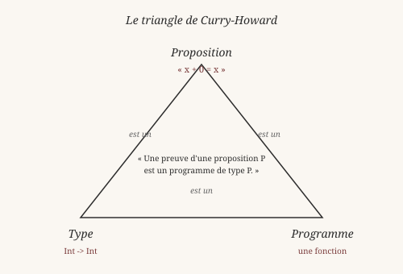
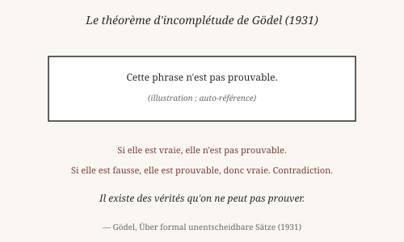

# Chapitre 8 — Preuves et théorèmes

> *« Prouver, c'est contraindre l'imagination à ne plus pouvoir
> douter. »*
> — Gottfried Wilhelm Leibniz

Heaven possède des mécanismes expérimentaux pour exprimer des
théorèmes et tenter de les résoudre. Il dispose aussi d'un petit
noyau de vérification de termes typés. Mais toutes les méthodes de
preuve du langage ne produisent pas aujourd'hui un certificat
indépendamment vérifié. Ce chapitre distingue les possibilités
effectives, les garanties du noyau et les travaux encore nécessaires.

## 1. Opinion vraie et savoir (rappel)

Platon, dans le *Ménon*, distinguait deux choses :

- Une **opinion vraie** — une croyance qui se trouve être correcte,
  mais dont on ne sait pas *pourquoi*.
- Un **savoir** — une croyance correcte qu'on peut **justifier**.

L'esclave du *Ménon* peut répondre correctement à une question de
géométrie. Il a une opinion vraie. Mais il ne peut pas **prouver**
sa réponse. Il ne sait pas ce qu'il sait.

Un programme qui passe tous ses tests ressemble à l'esclave. Il
**marche**. Il fait ce qu'il fait. Mais peut-on **prouver** qu'il
fait toujours ce qu'il prétend ? C'est une autre question.

Heaven essaie de répondre à cette question. Il permet d'écrire des
programmes qu'on peut non seulement **exécuter**, mais **prouver**
corrects.

## 2. Curry-Howard : preuves = programmes

En 1934, le mathématicien américain Haskell Curry (1900-1982)
remarque une correspondance frappante entre la logique et le calcul.
En 1969, William Alvin Howard la formalise dans un article resté
célèbre. Aujourd'hui, on l'appelle la **correspondance de
Curry-Howard** :

- Une **proposition** logique est un **type** en programmation.
- Une **preuve** de cette proposition est un **programme** de ce
  type.
- Vérifier une preuve, c'est **type-checker** un programme.

C'est une des découvertes les plus profondes du XXᵉ siècle. Elle
dit que la logique et le calcul ne sont pas deux mondes séparés —
ce sont **le même** monde, vu sous deux angles.

Un exemple simple :

- **Proposition** : `A → B → A` (de A on déduit B on déduit A).
- **Type** : `a -> b -> a`.
- **Preuve / programme** : `\x y. x` — une fonction qui rend son
  premier argument, quel que soit le second.

Le théorème logique et la fonction sont **le même objet**. C'est
pourquoi Heaven peut être à la fois un langage de programmation et
un assistant de preuve.

## 3. Le noyau de vérification

Heaven ne repose pas sur le **Calcul des Constructions Inductives**
(CIC) de Coq/Rocq. Son implémentation possède un noyau de vérification
dépendant, plus petit et beaucoup plus limité. Il ne faut donc pas
confondre l'inspiration théorique de Heaven avec une implémentation
complète du CIC.

Le noyau contient notamment des mécanismes de typage et de vérification
de termes de preuve. Son fragment arithmétique inclut des déclarations
typées pour `Nat`, `zero`, `succ`, `add` et `nat_ind`, ainsi que des
règles de réduction. Certaines de ces déclarations appartiennent à
la base de confiance du système : elles ne sont pas toutes dérivées
par des preuves Heaven.

Un exemple important est la règle de réduction
`add(n, zero) -> n`, explicitement traitée comme une règle admise
(*FIAT*) dans le code du noyau. Cette base de confiance doit être
documentée : une vérification n'est jamais plus forte que les
définitions, axiomes et règles auxquels elle fait confiance.

Le noyau sait vérifier certains termes dans ce fragment. Cela ne
signifie pas qu'il implémente toutes les constructions du CIC, ni
qu'il sait vérifier toutes les preuves produites par les tactiques.

> **État réel (2026-11-18).** Le noyau actif est distinct des anciens
> composants de typage et de preuve qui subsistent dans le dépôt.
> `src/core/proof_core.zig` gère les théorèmes et les méthodes de
> résolution ; `src/kernel/` contient les mécanismes de vérification.
> La vérification du noyau couvre un fragment limité. En particulier,
> le chemin d'induction actuel construit un certificat spécialisé
> pour `add_comm` sans relier son type au théorème demandé : il ne
> constitue donc pas une certification générale fiable.
> Voir `docs/spec/_claims_vs_reality.md`.

## 4. Théorème et méthodes de résolution

En Heaven, un **théorème** est une affirmation enregistrée. Une
commande `prove` demande au système d'essayer de la résoudre.

On rencontre notamment cette syntaxe :

    heaven> theorem deux_plus_deux : 2 + 2 = 4
    heaven> prove deux_plus_deux by eval

La déclaration d'un théorème et la réussite d'une méthode de
résolution ne doivent pas être confondues avec une certification
par le noyau.

Les méthodes disponibles n'offrent pas toutes les mêmes garanties :

- **`eval`** évalue les deux côtés d'une expression fermée et compare
  les résultats. Une réussite est classée comme équivalence canonique,
  pas comme certification du noyau.
- **`simplify`** applique une chaîne de réécritures et de simplifications.
  Si les deux côtés deviennent structurellement identiques, le résultat
  est également classé comme équivalence canonique.
- **`induction`** est expérimental. Son implémentation actuelle ne
  relie pas correctement le certificat construit au théorème soumis.
  Elle ne doit donc pas être considérée comme une preuve générale
  certifiée.

Les statuts internes distinguent notamment
`canonically_equivalent`, `solved` et `kernel_certified`.
Seul ce dernier correspond à une certification du noyau.
Une commande qui réussit ou un théorème affiché comme résolu ne
suffisent pas à établir ce statut.

**Objectif de conception :** les tactiques devraient produire des
termes de preuve que le noyau vérifie indépendamment. Cette séparation
est essentielle pour qu'une erreur dans une tactique ne puisse pas
être prise pour une preuve correcte.

**État réel :** cette architecture n'est pas encore réalisée de bout
en bout pour toutes les méthodes. En particulier, `ProofSession.finish`
marque une session comme `.solved` lorsque ses objectifs sont résolus ;
cette opération ne réalise pas, à elle seule, une certification par
le noyau.

## 5. Trous et raffinement

Heaven dispose d’un mécanisme de gestion des trous dans les arbres
d’expressions. Le symbole `_` crée un nœud représentant une expression
encore indéterminée.

La commande `:refine <id> <expr>` associe une expression à un trou
existant. La commande `:hole` affiche les trous enregistrés, leur
identifiant et leur éventuel raffinement.

Ce mécanisme repose sur deux structures :

- `holes` conserve les identifiants de tous les trous créés ;
- `subst` associe les identifiants raffinés aux expressions qui les
  remplacent.

Un trou raffiné reste donc enregistré et visible dans l’inventaire.
La fonction `hasUnresolvedHoles` permet de détecter les trous non
raffinés dans un arbre d’expressions.

**Limite importante :** raffiner un trou ne vérifie pas que
l’expression associée satisfait un type ou démontre une proposition.
Ce mécanisme de substitution ne constitue pas un assistant de preuve
certifié par le noyau.

## 6. Capacités et limites actuelles

Il faut distinguer ce que le système sait calculer, ce que ses méthodes
de résolution savent reconnaître et ce que le noyau sait certifier.

**Ce qui est actuellement disponible :**

- L'évaluation d'expressions fermées avec `eval`.
- La simplification et la comparaison structurelle après réécriture
  avec `simplify`.
- L'enregistrement de théorèmes et le suivi d'objectifs interactifs.
- Un noyau de vérification typée pour un fragment limité de termes
  et de constructions arithmétiques.

**Ce qui n'offre pas encore de garantie générale :**

- L'induction sur les naturels : le chemin actuel présente un défaut
  de correspondance entre le théorème demandé et le certificat
  construit. Il ne faut pas utiliser son résultat comme preuve
  générale certifiée.
- Les inégalités et les ordres partiels comme propositions disposant
  d'une infrastructure générale de preuve.
- La composition générale de théorèmes certifiés et de preuves
  dépendant les unes des autres.
- Les preuves générales d'équivalence entre fonctions.

Une expression comme `(< 2 3)` peut être calculée et produire
`true`. Cela ne signifie pas que le système sait construire et
certifier une preuve propositionnelle générale de `2 < 3`.

Ces distinctions sont importantes : **calculer**, **résoudre
canoniquement** et **certifier par le noyau** sont trois opérations
différentes.

## 7. Le théorème de Gödel

En 1931, le logicien autrichien Kurt Gödel (1906-1978) démontre un
théorème qui bouleverse les fondations des mathématiques. Son énoncé
informel :

> *Tout système formel suffisamment puissant pour décrire
> l'arithmétique contient des propositions vraies qu'on ne peut
> pas prouver dans ce système.*

Gödel construit, dans un système formel capable de représenter
une partie suffisante de l'arithmétique, une phrase qui exprime
indirectement sa propre non-démontrabilité dans ce système.

L'idée informelle « cette proposition n'est pas démontrable ici »
résume cette construction, mais ne constitue pas à elle seule
la démonstration. Le résultat mathématique dépend de propriétés
précises du système, notamment sa cohérence et sa capacité à
formaliser l'arithmétique.

Sous les hypothèses du premier théorème d'incomplétude, il existe
des énoncés que le système ne peut pas démontrer. La formulation
populaire « une proposition vraie mais indémontrable » demande
des précautions supplémentaires selon les hypothèses retenues.

Ce n'est pas un défaut du système. C'est une **limite intrinsèque**
de tout système formel assez puissant. Le mathématicien anglais
Roger Penrose en a tiré des arguments philosophiques sur la nature
de la conscience (*The Emperor's New Mind*, 1989). D'autres,
comme Douglas Hofstadter dans *Gödel, Escher, Bach* (1979), y ont
vu une leçon plus générale sur l'auto-référence.

Heaven, comme tout langage fondé sur un système formel, est
**concerné** par ce théorème. Il y aura toujours des propositions
qu'on ne peut pas prouver en Heaven. Mais :

- C'est **normal** — tous les langages logiques sont dans ce cas.
- Ce n'est **pas grave** — on peut prouver beaucoup de choses
  utiles.
- C'est **philosophiquement intéressant** — on sait qu'on ne saura
  jamais tout.

Wittgenstein, dans le *Tractatus* (§6.54), disait : *« Mes
propositions servent d'échelons : celui qui les comprend finit par
les reconnaître comme absurdes, quand il les a utilisées pour monter
au-dessus d'elles. »* Gödel a formalisé une version de cette idée :
certaines vérités ne peuvent être *dites* dans le système, seulement
*montrées* de l'extérieur.

## Ce qu'on a appris

- Platon (*Ménon*) : la différence entre **opinion vraie** et
  **savoir**.
- **Curry-Howard** (Curry 1934, Howard 1969) : propositions =
  types, preuves = programmes.
- Heaven possède un **noyau de vérification expérimental**, limité à
  un fragment de types et de termes de preuve.
- Un **théorème** s'écrit `theorem t : ...`. Une tentative de
  résolution se donne avec `prove t by <tactique>`.
- Les méthodes `simplify`, `eval` et `induction` n'offrent pas
  toutes les mêmes garanties.
- Les **trous** (`_`) et le **raffinement** (`:refine`) permettent
  d'explorer une preuve pas à pas, sans garantir à eux seuls une
  certification par le noyau.
- Les inégalités et les ordres partiels ne disposent pas encore
  d'une infrastructure générale de preuve.
- Le **théorème de Gödel** (1931) établit, sous certaines hypothèses,
  des limites fondamentales des systèmes formels.

Wittgenstein aurait vu dans la preuve une **grammaire** : un
ensemble de règles qui disent ce qui compte comme justification.
Prouver, c'est *suivre des règles* — pas *voir la vérité*.
Le noyau de vérification définit une partie de ces règles, avec
une portée et une base de confiance qu'il faut expliciter.

Leibniz, encore lui, rêvait d'un langage où « deux philosophes
pourraient résoudre un désaccord en disant : *calculons* ». Heaven
est un pas modeste dans cette direction.

Au chapitre suivant, on descend des hauteurs théoriques pour
aborder le **monde réel** : fichiers, réseau, acteurs, appels C.
Comment Heaven interagit avec le monde extérieur, ses fichiers,
son réseau et ses contraintes d'exécution.
