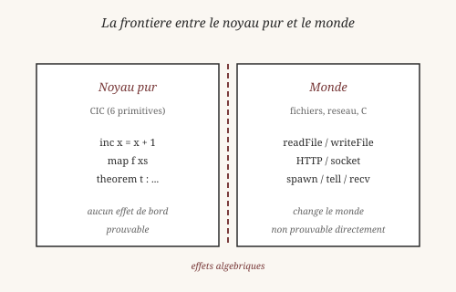
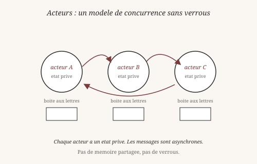
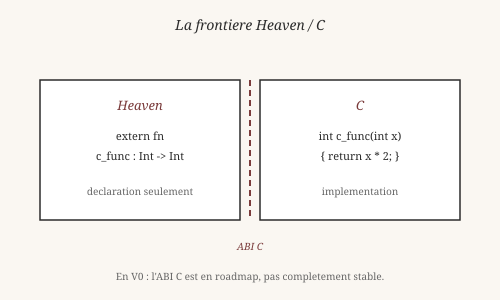

# Chapitre 9 — Le monde réel

> *« La théorie, c'est quand on sait tout et que rien ne fonctionne.
> La pratique, c'est quand tout fonctionne et que personne ne sait
> pourquoi. »*
> — Proverbe attribué à Einstein

Jusqu'ici, on a manipulé des valeurs abstraites : listes, streams,
théorèmes. Il est temps de faire quelque chose d'utile. Ce chapitre
montre comment Heaven interagit avec le monde extérieur.

## 1. Sortir du noyau pur

Le noyau CIC est **pur** : il calcule, il prouve, il ne fait rien
d'autre. Mais un programme réel doit lire un fichier, écrire sur un
disque, envoyer un message. Comment concilier les deux ?

La réponse tient en une phrase : *on sépare le calcul de l'effet*.
Le noyau reste pur. Les effets passent par des **portes étroites**
(`perform` et `handle`, chapitre 6) qui traduisent le pur en impur,
et inversement.

Cette séparation a un nom en philosophie. Le linguiste et
philosophe John Searle (né en 1932) distingue, dans *Intentionality*
(1983), la **causalité intentionnelle** (ce que l'esprit veut faire)
de la **causalité physique** (ce que le corps fait effectivement).
Le noyau CIC est la partie intentionnelle — il décrit ce qu'on
veut. Les effets sont la partie physique — ils le réalisent.

## 2. Lire et écrire un fichier

La porte la plus simple vers le monde : les fichiers.

    heaven> readFile "data.txt"
    ✓ ... (le contenu, sous forme de string)

`readFile` rend le contenu du fichier comme une chaîne. Si le
fichier n'existe pas, l'appel produit une erreur — qu'on peut
capturer avec `handle` (chapitre 6) :

    heaven> handle (readFile "data.txt") errorHandler

L'écriture est symétrique :

    heaven> writeFile "sortie.txt" "bonjour"
    ✓ ()

`writeFile` ne rend rien (`()` — Unit, chapitre 2), mais il **agit**.
C'est un effet, comme `perform "Log"` du chapitre 6 — mais un effet
qui atteint le disque.

Un point philosophique important : *lire un fichier n'est pas une
fonction*. Une même lecture peut donner deux résultats différents à
deux instants différents (le fichier a pu changer). C'est un
performatif au sens d'Austin (chapitre 6) : lire, c'est aussi agir
sur le temps.

## 3. Le serveur HTTP

Heaven embarque un serveur HTTP. On l'a vu en détail au chapitre 6
(le serveur statique natif, `core/http.hvn`). Reprenons l'idée :

    $ ./zig-out/bin/heaven run serve.hvn
    # attendre ~8 secondes (chargement des modules std)
    # puis dans un autre terminal :
    $ curl http://localhost:8080/egraph-viz/

Un serveur HTTP 100% Heaven, qui lit des fichiers, construit des
réponses, et les envoie sur un socket. Pas de libc, pas de Zig, pas
de Python — juste les **magics IO natives** (`raw_syscall6`,
`io_read`, `io_write`, `io_open`).

C'est un exemple concret de ce que les effets du chapitre 6
permettent : écrire du code qui **agit** sur le monde, tout en
restant vérifiable dans sa structure.

Le philosophe et sociologue Max Weber (1864-1920) parlait de
**rationalisation** : le passage d'une action traditionnelle à une
action techniquement coordonnée. Un serveur HTTP en Heaven est un
exemple de cette rationalisation — chaque couche (syscall, protocole,
réponse) est justifiée par une spécification, pas par une habitude.

## 4. Les acteurs

Le modèle d'**acteurs** vient de Carl Hewitt (1973), et a été
popularisé par Joe Armstrong avec Erlang (1986). C'est un modèle de
concurrence sans mémoire partagée :

- Un **acteur** est un objet avec un état privé et une boîte aux
  lettres.
- Un acteur ne communique **que** par messages — pas de variable
  partagée, pas de verrou.
- Chaque acteur traite ses messages **un par un**, dans l'ordre
  d'arrivée.

En Heaven :

    heaven> actor Counter state =
              recv (lambda msg.
                tell (pair "count" (state + 1))
                (Counter (state + 1)))

L'acteur `Counter` reçoit un message, incrémente son état, répond
avec `tell`, et se relance. Trois primitives : `spawn` (créer),
`tell` (envoyer), `recv` (recevoir). C'est tout.

Le modèle d'acteurs est **conservateur** : il n'y a rien à protéger
(sinon les boîtes aux lettres), donc pas besoin de verrous. C'est
l'équivalent en programmation de ce que le sociologue Niklas
Luhmann (1927-1998) appelait les **systèmes autopoïétiques** : des
systèmes qui se maintiennent par leurs propres communications, sans
contrôle central.

Heaven V0 supporte les acteurs en mode **séquentiel** (pas de
préemption). Depuis 2026-10, un contournement coopératif existe :
`(@budget_left)` permet à une tâche de `yield` quand son budget est
épuisé (voir chapitre 13). Voir D8 et D31 dans `docs/DECISIONS.md`.

*Vérifiable : les exemples `readFile`, `writeFile` et le serveur
HTTP fonctionnent tels quels. Les acteurs fonctionnent mais sans
préemption (V0).*

## 5. L'ABI C

Un langage jeune ne peut pas tout faire. Pour les bibliothèques
existantes (crypto, graphics, base de données), il faut pouvoir
appeler du code C. C'est ce qu'on appelle une **ABI** (Application
Binary Interface).

En Heaven, l'appel à C se déclare avec `extern fn` :

    heaven> extern fn c_func : Int -> Int
    ✓ extern c_func : Int -> Int

    heaven> c_func 21
    42

La déclaration dit à Heaven : « il existe une fonction `c_func`
quelque part, qui prend un `Int` et rend un `Int` ». À l'exécution,
le noyau fait le pont entre les deux mondes.

C'est une **frontière** au sens propre : d'un côté, le noyau pur
CIC ; de l'autre, du code C impur, avec sa propre sémantique, ses
propres conventions, ses propres risques. Le pont entre les deux est
mince, explicite, contrôlé.

Le sociologue Bruno Latour (né en 1947) parle de **traduction** entre
mondes : il n'y a pas de passage direct d'un univers à un autre, il
y a des **médiateurs** qui font le travail. L'ABI C est un tel
médiateur — il traduit `Int` Heaven en `int` C, et réciproquement.

**En V0** : l'ABI C existe mais reste en roadmap. Elle fonctionne
pour les cas simples, pas pour les structures complexes (records,
callbacks). C'est une limite documentée.

## 6. Vessel et le REPL web

Heaven embarque aussi un serveur web plus riche, appelé **Vessel**,
écrit en Zig. Il sert :

- Le **REPL web** : `https://aziz-abouchi.github.io/heaven`
- Le module **WASM** compilé
- Les **tests navigateur**
- Quelques **endpoints API**

L'intérêt : on peut essayer Heaven **sans rien installer**. Un
navigateur, une URL, et l'environnement complet est disponible.

C'est une décision philosophique autant que technique. Le logiciel
libre a souvent un **seuil** : télécharger, installer, configurer.
Vessel abaisse ce seuil à zéro. Le scientifique et philosophe des
sciences Bruno Latour parlait de « **centres de calcul** » : les
lieux où l'on peut essayer les choses sans engagement. Vessel est un
tel centre — on peut essayer Heaven avant de décider de l'adopter.

## 7. Ce qui reste fragile

Il faut être **honnête** sur l'état de V0. Ce qui marche :

- `readFile`, `writeFile`, `print`, `readLine` (via effets).
- Le serveur HTTP statique (`core/http.hvn`).
- Vessel et le REPL web.
- Les acteurs en mode séquentiel.
- L'ABI C pour les cas simples.

Ce qui reste en chantier :

- **ABI C complète** — structures, callbacks, gestion mémoire
  partagée.
- **Acteurs préemptifs** — D8 vraies continuations (2-3 sessions).
- **Endpoints HTTP dynamiques** — `/api/egraph` pour la viz, non
  servis actuellement.
- **DebugAllocator** — fuite intermittente, contournée par
  `HEAVEN_NO_LEAK_CHECK=1`.
- **TCO complète** — la récursion terminale simple marche, la TCO
  mutuelle et les cas complexes non.

C'est **cohérent** avec ce qu'on a vu : chaque chapitre du livre
distingue **ce qui marche** de **ce qui reste à faire**. La V0 n'est
pas un brouillon — c'est une **base stable** avec des frontières
assumées.

Le philosophe des sciences Thomas Kuhn (1922-1996) parlait de
**science normale** par opposition aux **révolutions** : une période
où le paradigme est stable, où l'on résout des énigmes dans le cadre
existant. Heaven V0 est en science normale : le noyau CIC est
stable, les extensions sont progressives.

## Ce qu'on a appris

- Le noyau CIC est **pur**. Les effets (`perform`/`handle`) sont des
  **portes étroites** vers le monde impur.
- **Searle** (1983) : causalité intentionnelle vs physique.
- **`readFile`** et **`writeFile`** sont des effets simples mais
  puissants. Un fichier peut changer entre deux lectures — c'est un
  performatif.
- Un **serveur HTTP** complet peut s'écrire en 90 lignes de Heaven
  pur (`core/http.hvn`).
- Le **modèle d'acteurs** (Hewitt 1973, Armstrong 1986) évite les
  verrous par construction. Trois primitives : `spawn`, `tell`,
  `recv`.
- L'**ABI C** permet d'appeler du code C existant. En V0, partiel.
- **Vessel** sert le REPL web et abaisse le seuil d'entrée à zéro.
- V0 est stable mais **incomplet** : voir la section 7 pour les
  frontières exactes.

Le philosophe Bruno Latour aurait vu dans ces ponts (effets, ABI,
Vessel) des **médiateurs** entre mondes : le pur et l'impur, le
calculable et l'exécutable, l'abstrait et le concret. Heaven est
fait de tels ponts — petits, explicites, contrôlés.

Au chapitre suivant, on continue dans le monde réel : les
**modules**. Comment organiser du code en unités cohérentes, comment
les importer, comment les nommer.

*Vérifiable : les exemples `readFile`, `writeFile`, `extern fn`,
et l'accès à Vessel fonctionnent tels quels dans le REPL ou dans le
navigateur (selon le cas).*

