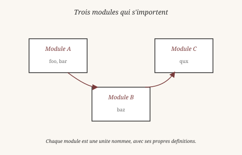
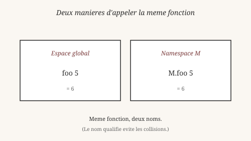
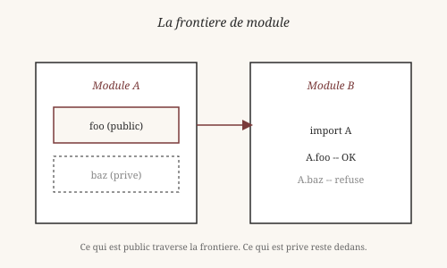

# Modules : organiser le sens

> *« Un programme qui tient dans un fichier est un programme qui
> ne grandit pas. »*
> — Anonyme

Depuis septembre 2026, Heaven a un système de modules minimal mais
utilisable. Ce chapitre montre comment organiser du code en unités
cohérentes, comment les importer, et comment les nommer.

## 1. Pourquoi découper ?

Quand un programme dépasse une centaine de lignes, il devient
difficile à comprendre d'un seul regard. On a besoin de le
**découper** en unités plus petites, chacune avec une responsabilité
claire.

Aristote, dans la *Métaphysique* (livre Δ), distingue **l'unité
par contiguïté** (des choses collées ensemble) de **l'unité par
forme** (des choses qui participent à une même idée). Un tas de
pierres est unité par contiguïté. Un organisme est unité par forme :
chaque partie a une fonction, et le tout a une finalité.

Un **module** est une unité par forme. Ce n'est pas juste un fichier
découpé — c'est un ensemble de définitions qui **vont ensemble**,
avec un nom, une frontière, et une responsabilité.

## 2. Ouvrir un namespace

Le mot-clé est `module`. Il ouvre un **namespace** : un espace de
noms qui peut être référencé par un préfixe.

    heaven> module M
    ✓ module M ouvert

    heaven> foo x = x + 1
    ✓ clause enregistrée pour 'foo'

    heaven> M.foo 5
    6

    heaven> foo 5
    6

Une chose importante à remarquer : `foo` **reste accessible** par
son nom global. C'est le comportement par défaut en V0, appelé
« non-strict ». Le nom qualifié `M.foo` **s'ajoute** au nom global
`foo` — il ne le remplace pas.

C'est une décision de design. Le philosophe du langage Paul Grice
(1913-1988) a montré, dans ses travaux sur la **signification du
locuteur**, que le même mot peut avoir plusieurs usages selon le
contexte. Heaven applique cette idée : `foo` et `M.foo` désignent
la **même** fonction, mais avec deux degrés de précision.

## 3. Importer un fichier

Un module seul ne sert à rien — il faut pouvoir en **importer**
d'autres. Deux syntaxes :

    heaven> import "core/stream.hvn" as Stream
    ✓ import Stream

Le nom est déduit du **basename** si `as` est absent :

    heaven> import "core/stream.hvn"
    ✓ import stream

On peut aussi utiliser la forme courte, sans guillemets :

    heaven> import Stream
    ✓ import Stream

Cette forme cherche dans deux endroits :

- `core/std/stream.hvn` — la bibliothèque standard.
- `core/stream.hvn` — les modules racine.

Le nom est mis en minuscules pour le fichier (`stream`), mais le
namespace est en capitales (`Stream`). C'est la convention du
projet : fichiers en minuscules, namespaces en CamelCase.

## 4. Comment un module trouve ses voisins

Si un import n'est pas trouvé dans le répertoire courant, Heaven
cherche dans une variable d'environnement appelée `HEAVEN_PATH`.
C'est la même idée que `PATH` sur Unix : une liste de répertoires
où chercher.

    $ export HEAVEN_PATH=".:$HOME/heaven-modules"

L'import devient alors résilient : peu importe où on lance le
programme, Heaven trouvera le module s'il est quelque part dans le
chemin.

C'est une idée ancienne. Le **filesystem hiérarchique** d'Unix
(1970) reposait déjà sur la même logique : au lieu de tout mettre
dans un même répertoire, on organise par **chemins**. Chaque niveau
a un rôle. Le nom `HEAVEN_PATH` suit cette tradition.

## 5. Anti-shadowing : protéger les magics

Une question délicate : que se passe-t-il si un utilisateur définit
une fonction du même nom qu'une **magic** du noyau ? Par exemple,
`if`, `let`, `perform`.

En V0, `evalEquation` **refuse** ces redéfinitions. Si on essaie
d'écrire :

    heaven> if x = x + 1
    ✗ refusé : 'if' est une magic réservée

C'est une **garde anti-shadowing**. Elle protège le noyau contre
des redéfinitions accidentelles. Si on autorisait `if` comme nom de
fonction, on ne pourrait plus utiliser la conditionnelle `if` — le
langage s'auto-détruirait.

Cette garde est philosophiquement intéressante. Elle applique une
distinction entre **le vocabulaire** (les mots ordinaires) et **la
grammaire** (les règles de la langue). On peut inventer autant de
mots qu'on veut — mais on ne peut pas changer les règles en cours
de route. Wittgenstein aurait dit : *« on ne peut pas réviser les
règles du jeu pendant qu'on joue »*.

## 6. Ce qui reste fragile en V0

Le système de modules est **minimal** mais utile. Voici ses limites :

- **Namespace plat** — `A.B.foo` est une clé string, pas une
  hiérarchie sémantique. `A.B.foo` et `A_B.foo` sont deux noms
  différents.
- **Pas de rechargement dynamique** — une fois un module chargé, on
  ne peut pas le remplacer.
- **Pas de sélection d'import** — on ne peut pas écrire
  `import List (map, filter)` pour n'importer que certaines
  fonctions.
- **Alias limité** — `M.x` marche pour `fn`, `let`, et `theorem`.
  Les constructeurs et les `data` ne sont pas encore aliasés.
- **Mode non-strict par défaut** — `foo` reste accessible. Le mode
  strict (namespace obligatoire) existe (`strict on`), mais c'est
  l'exception.

Ces limites sont **assumées**. Le système de modules rend service
sans être complet. Une V1 plus riche viendra quand les use cases
l'exigeront.

Le sociologue des organisations Herbert Simon (1916-2001) a montré,
dans *The Sciences of the Artificial* (1969), que les systèmes
complexes sont **quasi-décomposables** : ils ont des frontières
internes solides, mais pas absolues. Un module Heaven est une telle
frontière — solide pour ce qui est public, mais pas étanche. On
peut encore tout voir de l'extérieur si on veut.

## Ce qu'on a appris

- Un **module** est une unité par forme (Aristote) : ses parties
  vont ensemble par responsabilité, pas par contiguïté.
- Le mot-clé `module` ouvre un **namespace**. `M.foo` s'ajoute à
  `foo` (mode non-strict).
- **`import`** charge un fichier, avec ou sans alias (`as`).
- La **forme courte** `import Nom` cherche dans `core/std/` puis
  `core/`.
- **`HEAVEN_PATH`** permet de chercher ailleurs (héritage Unix).
- La **garde anti-shadowing** protège les magics (`if`, `let`,
  `perform`) contre la redéfinition.
- En V0, le système est **plat** et minimal, mais utilisable.

Wittgenstein aurait vu dans les modules une illustration de son
« jeu de langage » : chaque module est un jeu avec ses propres
règles, ses propres noms, ses propres conventions. Importer un
module, c'est apprendre un nouveau jeu — sans quitter le grand jeu
commun qu'est Heaven.

Au chapitre suivant, on aborde une question plus ambitieuse :
comment représenter du **savoir**, pas seulement du code. Le module
`Knowledge` de Heaven stocke des faits, des règles, des assertions
avec provenance. C'est une autre manière d'organiser le sens.

*Vérifiable : `module M`, `import Stream`, `M.foo` et le refus des
magics fonctionnent tels quels dans le REPL.*

