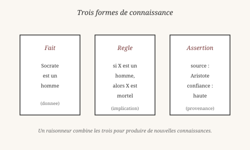
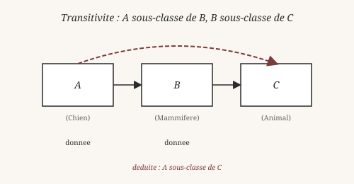
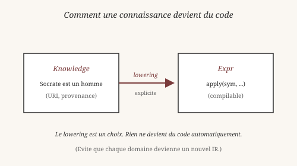

# Chapitre 11 — Knowledge : raisonner sur le monde

> *« Nous ne connaissons pas le monde, nous connaissons seulement
> des propositions sur le monde. »*
> — Karl Popper, *La Connaissance objective* (1972)

Jusqu'ici, Heaven manipule principalement des programmes, des
valeurs et des preuves. Mais un système distribué, un outil de
raisonnement, ou une base de données doit aussi pouvoir représenter
des **connaissances** provenant de sources différentes.

Heaven possède pour cela une couche **Knowledge**. Elle est
volontairement séparée de `Expr` (le noyau compilable).

## 1. Une connaissance n'est pas un programme

Le noyau de Heaven utilise `Expr` comme IR compilable unique :

    source
      |
      v
    Expr
      |
      v
    MIR
      |
      v
    backend

Knowledge suit une autre voie :

    RDF / connaissances
          |
          v
    KnowledgeStore
          |
          v
       reasoner

Une connaissance **ne devient pas** automatiquement du code. Si une
connaissance doit finalement participer à un calcul, un **lowering
explicite** pourra la transformer en `Expr`. Mais ce n'est pas
automatique.

Cette séparation évite de transformer chaque domaine de
raisonnement en nouvel IR. C'est une décision de design qui a un
nom : *garder le noyau petit, et les extensions explicites*.

Le philosophe autrichien Karl Popper (1902-1994) proposait de
distinguer **trois mondes** :

- **Monde 1** — les objets physiques (le caillou, l'arbre).
- **Monde 2** — les états mentaux (ma perception de l'arbre).
- **Monde 3** — les contenus objectifs de la pensée (la théorie
  scientifique sur l'arbre, la proposition « l'arbre est un
  chêne »).

Knowledge appartient au **monde 3** : des contenus objectifs, avec
leurs relations, indépendamment de qui les pense. `Expr` est du
monde 1 : du code qu'on peut exécuter, compiler, manipuler.

La séparation est philosophique : *ce qu'on sait* n'est pas *ce
qu'on exécute*. Confondre les deux, c'est croire que toute
connaissance est un programme. C'est faux.

## 2. Fait, règle, assertion

Le module `Knowledge` distingue trois sortes de contenus.

**Les faits** — des énoncés simples, sans condition. Par exemple :
« Socrate est un homme ».

**Les règles** — des implications conditionnelles. Par exemple :
« Si X est un homme, alors X est mortel ».

**Les assertions** — des faits ou règles **attribués** à une source,
avec un degré de confiance. Par exemple : « Aristote affirme que
Socrate est un homme », avec une confiance élevée.

La distinction est essentielle. Un fait peut être vrai ou faux. Une
assertion est la **prétention** qu'un fait est vrai, attribuée à
quelqu'un. C'est la même distinction qu'en épistémologie : une
croyance vraie n'est pas encore un savoir — il faut pouvoir la
**justifier** (Platon, *Ménon*, chapitre 8).

Une ressource est identifiée par une **URI** (Uniform Resource
Identifier) :

    http://example.org/Socrate
    http://example.org/homme
    http://example.org/mortel

Les URI viennent du Web sémantique (Berners-Lee, 2001). L'idée : au
lieu de donner des noms locaux, on donne des **noms globaux** qui
peuvent être partagés entre systèmes. C'est une extension de la
logique de Peano : *au lieu de nommer les objets par convention,
on les nomme par identité mondiale*.

## 3. Le premier raisonneur

Un **raisonneur** (reasoner) combine les faits et les règles pour
produire de **nouvelles connaissances**. Heaven en a un, minimal
mais réel : le raisonneur de **subsomption** (*subClassOf*
transitif).

La règle :

    Si A ⊑ B et B ⊑ C, alors A ⊑ C.

Lisez `⊑` comme « est une sous-classe de ». Un exemple :

    Chien ⊑ Mammifere
    Mammifere ⊑ Animal
    ------------------
    Chien ⊑ Animal      (deduit)

Le raisonneur applique cette règle par **chaînage** : il suit les
liens de subsomption jusqu'à ce qu'il n'y ait plus rien à déduire.
C'est l'ancêtre des moteurs d'inférence modernes (Datalog, Prolog)
et du RDFS (Resource Description Framework Schema, W3C 2004).

Aristote avait déjà formalisé cette idée dans les *Premiers
Analytiques* : le **syllogisme** Barbara (« Tous les hommes sont
mortels ; Socrate est un homme ; donc Socrate est mortel »). Le
raisonneur de Heaven en est une version calculable.

## 4. Confiance et provenance

Un raisonneur qui produit de nouvelles connaissances doit pouvoir
dire **d'où** elles viennent, et **à quel point** on y croit.

Heaven attache à chaque assertion :

- Une **provenance** — la source qui l'a produite (utilisateur,
  fichier, raisonneur, URL).
- Un **statut** — asserté, déduit, ou inféré.
- Une **confiance** — un score entre 0 et 1.

Ces trois attributs permettent de distinguer :

- Une connaissance **directement observée** (confiance 1.0).
- Une connaissance **déduite** par une règle fiable (confiance 0.9).
- Une connaissance **spéculative** (confiance 0.3).

Le sociologue des sciences Bruno Latour (né en 1947) a montré, dans
*La Science en action* (1987), que la science est un **réseau de
traductions** : chaque fait est relié à d'autres par des chaînes de
justifications. La provenance dans Heaven est un tel réseau, réduit
à sa forme minimale.

## 5. Le lowering vers Expr

Une connaissance peut devenir du code — mais **seulement si on le
demande explicitement**. Le passage de `Knowledge` à `Expr` s'appelle
un **lowering**.

    knowledge : Socrate est un homme
                  |
                  v
    expr : apply(sym("est_un_homme"), [sym("Socrate")])

Le lowering n'est pas automatique. C'est un **choix**, fait par
l'utilisateur ou par une passe explicite. Cela évite qu'une
connaissance devienne du code par accident, ou que deux
connaissances contradictoires produisent du code incohérent.

Cette décision suit le principe de **séparation des préoccupations**
(Dijkstra, 1974). Un système qui fait plusieurs choses doit les
séparer en couches, chacune avec ses propres règles. Knowledge et
Expr sont deux couches. Le lowering est le pont — explicite, mince,
contrôlé.

## 6. Ce qui reste fragile en V0

Le module `Knowledge` est un **POC** (proof of concept). Ce qui
marche :

- Stockage de faits et d'assertions avec provenance.
- Le raisonneur de subsomption transitive.
- Le lowering explicite vers `Expr`.

Ce qui est **hors périmètre** en V0 :

- **OWL** (Web Ontology Language) complet.
- **SPARQL** (langage de requête RDF).
- La **fusion implicite** via `sameAs` (équivalence).
- Un **second IR spécialisé** — Knowledge reste séparé d'Expr.
- Les raisonneurs avancés (description logics, contraintes).

Ces limites sont documentées dans `docs/ROADMAP.md`. Le module
Knowledge est volontairement minimal : il **fait** ce qu'il fait,
sans prétendre à plus.

Le philosophe Willard Van Orman Quine (1908-2000), dans *Le Mot et
la chose* (1960), parlait de la **toile de croyances** : nos
connaissances forment un réseau dont les bords touchent l'expérience,
mais dont le centre est fait de conventions. Le module Knowledge est
une telle toile — un réseau de faits, de règles, et de sources, où
les bords sont les assertions directes, et le centre les déductions.

## Ce qu'on a appris

- Une **connaissance** n'est pas un programme. Elle vit dans un
  module séparé (`Knowledge`), pas dans `Expr`.
- Popper (*La Connaissance objective*, 1972) distingue trois
  mondes. Knowledge est du **monde 3**.
- Trois formes : **fait**, **règle**, **assertion**. Une assertion
  est un fait attribué à une source, avec confiance.
- Les **URI** donnent des noms globaux (Berners-Lee, Web sémantique).
- Le **raisonneur** de subsomption transitive déduit `A ⊑ C` depuis
  `A ⊑ B` et `B ⊑ C` (Aristote, syllogisme Barbara).
- La **provenance** et la **confiance** distinguent les
  connaissances directes des déduites.
- Le **lowering** vers `Expr` est **explicite**, pas automatique
  (Dijkstra, séparation des préoccupations).
- En V0, Knowledge est un **POC** minimal : pas d'OWL, pas de
  SPARQL, pas de fusion automatique.

Wittgenstein aurait vu dans Knowledge une application de son
« voir comme » : un fait vu comme *énoncé* (à propos du monde) et
vu comme *assertion* (attribué à une source). Deux aspects d'un
même contenu objectif.

Quine aurait ajouté : la toile de croyances ne s'arrête jamais. Il
y a toujours une assertion de plus à rattacher, une règle à
affiner, une source à questionner.

Au chapitre suivant, on continue dans le monde pratique : les
**BigInt**. Comment représenter des nombres arbitrairement grands
dans un langage qui n'a que des entiers 64 bits ? La réponse :
construire une structure de données récursive qui les simule.

*Vérifiable : les faits, règles et assertions de ce chapitre
fonctionnent tels quels dans le REPL (voir `core/knowledge.hvn` et
les tests associés).*

