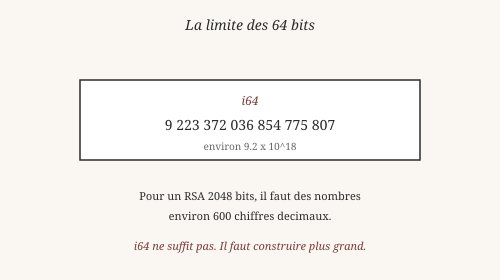
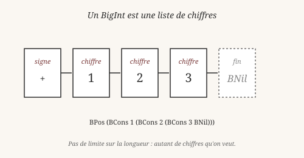
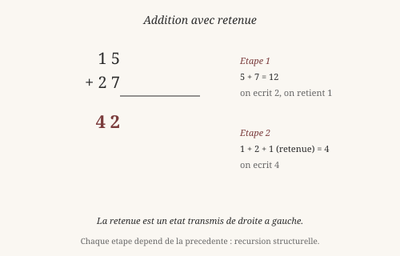

# Chapitre 12 — BigInt : calculer au-delà du fini

> *« Le fini est plus grand qu'on ne le croit. L'infini est plus
> petit qu'on ne l'espère. »*
> — Anonyme

`i64` plafonne à environ `9.2 × 10^18`. C'est déjà beaucoup — un
milliard de milliards. Mais pour les RSA, les tests de primalité, ou
simplement compter les grains de sable d'une plage, ça ne suffit pas.

Heaven fournit un **BigInt** dans `core/bigint.hvn` — entièrement
écrit en Heaven, sans magic supplémentaire.

## 1. Les limites du fini

Un entier de 64 bits peut représenter environ `9 223 372 036 854
775 807` valeurs différentes. C'est **fini**, et c'est **arbitraire**.
Pourquoi 64 bits ? Parce que c'est la taille d'un registre sur les
processeurs modernes — un compromis entre vitesse et capacité.

Mais l'arithmétique n'a pas de limite. Les nombres premiers, les
factoriels, les puissances : tous croissent au-delà de toute borne
finie. Un RSA 2048 bits utilise des nombres d'environ 600 chiffres
décimaux — `i64` ne peut pas les contenir.

La question philosophique est ancienne. Aristote, dans la *Physique*
(livre III), distinguait deux formes d'infini :

- L'**infini en acte** — une totalité infinie, déjà réalisée.
- L'**infini en puissance** — quelque chose qui peut toujours croître,
  mais dont chaque étape reste finie.

Les Grecs rejetaient l'infini en acte. Un BigInt suit cette
intuition : c'est un **infini en puissance**. Chaque nombre est fini,
mais la suite des nombres n'a pas de borne. On peut toujours
**construire** un nombre plus grand — sans jamais avoir besoin d'un
infini actuel.

## 2. Représenter l'infini par une structure

Comment représenter un nombre arbitrairement grand ? La réponse est
simple : comme on l'écrit sur une feuille — **chiffre par chiffre**,
de gauche à droite.

En Heaven, un BigInt est un **signe** suivi d'une **liste de
chiffres** (0 à 9), MSB-first (chiffre de poids fort à gauche) :

    data BList  = BNil | BCons Int BList
    data BigInt = BZero | BPos BList | BNeg BList

Par exemple, `123` s'écrit :

    BPos (BCons 1 (BCons 2 (BCons 3 BNil)))

Trois chiffres, un signe, et un constructeur de fin (`BNil`). Les
zéros de tête sont interdits (sauf pour `BZero`, qui représente
zéro).

C'est une idée profonde : *l'infini se construit avec une structure
finie*. Chaque BigInt a un nombre fini de chiffres — mais rien ne
limite ce nombre. La structure est **récursive** : un BigInt est un
chiffre suivi d'un autre BigInt. C'est la même idée que Peano
(chapitre 4), mais avec 10 chiffres au lieu de `Succ`.

## 3. Addition par retenue

Comment additionne-t-on deux BigInt ? Comme on le fait à la main :
**chiffre par chiffre, avec une retenue**.

L'algorithme :

1. Additionner les chiffres de droite (unités) : `5 + 7 = 12`.
2. Si le résultat dépasse 9, écrire le chiffre des unités (`2`) et
   **retenir** `1` pour la position suivante.
3. Additionner les chiffres suivants, plus la retenue.
4. Répéter jusqu'à épuisement des chiffres.

En Heaven, cette logique se traduit en deux fonctions :

    badd_digits A B retenue = ...
    badd A B                = ...

Le premier paramètre est la **retenue courante**. Elle traverse la
structure de gauche à droite — comme un **état** qui se propage. À
chaque étape, on calcule `(a + b + retenue)`, on extrait le chiffre
(le reste modulo 10) et la nouvelle retenue (le quotient par 10).

C'est une **récursion structurelle** (chapitre 4) : la fonction suit
la structure de la liste, cran par cran. La terminaison est garantie
par la structure de la donnée — quand les deux listes sont épuisées,
il ne reste que la retenue.

Le nom technique est **addition en cascade** (*carry propagation*).
C'est aussi vieux que l'arithmétique écrite : les Babyloniens
faisaient déjà cela en base 60, il y a 4000 ans.

## 4. Multiplication par chiffres

La multiplication est plus délicate. L'algorithme élémentaire — celui
qu'on apprend à l'école — est **quadratique** : pour multiplier deux
nombres de `n` chiffres, il faut `n²` opérations élémentaires.

En Heaven, `bmul` fait exactement cela :

    bmul A B = ...   -- O(n²) multiplications de chiffres

Pour des nombres jusqu'à environ 1000 chiffres, c'est acceptable. Au-
delà, il faut des algorithmes plus fins.

En 1960, le mathématicien soviétique **Anatoli Karatsuba**
(1937-2008) découvre un algorithme en `O(n^1.585)` — plus rapide que
le quadratique. L'idée : au lieu de multiplier les nombres entier,
on les découpe en deux moitiés, et on combine les produits partiels
par des additions et soustractions.

Le gain est modeste pour de petits nombres, mais significatif pour
de grands. L'algorithme de Karatsuba a ouvert une **course aux
algorithmes** : Toom-Cook (1963), Schönhage-Strassen (1971),
Fürer (2007). Chacun améliore l'exposant. Le record actuel est
`O(n log n)` — presque linéaire.

Heaven V0 n'implémente pas Karatsuba. `bmul` est quadratique. C'est
un **chantier documenté** dans `docs/ROADMAP.md`. La dette est
assumée.

## 5. La complexité, ou l'art de mesurer

La complexité algorithmique est une notion moderne. Elle vient de la
**théorie de la calculabilité** des années 1930 (Turing, Church,
Gödel) et de la **théorie de la complexité** des années 1960
(Cook, Karp).

L'idée : au lieu de compter les secondes concrètes (qui dépendent de
la machine), on compte les **opérations élémentaires** en fonction de
la taille de l'entrée. Un algorithme `O(n²)` fait `n²` opérations
pour une entrée de taille `n`. Un algorithme `O(n)` fait `n`. Un
algorithme `O(n^1.585)` fait `n^1.585`.

Pourquoi c'est important ? Parce que `n²` croît vite. Doubler la
taille d'un BigInt multiplie le temps par **4** pour `O(n²)`, par
**3** pour `O(n^1.585)`. Sur un RSA 2048 bits, la différence est
considérable.

Heaven V0 utilise `O(n²)` partout. C'est **honnête** : un algorithme
qui marche, avec une complexité connue. Les algorithmes plus fins
sont des **optimisations**, pas des corrections.

La complexité est aussi une notion philosophique. Le mathématicien
Alan Turing (1912-1954) a montré, dans son article de 1936, qu'il
existe des problèmes **non calculables** — qu'aucun algorithme ne
peut résoudre. La complexité ajoute une dimension : parmi les
problèmes **calculables**, certains sont **faisables** et d'autres
**inabordables**. C'est une frontière plus fine que la calculabilité
pure.

## 6. Ce qui reste fragile en V0

Le module `core/bigint.hvn` marche pour les cas usuels. Voici ses
limites.

**Ce qui marche** :

- Addition (`badd`), soustraction (`bsub`), multiplication (`bmul`).
- Comparaison (`bcmp`).
- Conversion depuis/vers `Int` (`from_int`, `to_int`).
- Conversion depuis/vers string (`from_string`, `bto_string`).
- Tous les signes (positif, négatif, zéro).

**Ce qui ne marche pas encore** :

- **Division** (`bdiv`) au-delà de 1000 chiffres — le tree-walker
  récursif déborde la pile. C'est un chantier de refonte
  (tree-walker itératif, 2-3 sessions).
- **Modulo** rapide pour les grands nombres.
- **Karatsuba** et algorithmes sous-quadratiques.
- **Puissances** (`bpow`) et opérations avancées.

**Résultat** : Heaven V0 peut manipuler des nombres de plusieurs
centaines de chiffres en addition, soustraction, multiplication.
Pour la division, la limite pratique est autour de 1000 chiffres.

La courbe de complexité des algorithmes est une **courbe
d'apprentissage** aussi. On commence par l'algorithme naïf qui
marche. On découvre ensuite qu'il est trop lent. On en cherche un
meilleur. Chaque étape est une **conquête intellectuelle** — pas un
progrès automatique.

Le mathématicien Paul Erdős (1913-1996), connu pour sa prolificité,
disait : *« les mathématiques ne sont pas encore prêtes pour ce
problème »*. C'est parfois vrai. Parfois, il faut inventer une
**théorie** avant de pouvoir résoudre un problème pratique. La
course aux algorithmes de multiplication en est un exemple.

## Ce qu'on a appris

- Un entier 64 bits (`i64`) plafonne à environ `9.2 × 10^18`.
- Aristote (*Physique* III) distinguait l'**infini en acte** et
  l'**infini en puissance**. Un BigInt est en puissance.
- Un BigInt est un **signe + liste de chiffres**. Structure
  récursive, longueur arbitraire.
- L'**addition par retenue** traverse la structure comme un état
  qui se propage (carry propagation).
- La **multiplication** est `O(n²)` en version naïve. **Karatsuba**
  (1960) descend à `O(n^1.585)`.
- La **complexité algorithmique** (Cook, Karp, 1960s) mesure les
  opérations en fonction de la taille de l'entrée.
- En V0, `bdiv` est limité à environ 1000 chiffres par la pile
  récursive. Chantier documenté.
- Karatsuba et les algorithmes sous-quadratiques sont en roadmap.

Aristote aurait aimé les BigInt. Sa distinction entre l'infini en
acte et l'infini en puissance est exactement ce que la structure
implémente : chaque nombre est fini, mais rien n'empêche de
construire le suivant. L'infini n'est pas *donné* — il est
**engendré**, chiffre par chiffre.

Erdős aurait ajouté : *« le meilleur algorithme n'est pas encore
né »*. Peut-être qu'un jour Heaven aura Karatsuba, Toom-Cook, et
pourquoi pas Schönhage-Strassen. Pour l'instant, on a la version
naïve qui marche — et c'est déjà beaucoup.

Au chapitre suivant, on aborde la **concurrence** : comment plusieurs
tâches avancent ensemble dans Heaven, sans verrous ni préemption,
avec un scheduler coopératif.

*Vérifiable : les exemples `from_int`, `badd`, `bsub`, `bmul`,
`bcmp`, `bto_string` fonctionnent tels quels dans le REPL.
`tests/test_bigint.hvn` (30/30) confirme.*

