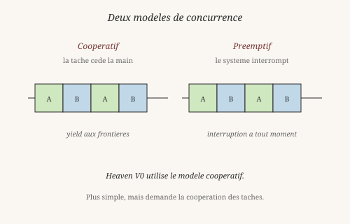
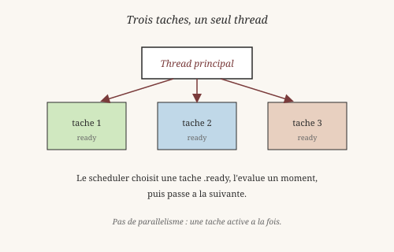
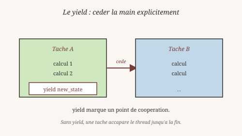

# Chapitre 13 — Concurrence coopérative

> *« La concurrence, c'est composer des processus indépendants.
> Le parallélisme, c'est exécuter plusieurs choses en même temps. »*
> — Rob Pike, *Concurrency is not Parallelism* (2012)

Heaven fournit un **scheduler coopératif** dans le noyau. Plusieurs
tâches partagent le thread principal, chacune cédant la main à des
points explicites (`yield`). Ce chapitre montre comment cela
fonctionne, et ce que ça change philosophiquement.

## 1. Concurrence ≠ parallélisme

Il faut distinguer deux choses que le langage courant confond :

- Le **parallélisme** — plusieurs choses s'exécutent **en même
  temps**, sur plusieurs cœurs ou processeurs.
- La **concurrence** — plusieurs tâches progressent **en
  interaction**, sans forcément tourner simultanément.

Une seule personne peut gérer plusieurs tâches en alternance (répondre
au téléphone, écrire un email, ranger son bureau). C'est de la
concurrence — pas du parallélisme. Le programmeur Rob Pike (né en
1956), co-créateur de Go, a popularisé cette distinction dans une
conférence restée célèbre (2012).

Heaven V0 fait de la **concurrence coopérative** : plusieurs tâches
progressent dans un **seul thread**, chacune cédant la main
explicitement.

Deux modèles existent :

- **Coopératif** — la tâche décide quand céder la main (`yield`).
- **Préemptif** — le système interrompt la tâche à tout moment.

Le modèle coopératif est plus simple à implémenter et à raisonner.
Mais il exige la **coopération** de toutes les tâches : si une tâche
ne rend jamais la main, tout s'arrête.

## 2. Le scheduler

Un **scheduler** (ordonnanceur) est le composant qui décide quelle
tâche s'exécute à chaque instant. Le modèle de Heaven est minimal.

Une **tâche** est une fonction `state -> résultat` qui peut céder la
main :

    body s = ...      -- si fini, retourne le resultat
                      -- sinon, cede avec (yield new_state)

Le scheduler alterne entre les tâches à chaque `yield`. Quand une
tâche ne cède plus, elle est terminée. Quand toutes sont terminées,
le scheduler retourne.

Trois primitives suffisent :

- **`add_task body init_state`** — crée une tâche, retourne un
  `task_id` (entier).
- **`schedule budget`** — lance le scheduler. Chaque tâche s'exécute
  avec un budget de `budget` réductions. Quand le budget est épuisé,
  la tâche est remise en queue.
- **`yield new_state`** — dans le corps d'une tâche, cède la main
  avec un nouvel état.
- **`task_state id`** — lit l'état courant d'une tâche.

Quatre magics, une seule idée : *coopérer explicitement*.

## 3. Un exemple simple

Comptons jusqu'à 5, en cédant la main à chaque étape :

    heaven> body s = (if (eq s 5) s (yield (s + 1)))
    ✓ clause enregistrée pour 'body'

    heaven> main u =
              let t = (add_task body 0) in
      let _ = (schedule 1000) in
      (task_state t)
    ✓ clause enregistrée pour 'main'

    heaven> main unit
    5

Déroulons :

- `add_task body 0` crée une tâche avec l'état initial `0`.
- `schedule 1000` lance le scheduler avec un budget de 1000
  réductions.
- La tâche `body` s'exécute. À chaque étape, elle vérifie `(eq s 5)`.
  Si non, elle `yield` avec `s + 1`.
- Quand `s = 5`, la tâche retourne `5`.
- `task_state t` lit l'état final.

Le scheduler a alterné entre cette tâche (et d'autres éventuelles),
en reprenant à chaque fois depuis l'état cédé. C'est une forme de
**calcul interruptible** : chaque tâche peut être mise en pause et
reprise, tant qu'elle sauvegarde son état dans le `yield`.

L'idée est ancienne. Le mathématicien et logicien Stephen Kleene
(1909-1994), dans ses travaux sur les fonctions récursives
(1936), avait déjà formalisé la notion de **calcul par étapes**.
Un calcul n'est pas un bloc — c'est une **suite d'états**, chacun
dérivé du précédent. Le scheduler de Heaven suit cette intuition.

## 4. Deux tâches entrelacées

Voici un exemple plus intéressant : deux tâches qui alternent :

    heaven> b1 s = (if (eq s 3) 99 (yield (s + 1)))
    ✓ clause enregistrée pour 'b1'

    heaven> b2 s = (if (eq s 5) 99 (yield (s + 1)))
    ✓ clause enregistrée pour 'b2'

    heaven> main u =
              let t1 = (add_task b1 0) in
      let t2 = (add_task b2 0) in
      let _ = (schedule 1000) in
      (+ (task_state t1) (task_state t2))
    ✓ clause enregistrée pour 'main'

    heaven> main unit
    198

Résultat : `99 + 99 = 198`. Les deux tâches ont progressé en
alternance : `t1` un cran, `t2` un cran, `t1` un cran, etc. Chacune
s'est arrêtée à son propre cas de base (3 pour `t1`, 5 pour `t2`).

Le scheduler ne connaît rien du **sens** des tâches. Il ne sait pas
que `b1` compte jusqu'à 3 et `b2` jusqu'à 5. Il applique une règle
mécanique : *prendre la prochaine tâche prête, l'exécuter un moment,
la remettre en queue*. La sémantique émerge de l'interaction — pas
d'un contrôle central.

C'est exactement ce que le sociologue et économiste **Friedrich
Hayek** (1899-1992) appelait l'**ordre spontané** : un système
complexe peut émerger de règles locales simples, sans plan
centralisé. Le scheduler est un tel ordre.

## 5. Le modèle redémarrable

Un point technique important : le scheduler de Heaven V0 est
**redémarrable**. Quand le budget d'une tâche est épuisé, la tâche
n'est **pas** reprise exactement là où elle s'était arrêtée — elle
repart de son dernier état cédé — `current_state`, qui vaut `init_state` tant qu'aucun `yield` n'a eu lieu — en rejouant les étapes déjà effectuées.

C'est une **limitation** du modèle — mais depuis A-3a (2026-10-14),
une tâche suspendue par budget insuffisant n'est plus **perdue** :
elle passe `.preempted` (distinct de `.blocked`, terminal) et sera
reprise au prochain `schedule`. Le redémarrage est le mécanisme de
reprise actuel.

La reprise **exacte** (repartir au point précis de suspension)
demanderait des **continuations délimitées** (D8), qui capturent la
pile entière au moment de la suspension. A-2 a posé le hook de
capture conditionnel dans `evaluate` ; A-3b utilisera ce hook pour
la reprise exacte. Chantier de 2-3 sessions, documenté dans
`docs/spec/_capture_eval.md`.

Pourquoi c'est acceptable ? Parce que les tâches d'un calcul pur
sont **déterministes** : rejouer les étapes donne le même résultat.
Tant qu'on ne fait pas d'effets de bord (écrire un fichier, envoyer
un message), le redémarrage est transparent.

Cette distinction recoupe une question philosophique classique : la
**persistance de l'identité**. Qu'est-ce qui fait qu'une tâche
reprise est la même que la tâche suspendue ? Le philosophe Derek
Parfit (1942-2024), dans *Reasons and Persons* (1984), soutient que
l'identité personnelle n'est pas une substance mais une **continuité
psychologique**. Un calcul qui reprend à partir du même état est
**le même calcul** — même s'il est réexécuté.

## 6. Ce qui reste fragile en V0

Le scheduler coopératif est **livré**, mais minimal. Ce qui marche :

- `add_task`, `schedule`, `yield`, `task_state` (4 magics).
- Tâches sans `yield` (exécution directe).
- Tâches avec `yield` multiple (état intermédiaire).
- Tâches entrelacées (alternance coopérative).

Ce qui **ne marche pas encore** :

- **Reprise exacte** — les tâches redémarrent au lieu de reprendre
  (A-3a : `.preempted` retriable, mais redémarrage complet).
  Acceptable pour du calcul pur, pas pour des effets.
- **Priorités** — la structure `Policy` (`.priority`, `.edf`)
  existe, mais n'est pas utilisée par `schedule`.
- **Intégration avec les acteurs** — `spawn`/`tell`/`recv`
  (chapitre 9) et le scheduler sont deux modèles qui coexistent
  sans se parler.
- **Préemption** — pas d'interruption automatique. Une tâche qui ne
  cède jamais bloque tout. Contournement coopératif depuis 2026-10 :
  `(@budget_left)` permet à une tâche de `yield` quand son budget
  est épuisé (`tests/test_preemptive_coop.hvn` 4/4).

Le modèle coopératif est un **choix philosophique** : on préfère la
simplicité de raisonnement à la robustesse automatique. Une tâche mal
écrite casse le système — mais on peut **prouver** qu'une tâche
coopérative se termine. C'est un compromis entre confiance et
contrôle.

Le sociologue allemand **Niklas Luhmann** (1927-1998) aurait reconnu
ce modèle. Dans *Systèmes sociaux* (1984), il décrit les systèmes
sociaux comme des ensembles d'opérations qui **se reproduisent**
par elles-mêmes : chaque communication en engendre une autre, sans
plan central. Le scheduler coopératif est un tel système — chaque
`yield` produit la prochaine étape, sans qu'une intelligence centrale
ne supervise.

## Ce qu'on a appris

- **Concurrence** ≠ **parallélisme** (Rob Pike, 2012). La première
  est une composition logique, la seconde une exécution simultanée.
- Heaven V0 utilise un scheduler **coopératif** : les tâches cèdent
  la main explicitement (`yield`).
- Quatre magics suffisent : `add_task`, `schedule`, `yield`,
  `task_state`.
- Le modèle est **redémarrable** : les tâches repartent de leur dernier
  `yield` (ou de `init_state` si aucun yield n'a eu lieu) après un budget épuisé.
- Le **calcul par étapes** (Kleene, 1936) est un état, pas un bloc.
- L'**ordre spontané** (Hayek) émerge de règles locales.
- La **continuité psychologique** (Parfit, 1984) éclaire la reprise
  d'une tâche.
- Les **systèmes autopoïétiques** (Luhmann, 1984) se reproduisent
  par leurs propres opérations.
- En V0 : pas de reprise exacte, pas de priorité, pas de
  préemption. Chantiers documentés.
- A-3a : les tâches préemptées par budget sont **retriables**
  (`.preempted`), plus perdues. Redémarrage, pas reprise exacte.

Wittgenstein aurait vu dans la tâche coopérative une illustration
de son « jeu de langage » : chaque tâche joue son jeu, en respectant
la règle commune du `yield`. L'émergence d'un calcul collectif n'est
pas planifiée — elle **suit les règles**.

Au chapitre suivant, on aborde un sujet plus méta : les **schémas
de récursion**. On a déjà vu la récursion au chapitre 4. Maintenant,
on va la **formaliser** — la transformer en une famille de
fonctions génériques (`cata`, `ana`, `hylo`, `para`) qui capturent
toutes les formes de récursion en quelques lignes.

*Vérifiable : les exemples `add_task`, `schedule`, `yield`,
`task_state` fonctionnent tels quels dans le REPL.
`tests/test_scheduler.hvn` (3/3) confirme.*

