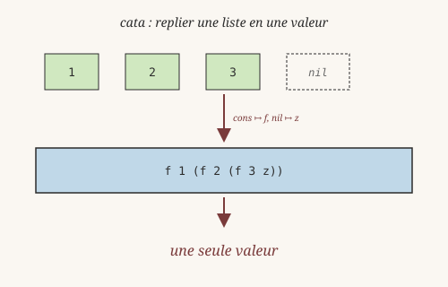
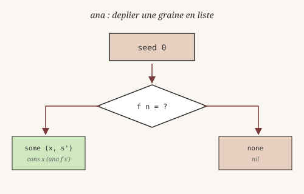
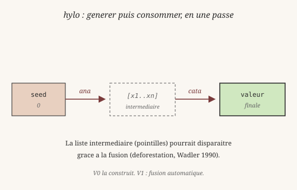

# Chapitre 14 — Schémas de récursion

> *« La programmation fonctionnelle se résume à deux gestes : replier
> une structure, et en déplier une autre. Le reste n'est que du sucre. »*
> — à la manière d'Erik Meijer, Maarten Fokkinga et Ross Paterson,
> *Functional Programming with Bananas, Lenses, Envelopes and Barbed Wire* (1991)

Jusqu'ici, chaque fois qu'on a voulu parcourir une liste, on a écrit
une fonction récursive ad hoc : une clause pour `nil`, une clause
pour `cons`, et une reconstruction à la main. C'est correct — mais
c'est répétitif. Et quand on a cinq structures de données, on écrit
cinq fois le même squelette.

Les **schémas de récursion** formalisent ce squelette. L'idée :
séparer *ce qu'on fait à chaque étape* de *la manière dont on
parcourt la structure*. Le parcours devient une fonction générique,
réutilisable, qu'on paramètre par la logique métier.

Heaven V0 n'a pas de `Fix` ni de types récursifs génériques. Mais
sur les listes — la structure la plus courante — on peut déjà
construire quatre schémas fondamentaux. Ce chapitre les présente,
avec les penseurs qui les ont nommés. Le module vit dans
`core/std/recursion.hvn`.

## 1. Le squelette qu'on écrit dix fois

En 1962, l'économiste et informaticien **Herbert Simon** (1916-2001,
prix Nobel 1978) publie *The Architecture of Complexity*. Il y
raconte la parabole des deux horlogers : **Tempus** assemble chaque
montre d'un bloc, et perd tout quand le téléphone sonne ; **Hora**
assemble par sous-ensembles stables, et ne perd qu'un sous-ensemble
à chaque interruption. La leçon : *les systèmes complexes se
construisent à partir de sous-structures stables, qu'on retrouve
identiques à plusieurs niveaux.*

Un programme récursif, c'est exactement ça. La fonction `sum`,
la fonction `length`, la fonction `product` — elles ne diffèrent
que par une opération locale (`+`, `+1`, `*`). Le reste — le
parcours, la reconstruction — est le **même sous-ensemble stable**.

On peut le nommer une fois pour toutes.

## 2. cata — replier une structure

`cata` (pour *catamorphisme*) est l'ancêtre direct du `foldr` de
Haskell. L'idée remonte à **Peter Freyd** (1936-2024), qui a montré
en 1991 (*Algebraically complete categories*) que la notion
catégorique d'**algèbre initiale** est exactement ce qui capture la
récursion. En clair : au lieu d'écrire la récursion à la main, on
dit *« voici comment combiner un élément avec le résultat du
reste »*, et le schéma s'occupe du parcours.

On l'écrit :

    cata _ z nil = z
    cata f z (cons x xs) = f x (cata f z xs)

Lisez-le à voix haute :

- Sur `nil`, on retourne `z` — la **graine** (zéro, unité, liste
  vide selon le contexte).
- Sur `cons x xs`, on calcule d'abord `cata f z xs` (le résultat
  sur la queue), puis on combine avec `x` via `f`.

La somme d'une liste, en REPL :

    heaven> cata _ z nil = z
    ✓ clause enregistrée pour 'cata'
    heaven> cata f z (cons x xs) = f x (cata f z xs)
    ✓ clause enregistrée pour 'cata'
    heaven> sum_f x acc = x + acc
    ✓ clause enregistrée pour 'sum_f'
    heaven> (cata sum_f 0 (cons 1 (cons 2 (cons 3 nil))))
    6

Trois clauses suffisent pour définir `cata`, puis une ligne pour la
somme. La longueur :

    length_f _ acc = acc + 1
    length xs = (cata length_f 0 xs)

Le produit :

    product_f x acc = x * acc
    product xs = (cata product_f 1 xs)

Trois fonctions, un seul squelette. C'est ça, l'intérêt.

## 3. ana — déplier une structure

`cata` consomme. Son dual, `ana` (pour *anamorphisme*), **génère**.
L'idée remonte à **Peter Aczel** (1941-2023), qui a introduit en
1988 la théorie des ensembles non-bien-fondés (*Non-Well-Founded
Sets*) et la notion de **coalgèbre finale** — le dual exact de
l'algèbre initiale de Freyd. Là où `cata` replie, `ana` déplie.

On lui donne une graine et une fonction d'étape qui, à chaque tour,
décide soit de s'arrêter, soit de produire un élément et une
nouvelle graine. En Heaven, la décision se prend avec `Option` :

    ana f seed = ana_step f (f seed)

    ana_step _ none = nil
    ana_step f (some (pair x next)) = cons x (ana f next)

`f` a donc le type informel `seed -> Option (élément, seed')`. On
itère tant que `f` renvoie `some`, on s'arrête au premier `none`.

Exemple : générer les entiers de 0 à 2, puis les compter.

    heaven> ana f seed = ana_step f (f seed)
    ✓ clause enregistrée pour 'ana'
    heaven> ana_step _ none = nil
    ✓ clause enregistrée pour 'ana_step'
    heaven> ana_step f (some (pair x next)) = cons x (ana f next)
    ✓ clause enregistrée pour 'ana_step'
    heaven> gen n = (if (< n 3) (some (pair n (+ n 1))) none)
    ✓ clause enregistrée pour 'gen'
    heaven> length_f _ acc = acc + 1
    ✓ clause enregistrée pour 'length_f'
    heaven> cata _ z nil = z
    ✓ clause enregistrée pour 'cata'
    heaven> cata f z (cons x xs) = f x (cata f z xs)
    ✓ clause enregistrée pour 'cata'
    heaven> (cata length_f 0 (ana gen 0))
    3

C'est l'inverse exact de `cata`. Là où `cata` plie une liste en une
valeur, `ana` déplie une valeur en une liste. On peut le voir comme
une **machine à états** : à chaque tour, l'état courant (la graine)
est transformé en un élément plus un nouvel état. Le programme
s'arrête quand l'état dit « stop » (`none`).

## 4. hylo — plier ce qu'on vient de déplier

Souvent, on génère une structure *pour la consommer immédiatement*.
Écrire `(cata f z (ana g s))` fonctionne, mais matérialise la liste
intermédiaire — chaque `cons` alloue, chaque `nil` aussi. C'est
gaspilleur.

Le schéma `hylo` (pour *hylomorphisme*, du grec *hylê* « matière »
et *morphê* « forme ») encapsule ce motif. Il a été nommé par
**Philip Wadler** (né en 1956) dans *Deforestation: transforming
programs to eliminate trees* (1990) — un article qui montre comment
un compilateur peut supprimer les structures intermédiaires. Le
nom « déforestation » est resté.

En Heaven V0 :

    hylo g z f seed = cata g z (ana f seed)

Le premier argument de `hylo` est la fonction de combinaison de
`cata`, le dernier est la fonction d'étape de `ana`. Le résultat
est directement la valeur finale.

Exemple : la somme des entiers de 0 à 4.

    hylo_gen n = (if (< n 5) (some (pair n (+ n 1))) none)
    sum_f x acc = x + acc
    resultat = (hylo sum_f 0 hylo_gen 0)   -- 0+1+2+3+4 = 10

**Note V0** : dans un langage avec fusion automatique (comme GHC
avec l'optimisation *foldr/build fusion*), `hylo` peut éviter de
construire la liste intermédiaire. Heaven V0 ne fait pas encore
cette optimisation — la liste est bel et bien créée. Mais le
schéma reste utile conceptuellement : il capture l'idée que
*produire puis consommer* est une seule opération.

## 5. para — voir la queue, pas seulement son résultat

Parfois, `cata` ne suffit pas. On a besoin non seulement du
**résultat** du parcours de la queue, mais aussi de la **queue
elle-même**. C'est le rôle de `para` (pour *paramorphisme*), nommé
par le mathématicien néerlandais **Lambert Meertens** en 1992 —
le même Meertens qui a co-fondé l'algèbre des algorithmes avec
Richard Bird.

Définition :

    para _ z nil = z
    para f z (cons x xs) = f x xs (para f z xs)

La différence avec `cata` : `f` reçoit **trois** arguments au lieu
de deux — l'élément `x`, la queue `xs`, et le résultat récursif
`para f z xs`.

Pourquoi c'est utile ? Prenons `dropWhile`, qui retire le préfixe
d'une liste tant qu'un prédicat est vrai. Avec `cata`, impossible :
on n'a jamais accès à la queue *telle quelle*, seulement à sa
version déjà consommée. Avec `para`, on peut :

    para_count_f _ _ acc = acc + 1
    para_sum_f x _ acc = x + acc
Chaque fonction de `para` peut *ignorer* la queue si elle n'en a
pas besoin — auquel cas `para` se comporte exactement comme `cata`.
La queue est là, disponible, mais on choisit.

Vérification en REPL :

    heaven> para _ z nil = z
    ✓ clause enregistrée pour 'para'
    heaven> para f z (cons x xs) = f x xs (para f z xs)
    ✓ clause enregistrée pour 'para'
    heaven> para_count_f _ _ acc = acc + 1
    ✓ clause enregistrée pour 'para_count_f'
    heaven> (para para_count_f 0 (cons 1 (cons 2 (cons 3 nil))))
    3

`para` est *plus général* que `cata` : tout ce qu'on écrit avec
`cata`, on peut l'écrire avec `para`. L'inverse est faux. Mais on
préfère `cata` quand il suffit, parce qu'il dit plus clairement
« je n'ai pas besoin de la queue ».

## 6. Ce qui reste fragile en V0

Le module `core/std/recursion.hvn` est un **pilote**. Il couvre les
listes — la structure récursive la plus courante — mais s'arrête là.
Comme le note **Douglas Hofstadter** (né en 1945) dans *Gödel,
Escher, Bach* (1979), la récursion est au cœur de toute
auto-référence — mais une auto-référence *générale* demande des
outils plus puissants que ce que V0 propose.

Trois limites à connaître :

- **Pas de `Fix`** : on ne peut pas définir un schéma générique qui
  marche pour *toutes* les structures récursives (arbres, `Maybe`,
  types utilisateur). Chaque structure aurait besoin de sa propre
  famille de fonctions. Le papier de Meijer-Fokkinga-Paterson
  montre comment y arriver avec des foncteurs ; Heaven V0 n'a pas
  encore cette machinerie.

- **Pas de fusion automatique** : `hylo` compose `ana` et `cata`,
  mais ne défait pas la liste intermédiaire. Un vrai hylomorphisme
  fusionné (déforestation, Wadler 1990) demanderait une passe du
  compilateur que V0 n'a pas.

- **Lambdas inline non supportées** : les exemples utilisent des
  fonctions nommées (`sum_f`, `length_f`) parce que le parser
  infixe actuel ne gère pas encore les lambdas dans les arguments
  de fonctions. C'est une limitation de surface, pas de fond.

Malgré ces limites, les quatre schémas suffisent à éliminer
beaucoup de boilerplate. `sum`, `length`, `product`, `map`, `filter`,
`take`, `drop` — tous s'écrivent en une ligne au-dessus de `cata`
ou `para`.

## Pour aller plus loin

- `core/std/recursion.hvn` : le module complet (32 lignes).
- `tests/test_recursion.hvn` : **22 tests** qui couvrent les quatre
  schémas — tous verts, exécution en moins de 20 ms.
- `core/std/list.hvn` : les versions spécialisées (`foldl`,
  `foldr`) — équivalentes à `cata` mais dans l'autre sens.
- Référence externe : la bibliothèque **`recursion-schemes`** de
  l'écosystème Haskell (Edward Kmett) généralise ces schémas à
  toutes les structures récursives via des foncteurs. Heaven s'en
  inspire, mais s'arrête pour l'instant aux listes.

---

Tu as maintenant quatre schémas qui éliminent le boilerplate
récursif sur les listes. Le squelette de Simon, nommé par Freyd,
Aczel et Meertens, fusionné par Wadler : quatre noms, une idée.

Un autre genre de boilerplate attend : l'accès aux structures
imbriquées. Pour lire `(fst (fst p))`, on écrit une fonction de
reconstruction à chaque fois. Le prochain chapitre présente une
réponse conceptuelle : les **optiques**, et en particulier les
**lenses**.
