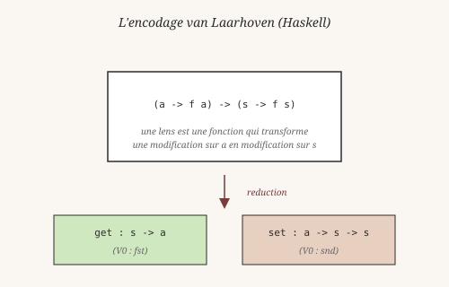
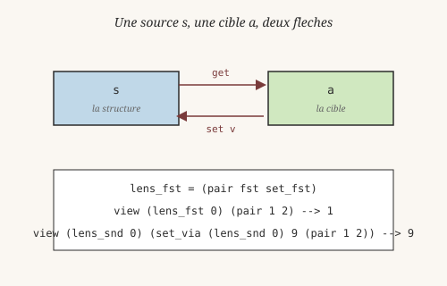
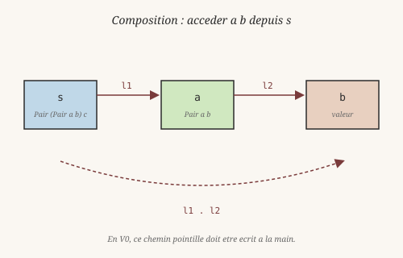

# Chapitre 15 — Optiques : lire et écrire en profondeur

> *« Une lentille ne change pas ce qu'elle voit. Elle décide
> seulement ce qui, depuis elle, devient visible. »*
> — à la manière d'Erik Meijer, Maarten Fokkinga et Ross Paterson,
> *Functional Programming with Bananas, **Lenses**, Envelopes and Barbed Wire* (1991)

Au chapitre 14, on a factorisé la **récursion**. Il reste un autre
genre de boilerplate dans nos programmes : l'accès aux structures
imbriquées. Pour lire le fond d'un `Pair (Pair a b) c`, on écrit
`(fst (fst p))`. Pour modifier cette valeur, il faut démonter,
changer, remonter :

    set_pp_fst v p =
      let inner = (fst p) in
      (pair (pair v (snd inner)) (snd p))

Sur un seul niveau, ça va. Sur cinq, ça devient illisible. Et chaque
nouvelle forme de structure demande une nouvelle paire de fonctions.

Les **optiques** formalisent cet accès. Ce chapitre les présente
et les implémente en Heaven — avec les penseurs qui les ont pensées.

## 1. Le problème : accéder, c'est déjà interpréter

En 1945, le philosophe **Maurice Merleau-Ponty** (1908-1961) publie
la *Phénoménologie de la perception*. Son argument central : on ne
perçoit jamais un objet « en soi », on le perçoit toujours **depuis
un point de vue**. Voir une maison, c'est voir une façade — pas
toutes les façades à la fois. La perception est *orientée*, et
cette orientation n'est pas un défaut : elle est la condition même
de l'accès.

Accéder à un champ dans une structure imbriquée, c'est exactement
ça. `(fst (fst p))` n'est pas neutre : c'est un **chemin** dans un
espace de positions. Et comme pour Merleau-Ponty, ce chemin est
corrélé à un **geste de modification**. Si je vise le `fst` du
`fst`, je peux le changer ; et changer demande de **préserver tout
le reste** — la façade qu'on ne regarde pas.

Les optiques font de cette idée un objet de première classe.

## 2. get et set — la lens comme couple

Une **lens** est un couple : un *getter* et un *setter*.

    get : s -> a          -- extrait la valeur cible
    set : a -> s -> s     -- remplace la valeur, rend la source modifiée

Le mathématicien **David Spivak** (né en 1978), connu pour son
travail sur les bases de données catégoriques, a montré en 2016
(*A Categorical Reconstruction of Lenses*) que ce couple n'est pas
arbitraire : c'est un **morphisme dans une catégorie précise**, et
cette structure explique *pourquoi* les lenses se composent. Le
getter et le setter ne sont pas deux fonctions indépendantes
rangées ensemble — ils obéissent à des lois (lois « put-get »,
« get-put », « put-put »). En V0, on les tient à la main ; en V1,
elles pourraient être vérifiées.

En Heaven, on construit une lens avec `lens` :

    lens get set = (pair get set)

Et on l'utilise via trois opérations :

    view l s = (fst l) s
    set_via l v s = (snd l) v s
    over l f s = (snd l) (f (view l s)) s

- `view` lit la cible.
- `set_via` la remplace par une valeur donnée.
- `over` la modifie par une fonction.

Le point clé : le setter **préserve le reste**. On ne touche qu'un
champ, tout le contexte autour survit intact — c'est exactement
ce que le test `set pp_fst preserve snd` vérifie : après avoir
changé `pp_fst` de 1 à 99, `snd` vaut toujours 3.

L'exemple le plus simple, en REPL :

    heaven> view (lens_snd 0) (mk 0)
    3
    heaven> view (lens_snd 0) (set_via (lens_snd 0) 30 (mk 0))
    30
    heaven> view (lens_snd 0) (over (lens_snd 0) inc (mk 0))
    4

## 3. Composition — la promesse non tenue de V0

En Haskell, deux lenses se composent avec l'opérateur `.`. Si
`l1` cible `a` dans `s`, et `l2` cible `b` dans `a`, alors `l1 . l2`
cible `b` dans `s`. Un seul chemin, une seule opération.

En Heaven V0, cette composition **n'existe pas**. Il faut écrire
chaque composition à la main :

    get_pp_fst p = (fst (fst p))
    set_pp_fst v p =
      let inner = (fst p) in
      (pair (pair v (snd inner)) (snd p))

    lens_pp_fst _ = (lens get_pp_fst set_pp_fst)

La raison est profonde : pour composer génériquement, il faut que
le setter de `l1` soit *lui-même* paramétré par un autre setter.
C'est l'encodage de **Twan van Laarhoven** (2009), popularisé par
**Oleg Kiselyov** : une lens n'est plus un couple `(get, set)` mais
une fonction unique qui prend une fonction de modification et rend
une fonction de modification sur la structure externe.

    type Lens s a = forall f. Functor f => (a -> f a) -> (s -> f s)

Cette signature ne peut pas s'écrire en Heaven V0 — il faut des
types paramétrés, des classes de foncteurs, et l'égalité
extensionnelle qu'on n'a pas encore. V0 reste à `(get, set)`.
C'est une limitation de **fond**, pas de surface : elle disparaîtra
quand le système de types s'enrichira.

## 4. Le bug qui a débloqué tout ça

L'implémentation de `lens.hvn` **ne marchait pas** avant un fix
précis. Ce code :

    g x = x + 1
    mkl _ = (pair g 0)
    ((fst (mkl 0)) 5)

devait rendre `6`. Il rendait autre chose. Pourtant, cette variante
marchait :

    (let f (fst (mkl 0)) (f 5))

Le problème était dans le tree-walker, pas dans la sémantique.
Quand on écrit `(apply expr args)`, l'évaluateur résolvait `expr`,
puis reconstruisait un nœud `apply` avec la valeur résolue **et**
les arguments d'origine — dont le premier argument qui *était*
`expr`. Résultat : le nœud reconstruit se croyait encore en
position d'opérateur, et passait **deux** arguments à la fonction
extraite au lieu d'un.

Le fix tient en quelques lignes (commit `2810cc7`) : reconstruire
le nœud avec **seulement** les arguments, sans l'opérateur
d'origine. Ça a suffi à débloquer les fonctions stockées dans des
structures.

C'est le point de **Christopher Strachey** (1916-1975), dans ses
*Fundamental Concepts in Programming Languages* (1967, publiés
tardivement en 2000). Strachey a introduit la distinction entre
les valeurs dites **first-class** (qu'on peut passer, retourner,
stocker) et les autres. Les fonctions en Heaven V0 sont *presque*
first-class — un seul `apply` mal reconstruit suffit à les
rétrograder. La leçon : quand un langage prétend qu'une valeur est
first-class, il faut pouvoir la mettre **n'importe où**, y compris
dans un champ de `Pair`. La lens a été le test qui a révélé que ce
n'était pas encore vrai.

## 5. Ce qui reste fragile en V0

Le module `core/std/lens.hvn` (32 lignes) couvre le strict minimum.
Trois limites à connaître, qu'on retrouve dans la bibliothèque
**`lens`** d'**Edward Kmett** (né en 1970) — la référence Haskell,
qui implémente tout ce qu'on n'a pas :

- **Composition générique absente** : pas d'opérateur `.` entre
  lenses. Chaque niveau supplémentaire demande une nouvelle paire
  de fonctions à écrire à la main. Kmett résout ça par l'encodage
  van Laarhoven, indisponible en V0.

- **Prisms et traversals absents** : une lens cible **exactement
  un** élément. Un **prism** cible zéro ou un (utile pour `Maybe`,
  `Either`, les sum types). Un **traversal** cible zéro ou
  plusieurs (listes, arbres). Ces optiques sont des variations du
  même motif — la bibliothèque Kmett les unifie sous
  `profunctor optics`. V0 s'arrête à la lens.

- **Pas de records** : sans champs nommés, toutes les lenses sont
  des `fst`/`snd` ou des positions. Si Heaven ajoute un jour des
  records, `lens_fst` deviendra `lens_name`, et tout le reste
  tiendra sans modification.

Ces limitations sont de surface pour deux d'entre elles (composition,
records), de fond pour l'autre (prisms/traversals demandent un
système de types plus riche).

## 6. Pourquoi ça vaut quand même

Même sans composition générique, une lens apporte deux choses —
et c'est **Ludwig Wittgenstein** (1889-1951) qui en donne la
formule la plus juste dans les *Recherches philosophiques* (1953) :
*« Les limites de mon langage sont les limites de mon monde. »*
Une lens, c'est un **mot nouveau** dans le vocabulaire du
programme.

1. **Un nom.** `view lens_snd p` dit ce qu'on fait. `(snd p)` dit
   la même chose mais sans intention. Sur du code long, la
   différence n'est pas cosmétique — c'est la différence entre un
   programme qui parle et un programme qui calcule.

2. **Un point d'extension.** Si demain on ajoute la composition
   générique ou les records, tout le code qui utilise
   `view`/`set_via`/`over` continuera de marcher. On n'aura changé
   que la **construction** des lenses, pas leur usage. C'est
   exactement le principe des abstractions bien posées :
   l'interface tient, la représentation bouge.

C'est le même mouvement qu'au chapitre 14 : Simon nous a dit qu'un
système complexe se construit par sous-ensembles stables. Une lens
est un sous-ensemble stable du code d'accès.

## Pour aller plus loin

- `core/std/lens.hvn` : le module (32 lignes).
- `tests/test_lens.hvn` : **12 tests** qui couvrent `view`/`set_via`/
  `over`, sur `Pair` simple et `Pair` imbriqué, plus un test
  first-class explicite — tous verts, exécution en moins de 10 ms.
- Référence externe : la bibliothèque **`lens`** d'Edward Kmett
  implémente composition générique, prisms, traversals, et bien
  plus — le tout fondé sur une théorie catégorique de l'accès
  (`van Laarhoven lenses`, `profunctor optics`). Heaven s'en
  inspire, mais s'arrête à la version minimale.
- Sur la théorie : David Spivak, *A Categorical Reconstruction of
  Lenses* (2016) — pourquoi `get`/`set` obéissent à des lois.

---

Tu sais maintenant lire et écrire dans des structures imbriquées
proprement, et tu as vu comment une limitation du runtime peut
bloquer une abstraction entière — jusqu'à ce qu'un bug de dix
lignes la débloque. C'est ça, un langage en construction : les
concepts avancés ne sont pas toujours possibles tout de suite, mais
ils laissent des traces — un nom, une interface, un test qui
échoue.

Il reste une autre abstraction de la même famille à explorer. Là
où les optiques accèdent à des **données**, les free monads
manipulent des **programmes**. Séparer le programme de son
interprétation est un motif qui revient partout. C'est le sujet du
prochain chapitre.
