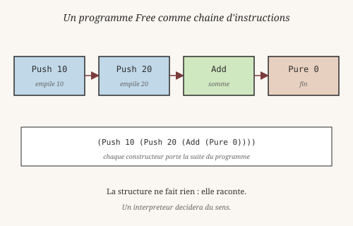
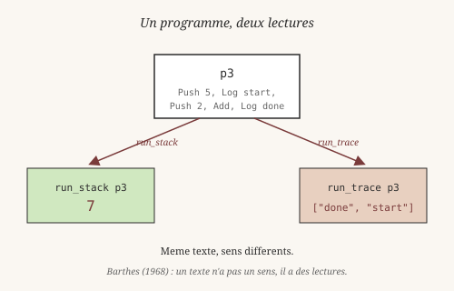
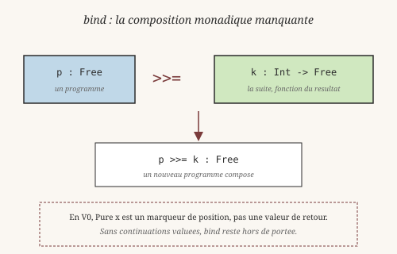

# Chapitre 16 — Free monads : séparer programme et interprétation

> *« Un programme qui n'a pas encore été interprété n'est ni vrai
> ni faux. C'est un texte en attente de lecture. »*
> — à la manière de Roland Barthes, *La mort de l'auteur* (1968)

Jusqu'ici, quand on a voulu faire quelque chose, on l'a fait tout de
suite : `(+ 1 2)` calcule, `perform` signale, `writeFile` écrit. Le
programme **est** son exécution.

Mais dans beaucoup de cas, on voudrait **décrire** un programme sans
l'exécuter tout de suite : pour le tester, pour le transformer, pour
l'interpréter de plusieurs manières. C'est l'idée derrière les
**free monads**, une abstraction qui vient de la théorie des
catégories et qui a envahi l'écosystème Haskell grâce aux
bibliothèques d'Edward Kmett.

Ce chapitre présente l'idée et son implémentation minimale en Heaven,
avec les penseurs qui l'ont rendue pensable.

## 1. Le problème : programme = exécution

En 1958, la philosophe **Hannah Arendt** (1906-1975) publie *The
Human Condition*. Elle y distingue trois modes d'activité : le
**travail** (*labor*, ce qui se consomme), l'**œuvre** (*work*, ce
qui dure), et l'**action** (*action*, ce qui se dit et se juge entre
humains). L'œuvre produit un objet **stable** qu'on peut regarder,
transformer, transmettre — indépendamment de celui qui l'a produite.

Un programme qui s'exécute immédiatement est du côté du *labor* : ça
se consomme, ça disparaît, ça ne laisse rien. Un programme qui se
**décrit** avant d'être exécuté est du côté de l'*work* : c'est un
objet qui existe, qu'on peut examiner, réinterpréter, transformer.

Supposons qu'on veuille écrire une petite machine à pile. En style
direct :

    calc_direct _ = (+ 10 20)

Cette fonction fait le calcul. Rien à redire. Mais :

- Impossible de **la tester** sans l'exécuter.
- Impossible de **l'optimiser** sans la réécrire.
- Impossible de lui donner **plusieurs sens** (évaluer, tracer,
  compiler vers autre chose).

Pour séparer le *quoi* du *comment*, on décrit d'abord les
opérations comme une **structure de données**. La structure ne fait
rien : elle raconte.

## 2. L'idée : Moggi et la monade

L'idée vient de la théorie des catégories, mais c'est **Eugenio
Moggi** (né en 1953) qui l'a importée en informatique théorique en
1989, dans *Computational Lambda-Calculus and Monads*. Son constat :
une grande variété d'effets calculatoires (état, exceptions, entrées-
sorties, non-déterminisme) peut être **unifiée** sous une seule
structure mathématique — la **monade**, introduite par **Saunders
Mac Lane** (1909-2005) en 1971 dans *Categories for the Working
Mathematician*.

Le passage clé de Moggi : une valeur de type `M a` n'est pas une
valeur de type `a`, c'est **un calcul qui produira un `a`** en
tenant compte d'un effet. Séparer `a` de `M a`, c'est séparer le
*quoi* (la valeur attendue) du *comment* (comment y arriver).

En Heaven V0, ce distinguo se matérialise dans un **type de données
récursif** : le programme lui-même est une valeur.

## 3. La structure Free : un AST d'opérations

Le module `core/std/free.hvn` (49 lignes) définit quatre opérations
et une fin :

    data Free
      = Pure Int
      | Push Int Free
      | Add Free
      | Mul Free
      | LogOp Str Free

Chaque constructeur représente **une instruction** :

- `Pure x` — fin du programme, on rend la main.
- `Push n rest` — empile `n` puis continue avec `rest`.
- `Add rest` — dépile deux valeurs, empile leur somme.
- `Mul rest` — idem avec le produit.
- `LogOp s rest` — émet un log `s` puis continue.

Un programme, c'est une **liste chaînée** de ces instructions. Par
exemple, « calcule (10 + 20) » s'écrit :

    p1 _ = (Push 10 (Push 20 (Add (Pure 0))))

C'est un **arbre**, mais en pratique une liste puisque chaque
constructeur a une seule continuation. Le `Pure 0` final est un
marqueur de fin (le `0` n'est pas utilisé).

En REPL :

    heaven> run_stack (p1 0)
    30
    heaven> run_stack (p2 0)
    12
    heaven> run_stack (p3 0)
    7

Chaque appel à `run_stack` est un **acte d'interprétation**. Le
programme `p1` existe indépendamment, et trois tests différents
peuvent le lire de trois façons.

## 4. Deux interpréteurs, un seul programme

Le point magique : le même `p1` peut être interprété de plusieurs
façons. Le module en fournit deux.

**Interpréteur 1 : évaluer sur une pile.** `run_eval` traverse
l'AST en maintenant une pile d'entiers :

    run_eval (Pure _) stack = (if (null stack) 0 (head stack))
    run_eval (Push n rest) stack = (run_eval rest (cons n stack))
    run_eval (Add rest) stack =
      (run_eval rest (cons (+ (head stack) (head (tail stack)))
                           (tail (tail stack))))
    ...

Sur `p1`, ça donne `30`. Sur `p2 = (Push 3 (Push 4 (Mul (Pure 0))))`,
ça donne `12`. Sur `p3`, qui mélange `Push`, `LogOp` et `Add`, ça
donne `7` — les logs sont ignorés.

**Interpréteur 2 : collecter les logs.** `run_log` oublie les
opérations arithmétiques et ne garde que les `LogOp` :

    run_log (Pure _) acc = acc
    run_log (Push _ rest) acc = (run_log rest acc)
    run_log (Add rest) acc = (run_log rest acc)
    run_log (LogOp s rest) acc = (run_log rest (cons s acc))

Sur le même `p3`, ça donne la liste `["done", "start"]` (ordre
inverse, dernier en tête). Le calcul `5 + 2` n'a plus aucune
importance — l'interpréteur ne le voit pas.

**Même programme, deux sens.** C'est exactement ce que **Roland
Barthes** (1915-1980) théorise en 1968 dans *La mort de l'auteur* :
un texte n'a pas **un** sens, il a **des** lectures. L'auteur qui
l'a produit n'est pas la source de sa signification — le lecteur,
l'interpréteur, le contexte d'usage le sont. Un AST Free est un
texte. `run_stack` et `run_trace` sont deux lectures du même texte.
On peut en ajouter une troisième qui compte les opérations, une
quatrième qui compile vers du code C, une cinquième qui exécute en
parallèle — sans toucher au texte lui-même.

## 5. Ce qui manque pour un vrai free monad

Le module fait 49 lignes et rend déjà service. Mais il lui manque
deux choses pour être un vrai free monad — comme le note **Oleg
Kiselyov** (né en 1960), co-auteur des *Freer Monads, More
Extensible Effects* (2015), la version moderne de l'idée.

**1. Le `>>=` (bind).** En Haskell, `>>=` chaîne deux programmes :
`p >>= f` est un programme qui exécute `p`, puis passe son résultat
à `f` pour continuer. On avait essayé d'écrire :

    chain (Pure x) k = (k x)
    chain (Push n rest) k = (Push n (chain rest k))
    ...

Ça ne marche pas tel quel parce que `Pure x` marque une **position**
dans la pile, pas une **valeur de retour**. Pour que `chain`
fonctionne, il faudrait que `Pure` porte réellement la valeur
finale et que les continuations (`k`) reçoivent cette valeur
comme argument. Or en Heaven V0, `Pure x` est un marqueur ; le
résultat réel vit sur la pile d'exécution, pas dans la structure.

**2. Les continuations valuées.** Pour un vrai bind, il faut que
chaque opération puisse dire : « après avoir fait ceci, appelle
cette fonction avec le résultat ». Ça demande que les continuations
soient des **fonctions** (`Int -> Free`) plutôt que des `Free`
directs. On a vu au chapitre 15 que Heaven supporte les fonctions
comme valeurs (avec le fix first-class). Mais le type `data Free`
devrait alors contenir des champs de type fonction, et la
récursion entre `Free` et `(Int -> Free)` complique le pattern
matching. C'est un problème de **type system**, pas de sémantique.

**Verdict honnête** : le module est un **AST interprétable**, pas
une implémentation complète de free monad. C'est suffisant pour la
plupart des usages pratiques (DSL simples, tests multiples), mais
ce n'est pas la généralité de la version Haskell.

## 6. Pourquoi documenter un presque-free-monad

Parce que l'**idée** est plus importante que la généralité, et que
le philosophe et logicien **Gottlob Frege** (1848-1925) en a donné
la formulation la plus nette dès 1892, dans *Über Sinn und
Bedeutung* (*Sens et dénotation*) : une expression a **deux**
niveaux — son *sens* (ce qu'elle décrit), et sa *dénotation* (ce
qu'elle désigne effectivement dans le monde). « L'étoile du soir »
et « l'étoile du matin » ont deux sens distincts, mais une seule
dénotation (Vénus).

Un programme Free, c'est un **sens** : une description d'opérations.
Son interprétation, c'est sa **dénotation** : la valeur qu'il produit
effectivement. Le module `free.hvn` capture exactement cette
distinction. Il ne fait pas *tout* ce qu'un free monad Haskell fait,
mais il fait la chose essentielle : séparer le sens de la dénotation.

1. **Séparation programme/interprétation** : c'est la contribution
   conceptuelle majeure. On l'a, et elle est utilisable.
2. **Multi-interprétation** : on l'a aussi. C'est ce qui rend les
   free monads intéressants en pratique.
3. **Point d'extension** : si Heaven V0.2 ou V0.3 ajoute des
   types plus riches (HKT, continuations valuées), le module
   `free.hvn` pourra être étendu sans casser l'API — les noms
   `Push`, `Add`, `run_stack`, `run_trace` sont stables.

C'est le même principe que pour les optiques au chapitre 15 :
mieux vaut une version minimale qui **fonctionne** et documente
ses limites, qu'une version théoriquement complète qui n'existe
pas encore.

## Pour aller plus loin

- `core/std/free.hvn` : le module (49 lignes).
- `tests/test_free.hvn` : **14 tests** qui couvrent `run_stack` et
  `run_trace` sur quatre programmes — tous verts, exécution en moins
  de 10 ms.
- La bibliothèque **`free`** de l'écosystème Haskell implémente
  la vraie monade libre, avec `>>=`, `liftF`, et une collection
  d'interpréteurs réutilisables.
- Les **monades libres** sont le fondement de `mtl`, `polysemy`,
  `fused-effects` — les bibliothèques modernes de gestion
  d'effets en Haskell.
- Le lien avec le chapitre 6 (Effects) : les effets algébriques
  de Heaven sont une autre manière de séparer *quoi* de
  *comment*. Les free monads sont la version « data » de la même
  idée.

---

Tu sais maintenant décrire un programme comme une **donnée** et
l'interpréter de plusieurs façons. C'est une des idées les plus
puissantes de la programmation fonctionnelle : le code n'est pas
seulement exécuté, il est manipulé, transformé, analysé — comme un
texte, au sens de Barthes, qui attend ses lecteurs.

On a construit beaucoup d'abstractions — types, preuves, effets,
streams, schémas de récursion, optiques, free monads — et on a vu
qu'elles se répondent les unes aux autres. Mais **comment tout
cela tient ensemble** au niveau du compilateur ? Le prochain
chapitre ouvre le capot : le noyau à 6 primitives, le tree-walker,
le compilateur, et pourquoi ces choix pèsent sur chaque décision
du langage.
