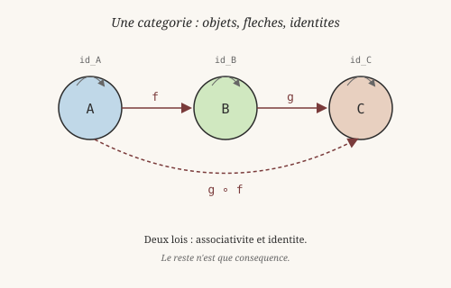
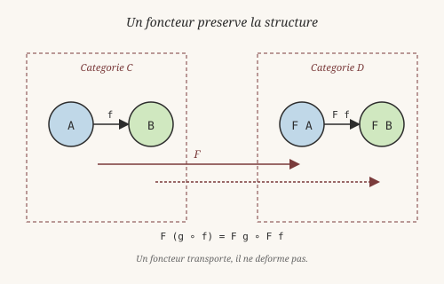
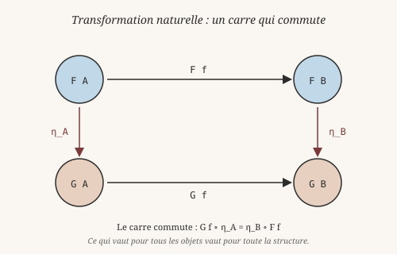

# Catégories : la structure derrière tout

> *« Je n'ai pas inventé les catégories pour étudier les foncteurs ;
> je les ai inventées pour étudier les transformations naturelles. »*
> — Saunders Mac Lane, entretien avec Gian-Carlo Rota (1997)

On a passé trois chapitres à construire des abstractions : schémas
de récursion, optiques, free monads. Elles se ressemblent. Toutes
parlent de **composition** — composer des folds, composer des
lenses, composer des programmes. Et toutes ces compositions ont
une structure commune.

Cette structure commune porte un nom : la **théorie des
catégories**. Elle a été inventée dans les années 1940 (Eilenberg
et Mac Lane) pour unifier des constructions algébriques, et elle a
envahi la programmation fonctionnelle dans les années 2000 via
Haskell, les monades, et les bibliothèques d'Edward Kmett.

Ce chapitre présente les idées de base : catégories, foncteurs,
monades, adjonctions, Yoneda. C'est un chapitre **conceptuel** —
Heaven V0 n'a pas le système de types nécessaire pour implémenter
ces notions directement, et il n'y a donc **ni code, ni test** ici.
Mais ces idées éclairent tout ce qu'on a vu avant.

## 1. La composition comme question première

En 1781, **Emmanuel Kant** (1724-1804) publie la *Critique de la
raison pure*. Il y distingue deux espèces de catégories : celles
d'**Aristote** (qu'on a vues au chapitre 2) — des *genres de
l'être*, des grilles ontologiques — et les siennes, les *catégories
de l'entendement* : les formes **a priori** que l'esprit impose à
toute expérience possible (substance, causalité, unité, pluralité,
etc.). La différence est importante : pour Kant, une catégorie
n'est pas une classe de choses dans le monde ; c'est une **manière
de structurer** ce qui nous apparaît.

Les catégories mathématiques, inventées bien plus tard, sont
exactement du côté de Kant : ce ne sont pas des classes d'objets,
mais des **manières de regarder** des structures. Ce qui importe
n'est pas *ce que sont* les objets, mais *comment ils se
composent*.

En 1945, **Samuel Eilenberg** (1913-1998) et **Saunders Mac Lane**
(1909-2005) publient *General Theory of Natural Equivalences*. Ils
ne cherchent pas à fonder une nouvelle branche des mathématiques :
ils veulent clarifier des calculs en topologie algébrique. Ce
qu'ils découvrent, c'est qu'une même structure — objets, flèches,
composition — sous-tend des situations apparemment sans rapport.
Ils l'appellent *catégorie* en hommage à Kant et Aristote, et
posent les deux lois qui la définissent.

## 2. Objets et flèches — la définition minimale

Une **catégorie** est :

1. Une collection d'**objets**.
2. Pour chaque paire d'objets `A`, `B`, une collection de
   **morphismes** de `A` vers `B`, notés `A → B`.
3. Une **composition** : si `f : A → B` et `g : B → C`, alors
   `g ∘ f : A → C`.
4. Un **morphisme identité** pour chaque objet : `id_A : A → A`.

Plus deux lois :

- **Associativité** : `h ∘ (g ∘ f) = (h ∘ g) ∘ f`.
- **Identité** : `id ∘ f = f` et `f ∘ id = f`.

C'est tout. Une catégorie, c'est juste des objets, des flèches, une
composition, et une identité. Le reste suit. Comme le dit Mac Lane
dans une formule restée célèbre : *« la théorie des catégories,
c'est l'étude de la composition »* — et cette phrase dit exactement
pourquoi la notion a envahi la programmation fonctionnelle : parce
que programmer, c'est composer.

## 3. Exemples : la même structure partout

**La catégorie `Set`.** Les objets sont les ensembles, les
morphismes sont les fonctions. La composition est la composition
de fonctions. L'identité est `\x. x`.

**La catégorie `Hask`.** C'est le monde des types et des fonctions
en Haskell (ou en Heaven). Les objets sont les types, les
morphismes sont les fonctions entre types. `id_A` est la fonction
identité sur `A`.

**La catégorie des propositions.** Les objets sont des
propositions logiques, les morphismes sont des preuves d'implication.
`A → B` signifie « `A` implique `B` ». La composition est le
modus ponens : de `A → B` et `B → C`, on déduit `A → C`. C'est la
**correspondance de Curry-Howard**, la même qui relie types et
preuves au chapitre 8.

**Un monoïde comme catégorie.** Une catégorie à un seul objet,
dont les morphismes sont les éléments d'un monoïde. La composition
est l'opération du monoïde. L'identité est l'élément neutre.

Ces exemples montrent la force de la notion : elle **abstrait** des
situations apparemment différentes sous un même formalisme. C'est
le geste même de la pensée catégorique — et, en un sens, le geste
que **Hermann Weyl** (1885-1955) appelait déjà de ses vœux dans
*Philosophie des mathématiques* (1927) : voir les mathématiques
comme l'étude de **structures**, non d'objets isolés.

## 4. Foncteurs — ce qui préserve la structure

Un **foncteur** est une transformation entre catégories. Il envoie :

- Chaque objet `A` de la catégorie source vers un objet `F A` de
  la catégorie cible.
- Chaque morphisme `f : A → B` vers un morphisme `F f : F A → F B`.

Et il doit préserver les lois :

- `F (g ∘ f) = F g ∘ F f` (compose puis transforme = transforme puis compose).
- `F (id_A) = id_{F A}`.

En Haskell, `Functor` est une classe de types qui a une méthode
`fmap` :

    class Functor f where
        fmap :: (a -> b) -> f a -> f b

`fmap` dit : « si tu as une fonction `a → b`, je peux l'appliquer
*à l'intérieur* de mon contexte `f` ». Pour les listes, `fmap = map`.
Pour `Maybe`, `fmap` applique la fonction si la valeur est `Just`,
sinon retourne `Nothing`.

Un foncteur n'ajoute rien : il **transporte**. C'est cette
transparence qui en fait l'outil générique de transformation entre
structures. On retrouve ce geste partout où un même calcul se
transpose d'un contexte à un autre.

## 5. Monades et adjonctions — les structures qui produisent

Une **monade** est un endofoncteur (un foncteur `M` d'une catégorie
vers elle-même) muni de deux transformations naturelles :

- **`return`** (ou `pure`) : `a → M a`. Envoie une valeur dans la
  monade.
- **`join`** (ou `>>=`) : `M (M a) → M a`. Aplatit deux couches.

Le nom vient du philosophe **Gottfried Wilhelm Leibniz**
(1646-1716), qui publie en 1714 la *Monadologie* : pour lui, toute
réalité est composée de **monades**, des substances simples,
sans parties, chacune reflétant l'univers tout entier depuis son
point de vue. La monade mathématique n'a rien à voir — elle a été
nommée ainsi par analogie formelle, pour sa simplicité
irréductible et son auto-composition. Mais l'hommage est parlant :
là où la monade de Leibniz est *une substance qui contient tout le
monde*, la monade mathématique est *une structure qui contient
tout un effet*.

On retrouve `return` dans `ret x = (Pure x)` du chapitre précédent.
Le `>>=` est cette fameuse opération qui chaîne deux programmes
monadiques. C'est **le** point qui nous a manqué dans le module
`free.hvn`.

Les lois des monades (identité à gauche, à droite, associativité)
sont exactement les lois d'une catégorie, transposées à l'aide du
foncteur `M`.

## 6. Adjonctions — le concept unificateur

Une **adjonction** est une paire de foncteurs `F : C → D` et
`G : D → C` tels que... la définition complète demande vingt
lignes de diagrammes. En pratique : `F` et `G` sont « presque
inverses », mais pas tout à fait. On note `F ⊣ G` (« `F` est
adjoint à gauche de `G` »).

Les adjonctions sont importantes parce qu'elles **produisent** la
plupart des structures utiles :

- Les **produits** (les `Pair` de Heaven) sont des adjoints
  à droite d'un foncteur « duplication ».
- Les **sommes** (les `data ... | ...`) sont des adjoints à gauche
  d'un foncteur diagonal.
- Les **free monads** du chapitre 16 sont exactement l'**adjoint à
  gauche** du foncteur oubli qui envoie une monade vers son type
  sous-jacent.
- Les **lenses** du chapitre 15 sont des adjoints à droite dans
  une certaine catégorie.

L'adjonction est le **motif** derrière presque toutes les
constructions abstraites. Si on devait garder une seule idée de
la théorie des catégories, ce serait celle-là. C'est ce que
**William Lawvere** (1937-2023) a tenté de formaliser dans les
années 1960, en proposant la théorie des catégories comme
*fondement* alternatif des mathématiques — rivalisant avec la
théorie des ensembles.

## 7. Yoneda — identité et relations

Le **lemme de Yoneda** dit (dans sa version courte) :

> Un objet est entièrement déterminé par les morphismes qui
> arrivent vers lui (ou par ceux qui partent de lui).

En Haskell, ça donne :

    -- Yoneda : un conteneur F a est isomorphe à :
    forall b. (a -> b) -> F b

L'idée : au lieu de stocker une valeur `a` dans un conteneur
`F a`, on stocke la **fonction** qui sait quoi faire avec cette
valeur.

C'est formulé par **Nobuo Yoneda** (1930-1996) en 1954, dans un
contexte technique de topologie algébrique. Mais la formule a une
portée philosophique qui dépasse de loin son origine : elle dit
qu'**un objet n'est rien d'autre que l'ensemble de ses relations**.
On retrouve là une intuition que Leibniz déjà formulait avec son
principe d'identité des indiscernables : deux choses qui se
comportent identiquement dans tous les contextes *sont* la même
chose. Le Yoneda formalise ce principe, en montrant qu'il est
constructif — on peut *reconstruire* l'objet à partir de ses
relations.

Ce lemme est partout : dans les encodages de Church, dans les
transforms de données, dans les parseurs. « Dis-moi ce que tu
fais, je te dirai qui tu es. »

## 8. Pourquoi Heaven V0 ne peut pas (encore)

Toutes ces notions supposent un **système de types riche** que
Heaven n'a pas en V0. Décrivons les blocages précis.

**1. Pas de higher-kinded types (HKT).** Une monade `M` est un
*foncteur*, c'est-à-dire un **constructeur de type** : `M a` est un
type pour chaque type `a`. En Haskell, on peut écrire `Functor f`
où `f` est un paramètre de type — c'est ce qu'on appelle un type
higher-kinded. Heaven V0 n'a pas ça : les `data` sont monomorphes
ou paramétrés mais on ne peut pas abstraire sur le constructeur
lui-même.

**2. Pas de classes de types.** `class Monad m where ...` définit
une **interface** que plusieurs types peuvent implémenter. Heaven
n'a pas de mécanisme équivalent. Chaque monade doit être écrite à
la main, comme on a fait pour `free.hvn`.

**3. Pas de quantification universelle.** Le lemme de Yoneda
s'écrit `forall b. (a -> b) -> F b`. Ce `forall` est une
quantification sur les types, que le système ne supporte pas.

**4. Pas de transformations naturelles.** En Haskell, une
transformation naturelle entre foncteurs `F` et `G` est une
fonction `forall a. F a -> G a`. C'est ce qui permet
d'**interpréter** un free monad : on définit une transformation
du foncteur d'opérations vers une monade cible. Sans quantification
universelle, on ne peut pas exprimer ça.

**Verdict** : la théorie des catégories est **le cadre** dans lequel
toutes les abstractions qu'on a vues prennent sens. Mais Heaven V0
n'a pas les primitives de types nécessaires pour les exprimer
directement. On peut seulement les **utiliser** au cas par cas, comme
on a fait pour `cata`, `lens`, `free`. C'est ce que le mathématicien
et informaticien **Bartosz Milewski** (né en 1967), auteur de
*Category Theory for Programmers*, appelle le passage « du cas
particulier au motif » — un passage qui demande des outils que V0
n'a pas encore.

## 9. Ce qu'on peut faire sans catégories explicites

Même sans le formalisme, l'**esprit** catégorique est présent dans
tout ce qu'on a fait :

- `recursion.hvn` : les schémas de récursion sont des
  transformations naturelles entre foncteurs (implicites).
- `lens.hvn` : les lenses sont des optiques, dont la théorie
  catégorique est bien établie (profunctor optics).
- `free.hvn` : les free monads sont l'adjoint à gauche du foncteur
  oubli, une adjonction classique.

Ce qu'on ne peut pas faire, c'est **écrire** la théorie une fois
pour toutes. On l'instancie à chaque cas. C'est un peu comme la
différence entre un langage dynamique où on écrit `map` pour chaque
type, et un langage statique où on écrit `Functor f => fmap` une
seule fois. Heaven V0 est dans le premier cas.

## Pourquoi documenter une théorie qu'on ne peut pas implémenter

Parce que la théorie **éclaire** tout ce qu'on a vu :

1. **Elle unifie.** Après ce chapitre, `cata`, `lens`, et `free`
   ne sont plus des outils isolés — ils sont trois instances du
   même motif catégorique.
2. **Elle oriente.** Si Heaven veut un jour exprimer ces notions
   directement, ce chapitre donne la feuille de route : HKT,
   classes de types, quantification universelle.
3. **Elle prépare.** Les bibliothèques modernes d'effets
   (`polysemy`, `fused-effects`, `mtl`) reposent sur ces
   abstractions. Comprendre les catégories, c'est comprendre la
   direction dans laquelle la programmation fonctionnelle
   avancée va.

C'est la même logique que pour les optiques (Ch15) et les free
monads (Ch16) : **mieux vaut un chapitre honnête sur les limites
qu'un bricolage qui trahit l'idée**.

## Pour aller plus loin

- *Categories for the Working Mathematician* (Saunders Mac Lane,
  1971) — la référence historique.
- *Category Theory for Programmers* (Bartosz Milewski, 2017-2019)
  — accessible, avec des exemples en Haskell. **Fortement
  recommandé** comme point d'entrée.
- *Theorems for Free!* (Philip Wadler, 1989) — comment la
  paramétricité des types donne des théorèmes gratuits, un
  résultat directement inspiré de Yoneda.
- La bibliothèque **`lens`** d'Edward Kmett — un cas d'école : sa
  théorie repose sur les profunctors et l'adjonction.
- La bibliothèque **`free`** — implémente la monade libre comme
  adjoint à gauche du foncteur oubli.
- La bibliothèque **`adjunctions`** — l'abstraction centrale de
  Kmett, dont dérivent lenses, free monads, et bien d'autres.

---

Tu as maintenant une vue d'ensemble. On a construit des types,
prouvé des théorèmes, géré des effets, composé des streams, foldé
des structures, accédé en profondeur, décrit des programmes,
et survolé la théorie qui relie tout cela. Il reste un dernier
chapitre : **Under the Hood**. On ouvre le capot, on regarde le
noyau à 6 primitives, le tree-walker, le compilateur, et comment
tout tient ensemble.
