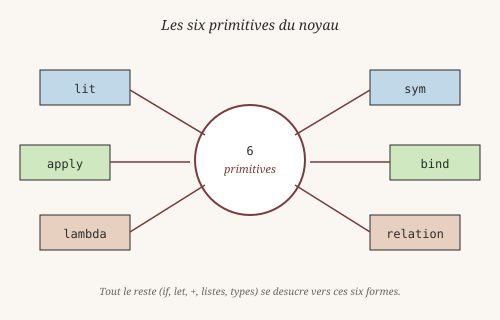
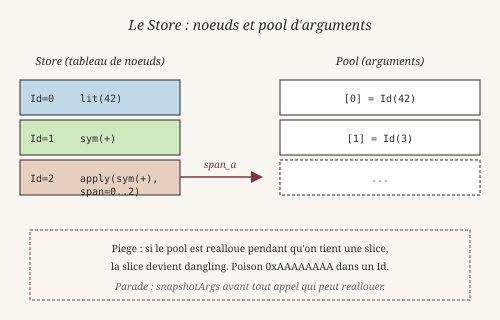
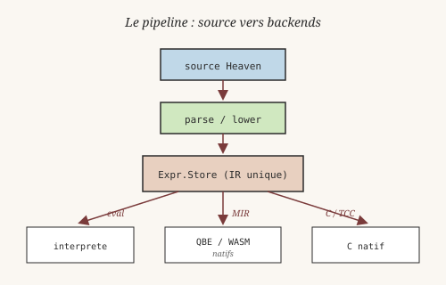

# Chapitre 18 — Under the Hood

> *« Toute la géométrie tient en cinq postulats. Toute la
> programmation peut tenir en quelques primitives — à condition de
> choisir les bonnes. »*
> — à la manière d'Euclide, *Éléments*, Livre I (v. 300 av. J.-C.)

Dernier chapitre. On a vu comment **utiliser** Heaven. Maintenant,
regardons comment il est **fait**. Pas parce que vous allez le
modifier tout de suite, mais parce que comprendre la mécanique rend
meilleur programmeur — et parce qu'un langage qu'on ne comprend pas
est un langage qu'on ne peut pas aimer.

## 1. Pourquoi un noyau minimal

En 1936, **Alonzo Church** (1903-1995) invente le λ-calcul avec
**trois** constructions : une variable, une abstraction, une
application. Trois règles, et tout le calcul y tient — y compris
les entiers, les booléens, les listes. **Alan Turing** (1912-1954)
la même année propose sa machine, avec un ruban, une tête, un
état : aussi minimal. Ces deux formalismes, radicalement différents,
calculent **exactement** la même classe de fonctions — c'est la
thèse de Church-Turing.

La leçon n'a pas vieilli : **un langage utile n'a pas besoin d'un
gros noyau**. Il a besoin d'un noyau **suffisant**, et d'un
frontend riche par-dessus. C'est la même idée qu'Euclide : cinq
postulats suffisent à déduire toute la géométrie plane. Le reste
est **dérivé**.

Heaven suit cette tradition. Six primitives, pas une de plus. Tout
le reste — `if`, `let`, `+`, `*`, les listes, les types dépendants
— se **désucre** vers ces six formes.

## 2. Les six primitives

*Figure : les six primitives **spécifiées**. Dans l'implémentation
actuelle, cinq sont câblées dans `expr.zig` ; `relation` est
spécifiée mais absente du Store (voir encadré plus bas).*

Voici les six formes irréductibles de Heaven :

1. **`lit`** : un littéral (entier, flottant, chaîne, booléen).
2. **`sym`** : un symbole (un nom, comme `x` ou `add`).
3. **`apply`** : une application (`f a`).
4. **`bind`** : une liaison (`let x = e in body`).
5. **`lambda`** : une abstraction (`λx. body`).
6. **`relation`** : une relation (`Eq(a, b)`). **Spécifié, non
   implémenté** dans `expr.zig` — voir encadré ci-dessous.

> **État réel (2026-10-26).** Les tags effectivement présents dans
> `src/core/expr.zig` sont : `apply`, `sym`, `lit`, `bind`,
> `lambda`, et `other` (fallback). Le tag `relation` **n'existe
> pas** dans le Store — il est documenté comme primitive mais pas
> encore câblé. Les relations passent aujourd'hui par `apply` sur
> un symbole relationnel (ex. `(eq a b)` devient
> `apply(sym("eq"), [a, b])`). Voir `docs/spec/_claims_vs_reality.md`.

Tout le reste se désucre. Par exemple, `(+ 1 2)` devient
`apply(sym("+"), [lit(1), lit(2)])`. `if cond then a else b`
devient un apply particulier. Le compilateur traduit tout en
primitives, puis le reste du système ne connaît que ces six formes.

Ce geste — choisir un petit noyau et faire tout le reste par
désucrage — remonte en droite ligne à **John McCarthy** (1927-2011)
et son article de 1960, *Recursive Functions of Symbolic Expressions
and Their Computation by Machine*. Le Lisp original avait `atom`,
`eq`, `car`, `cdr`, `cons` — cinq primitives. McCarthy a montré
qu'on pouvait écrire un interpréteur universel (`eval`) avec juste
ça. Heaven suit la même méthode, avec une autre sélection de
primitives parce que le contexte est différent (types dépendants,
preuves), mais l'esprit est identique.

## 3. Le Store — comment on range tout ça

Toutes les expressions sont stockées dans un **Store**, un grand
tableau de nœuds. Chaque nœud a :

- un **tag** (parmi les primitives du noyau — voir encadré)
- un **payload** (un index ou une valeur)
- une **span** (une plage dans un pool d'arguments)

Un `Id` est un index dans ce tableau. Deux expressions identiques
ont souvent le même `Id` — c'est un **hash-consing** léger, dans
l'esprit de ce que **John von Neumann** (1903-1957) proposait
dès 1945 dans le *First Draft of a Report on the EDVAC* : au lieu
de traiter le code comme une chose spéciale, on le range comme une
donnée, dans une structure régulière qu'on peut parcourir
efficacement.

Pourquoi ce design ? Parce qu'il est **rapide** et **compact**.
Pas de pointeurs, pas d'allocation par expression. Tout vit dans un
tableau qu'on peut parcourir vite.

### Le pool et l'invariant critique

Les arguments d'un `apply` ne sont pas dans le nœud lui-même : ils
sont dans un **pool** séparé. Un nœud `apply` a une `span_a` qui
pointe vers une plage du pool.

C'est efficace, mais ça crée un piège : si le pool est réalloué
pendant qu'on tient une slice vers lui, la slice devient **dangling**.
C'est le bug le plus fréquent de Heaven. Un poison `0xAAAAAAAA` dans
un `Id` signale qu'on lit de la mémoire libérée.

La parade : **snapshotter** avant tout appel qui peut réallouer. La
fonction `snapshotArgs` du Store encapsule ce pattern.

## 4. L'évaluateur et l'environnement

L'évaluateur est une fonction récursive `evaluate(store, env, engine,
id, depth)`. Elle prend un `Id` et rend un `Id` (la forme évaluée).

Elle a six branches, une par tag :

- `lit` : déjà une valeur.
- `sym` : cherche dans l'environnement, ou retourne le symbole.
- `apply` : évalue l'opérateur et les arguments, dispatch.
- `bind` : lie une valeur à un nom, évalue le corps.
- `lambda` : retourne tel quel (c'est une valeur).
- `relation` : **spécifié** (évalue les deux côtés, retourne un
  booléen). Non implémenté comme tag dans `expr.zig` — voir
  encadré section 2.

Le **dispatch** de `apply` est là où tout se joue. Selon l'opérateur,
on appelle une fonction utilisateur, un opérateur magique (`+`, `if`,
`handle`), ou un constructeur.

L'**environnement** (`Env`) est une `HashMap` de `Sym` vers `Id`. Un
`Sym` est un entier qui représente un nom interné. Toutes les chaînes
du programme vivent dans un **interner** (une table de chaînes
uniques). L'environnement est **lexical** : quand on entre dans une
lambda, on copie l'environnement courant et on ajoute la liaison du
paramètre. C'est simple, et ça évite les fuites de portée. C'est une
version concrète du modèle de substitution que Church décrivait en
1936 — la copie évite les captures accidentelles que le λ-calcul
nommé doit gérer par α-renommage.

## 5. Découper un monolithe

À l'origine, tout le frontend vivait dans un seul fichier,
`heaven_expr.zig` : le REPL, les tactiques, les imports, les types
dépendants, le chargement de la stdlib. 4000 lignes. Ça marchait,
mais ça freinait tout — impossible de tester une partie isolément,
impossible de lire la structure sans tout avaler.

Le découpage (RFC-0001) a extrait six modules :

- `io_handler.zig` — `print`, `readFile`, entrées/sorties.
- `expr_parser.zig` — parsing des expressions (infixe, S-expr,
  lambda).
- `hole_runtime.zig` — les trous `_`, leur raffinement, leur
  description.
- `std_loader.zig` — chargement des fichiers `core/std/*.hvn` au
  boot.
- `import.zig` — résolution de chemins, cycles, exports.
- `unify_proof.zig` — unification de premier ordre pour les
  tactiques.

C'est exactement le principe que **David Parnas** (né en 1942)
formulait en 1972 dans *On the Criteria To Be Used in Decomposing
Systems into Modules* : un module ne doit pas être une étape dans
un organigramme, il doit cacher une **décision de conception**. Et
ce que **Barbara Liskov** (née en 1939) systématisera en 1974 avec
Stephen Zilles sous le nom d'*abstract data types* : on expose un
**contrat**, on cache l'implémentation.

Chaque module de Heaven suit un contrat précis. Il ne connaît
**pas** la struct `Heaven` — ça créerait un cycle d'import. Il prend
un paramètre `heaven: anytype`, et Zig résout les champs à la
compilation : `heaven.allocator`, `heaven.eval`, `heaven.current_module`.
Si un champ manque, le compilateur le dit. Il retourne ses propres
erreurs (`ImportError = error{OutOfMemory}`), et le wrapper dans
`heaven_expr.zig` traduit en `HeavenError`.

C'est un peu inhabituel — en général, on préfère des interfaces
explicites. Mais pour un projet solo, c'est un compromis
raisonnable : pas de fichier `interface.zig` à maintenir, pas de
boilerplate, et le compilateur vérifie tout.

## 6. Deux sortes de trous — un piège silencieux

Il y a **deux** notions de « trou » dans Heaven, et les confondre
mène à des bugs silencieux.

Le premier est `Tag.hole`. C'est ce que vous tapez quand vous
écrivez `_` dans un programme. Un trou, c'est « je ne sais pas
encore quoi mettre ici ». Le REPL peut vous demander de le raffiner.
Il ne participe pas à l'unification.

Le second est `Tag.evar`. C'est une **métavariable** interne.
Personne ne la tape. Les tactiques la créent quand elles ont besoin
de nommer un inconnu à unifier. `unify` sait la lier.

Le piège : quand on a introduit v2d (unification d'indexes
dépendants), le code produisait `Vec (succ _)` avec `_` parsé en
`Tag.hole`. Puis il appelait `unify`. Mais `unify` ne lie que les
`Tag.evar`. Résultat : la substitution restait **toujours vide**.
Le mécanisme était un no-op silencieux.

Les tests v2d ne l'ont pas vu, parce qu'ils vérifiaient le résultat
d'un appel (`head (Cons 42 Nil) → 42`), et le pattern matching liait
`x := 42` indépendamment de l'unification. C'est le genre de bug
qu'on ne trouve qu'en testant **la chose qu'on croit avoir
ajoutée**. v2e a ajouté un test qui vérifie explicitement que la
substitution n'est pas vide. Il a échoué. C'était le bon signal.

Le fix : `holesToEvars`, une méthode qui parcourt un `Id`, remplace
chaque `Tag.hole` par un `Tag.evar` frais, et laisse le reste intact.
Avant d'unifier, on convertit. Aujourd'hui, ce mécanisme tourne mais
ne change encore rien en pratique — le body d'une clause est parsé
depuis une string utilisateur, il n'y a jamais d'evar dedans. v2e
est préparatoire à v2f (unification vraie modulo arithmétique,
`Vec (n + m)`).

## 7. Un bug vieux de deux ans

Un dernier détail, dans le Store.

Un nœud `apply` a deux champs : `payload` (l'opérateur) et `span_a`
(les arguments). Quand on a voulu ajouter `Store.pi` — la construction
du type Π, celui de `(n : Nat) -> Vec n -> a` — on a écrit un code
qui mettait un `Id` dans `payload`.

C'était faux. `payload` doit contenir un **Sym** (un entier interné)
pour `apply`, et un **Id** pour d'autres tags. Le compilateur ne le
dit pas, parce que `payload` est un `u32` unique qui accepte les
deux par coercition. On l'a découvert en écrivant v2c, quand
`sig head : ... -> a` se comportait bizarrement.

**Tony Hoare** (né en 1934), inventeur de la référence nulle en
1965, a présenté en 2009 des excuses publiques pour ce qu'il a
appelé sa *« billion dollar mistake »* : une valeur qui peut être
n'importe quel type parce que le type system ne distingue pas.
Le bug de `Store.pi` est du même genre, en miniature : `u32` peut
cacher n'importe quoi, parce que `payload` n'a pas de type qui
distingue « Sym » de « Id ». **Fernando Corbató** (1926-2019),
Turing Award 1990, avait résumé la leçon en une phrase restée
célèbre : *« the devil is in the details »* — et dans un langage
non typé, le diable se cache précisément dans ces `u32`
polymorphes.

Le fix est une ligne. La leçon dure plus longtemps : le hash-consing
aide, mais ne remplace pas la discipline.

## 8. Knowledge, ontologie, catalogue

Heaven distingue maintenant trois choses qui avaient historiquement
été mélangées. Le fichier `src/core/algo_catalog.zig` est un
**catalogue d'algorithmes** : il enregistre des implémentations,
leur complexité, et des informations permettant un choix contextuel.
Ce n'est pas une ontologie RDF. `src/core/ontology.zig` est un
ancien squelette sémantique conservé pour compatibilité et
expérimentation — il n'est pas le chemin de compilation du langage.

La nouvelle couche `src/knowledge/` représente explicitement des
connaissances RDF/RDFS :

    resource.zig
    triple.zig
    assertion.zig
    store.zig
    rdfs.zig

Elle possède son propre espace d'identifiants (`KnowledgeId`) et ne
partage pas les identifiants `Expr.Id`.

**Michel Foucault** (1926-1984) publie en 1969 *L'Archéologie du
savoir*. Son projet : décrire les **formations discursives** — les
règles qui font qu'à une époque donnée, certains énoncés sont
possibles et d'autres non. Sa méthode consiste précisément à
**séparer des strates** qu'on croyait continues, à refuser les
synthèses faciles, à distinguer des ordres de discours différents.

Heaven applique la même discipline : plutôt que de prétendre
qu'« une connaissance » et « une expression » sont la même chose
parce qu'elles vivent toutes les deux dans un Store, on distingue
**deux ordres** :

    Knowledge
       |
       | lowering explicite
       v
      Expr
       |
       v
      MIR
       |
       v
    backend

Cette règle permet d'ajouter RDF, RDFS ou d'autres sources de
connaissances sans multiplier les IR concurrents. `Expr` reste le
seul IR compilable de Heaven.

### Provenance et déduction

Une assertion Knowledge conserve son origine. Le reasoner RDFS
produit des assertions `inferred`, mais ne modifie pas le Store
source. Cela permet de distinguer quatre statuts :

    asserted   -> ce qu'une source affirme
    imported   -> ce qui a ete importe
    derived / inferred -> ce que le systeme deduit
    certified  -> ce qui dispose d'une certification explicite

La provenance et la *confidence* restent des dimensions séparées
du *status*.

## 9. Le noyau de preuve

À part, il y a le **noyau** (`kernel.zig`). Il ne partage rien avec
l'évaluateur : ses propres types de termes, son propre vérificateur.
C'est volontaire. Un noyau doit être **simple** et **autonome** pour
être auditable.

Le noyau a ~500 lignes de logique. Il implémente :

- l'inférence de types (`infer`)
- la vérification (`check`)
- la réduction (`whnf`, `eval`)
- la conversion (`subst`)

Quand vous prouvez un théorème, le noyau est le seul juge.

**Edsger W. Dijkstra** (1930-2002) écrivait en 1968 dans *A
Discipline of Programming* : *« Simplicity is prerequisite for
reliability. »* Le noyau de preuve est la matérialisation de cette
phrase : ce qui doit être **cru** (au sens logique) doit être
**petit**. Un vérificateur de 500 lignes peut être lu, compris,
audité par un humain. Un vérificateur de 50000 lignes, non — il
faut le croire sur parole, ce qui revient à ne rien vérifier.

## 10. Pipeline syntaxique HIR pour les déclarations `data`

Depuis octobre 2026, les déclarations de types paramétrés passent
par un chemin syntaxique explicite avant l'élaboration :

    source Heaven
          |
          v
    Tree-sitter CST
          |
          v
    syntax/lower.zig
          |
          v
    ast.DataDecl
          |
          v
    elabDataDecl
          |
          v
    TypeRegistry / runtime

Par exemple :

    data List<a> = Nil | Cons a (List<a>)

est reconnu par le parseur puis abaissé en un nœud HIR `DataDecl`
contenant le nom du type, ses paramètres et ses constructeurs.

Le champ `DataDecl.params` conserve les paramètres génériques au
niveau HIR. La propagation est faite pour le REPL (`evalDataDecl`,
commit `f213218`), Tree-sitter accepte `<a>`, et le corps des
constructeurs (`Cons a (List<a>)`) est correct.

## 11. Les backends compilés : MIR, QBE, WASM

Au-delà de l'interprète et du backend C (TinyCC embarqué pour
compiler du C à la volée), Heaven a un pipeline de compilation qui
passe par un IR intermédiaire, le **MIR** (Middle IR). Le MIR est
un langage à base de blocs basiques, avec des instructions simples
(arithmétique sur i64, comparaisons, sauts, phi). Deux backends
consomment ce MIR :

- `mir_qbe.zig` : émet de l'IL QBE, qui est ensuite compilé par
  l'outil `qbe` vers du code natif (x86-64, ARM, RISC-V).
- `mir_wat.zig` : émet du WAT (WebAssembly text), exécutable par
  wasmtime ou tout runtime WASM.

C'est l'idée d'**un seul lowering, N consommateurs** — la même que
**Frances Allen** (1932-2020, première femme Turing Award, 2006) a
défendue tout au long de sa carrière sur l'optimisation des
compilateurs : construire des IR intermédiaires **stables et
génériques**, et spécialiser uniquement en bout de chaîne. Les deux
backends de Heaven font ~200 lignes chacun, lisibles, testables
isolément.

### Tail Call Optimization

Deux formes de TCO sont implémentées (octobre 2026) :

**Self-tail-calls** — une fonction qui s'appelle elle-même en
position terminale. Détectés dans les deux backends, transformés en
boucle. Le pattern : `call_user` en dernière instruction d'un bloc,
suivi d'un `ret` direct ou d'un `jump` vers un bloc join pur
(`phi + ret`). Le backend émet alors : instructions normales, copie
des args vers temporaires, copie des temporaires vers les registres
de paramètres, saut au bloc d'entrée.

En QBE, qui est en SSA strict, le bloc d'entrée porte des **phi
nodes** pour chaque paramètre (valeur prise de `@entry` ou d'un bloc
TCO). En WASM, les locals sont mutables, un simple `local.set`
suffit.

**Récursion mutuelle** — deux fonctions qui s'appellent l'une
l'autre en position terminale (`isEven`/`isOdd`). Chaque backend a
sa stratégie :

- **WASM** : instruction native `return_call` (proposal tail-call,
  supportée par wasmtime 49). Aucune transformation, le moteur fait
  le travail.
- **QBE** : QBE 1.2 ne connaît pas les tail-calls. La solution est
  une **fusion SCC au niveau MIR** : les deux fonctions deviennent
  une seule fonction avec un tag de dispatch, les appels internes
  deviennent des sauts. Le backend ne voit qu'une fonction normale.

Conséquence : `count_down 10000000` et `isEven 100000000` compilent
et tournent sans exploser la pile. Sur WASM, le flag
`-W max-wasm-stack=67108864` n'est plus nécessaire.

**SCC de taille arbitraire** — depuis octobre 2026, la fusion SCC
couvre aussi les cycles de 3+ fonctions (`f -> g -> h -> f`). Chaque
SCC devient une fonction avec un tag dispatch à N branches. Vérifié :
`f 1000000 = 200` sur un cycle de 3.

**Non couvert** : trampolines généraux (tail-calls inter-fonction
hors du SCC), et SCC dont les membres ont des arités différentes.

### Cross-compilation

QBE supporte 5 cibles natives. `compile-qbe` accepte un flag
`--target` :

    ./zig-out/bin/heaven compile-qbe fib.hvn -o fib.s --target arm64
    ./zig-out/bin/heaven compile-qbe fib.hvn -o fib.s --target rv64

Sans `--target`, le comportement est natif : QBE émet pour la
machine courante, `cc` assemble et link, un binaire exécutable est
produit. Avec `--target`, QBE émet l'assembleur pour la cible
demandée et on s'arrête là (fichier `.s`). Un cross-cc
(`aarch64-linux-gnu-gcc`, `riscv64-linux-gnu-gcc`) est nécessaire
pour produire le binaire final, il n'est pas géré par Heaven.

Cibles disponibles : `amd64_sysv` (Linux x86-64), `amd64_apple`
(macOS Intel), `arm64` (Linux ARM64), `arm64_apple` (macOS Apple
Silicon), `rv64` (RISC-V 64 bits).

## 12. La philosophie

**Christopher Alexander** (1936-2022) publie en 1964 *Notes on the
Synthesis of Form*. Son idée directrice : la **forme** d'un objet
n'est pas arbitraire, elle est **l'ajustement** entre des forces
qui se contredisent. Un bon design n'est pas celui qui élimine les
forces, mais celui qui trouve la configuration où elles
s'équilibrent.

Trois principes structurent Heaven dans cet esprit :

1. **Un noyau minimal, un frontend riche.** Le noyau vérifie les
   preuves. Le frontend offre des tactiques, du sucre syntaxique,
   des raccourcis. Les deux communiquent par un AST bien défini.
   Deux forces opposées — la rigueur et la commodité — qui trouvent
   leur équilibre dans cette séparation.

2. **Zéro dépendance externe.** Tout est vendu avec le code source :
   TCC, tree-sitter, les parseurs. Pas de `apt install`, pas de
   `cargo`. Le projet compile seul.

3. **Iso-fonctionnalité.** Le natif et le web font la même chose.
   Le test `test_suite.hvn` tourne dans les deux.

## 13. Ce qui reste à faire

Heaven est un projet jeune. Il reste :

- **Multi-shot continuations** : les continuations délimitées
  one-shot (`@prompt`/`@throw`) sont livrées ; le multi-shot
  demande un clonage d'environnement et de Store (voir
  `docs/spec/_continuations.md`).
- **QTT intégré** : la gestion mémoire par multiplicité (0/1/ω)
  est une cible (voir `docs/spec/_memory.md`). Aujourd'hui, la
  couche mémoire est explicite (`core/std/memory.hvn` + `Arena`).
- **Les types quotients** dans le noyau CIC.
- **Un scheduler** préemptif (coopératif aujourd'hui ; C3 partiel :
  safepoints + budget + `TaskState.preempted` depuis 2026-10.
  Reprise exacte en attente d'A-3b, cf. `docs/spec/_capture_eval.md`).
- **Des cycles SCC** de 3+ fonctions pour la TCO mutuelle (QBE).
- **L'unification d'indexes** dépendants au-delà de v2f
  (`Vec (n + m)` modulo arithmétique complète).
- **Absorber Vessel** : migrer REPL, IDE, monitoring, E-Graph
  viewer vers la stack HTTP Heaven-native
  (`core/http_server.hvn`).

Chaque point est identifié. La structure est prête. C'est une
question de temps et de contributions.

## Le mot de la fin

**Alan Kay** (né en 1940), l'un des pères de la programmation
orientée objet et du Xerox PARC, a dit un jour : *« The best way to
predict the future is to invent it. »* Heaven n'est pas parfait.
Il est jeune, parfois rugueux, avec des coins non polis. Mais il
essaie quelque chose d'ambitieux : faire tenir dans un même langage
la légèreté d'un REPL, la rigueur d'un assistant de preuve, et la
réactivité des systèmes modernes.

Vous avez traversé dix-huit chapitres. Vous savez écrire des
fonctions, manipuler des listes et des streams, gérer des effets,
prouver des théorèmes. Vous savez aussi comment tout ça tient
ensemble — cinq primitives câblées (relation spécifiée), un Store,
un noyau de preuve, un
pipeline de compilation, et une discipline de séparation entre
strates.

Si vous voulez contribuer, tout est sur GitHub. Si vous voulez
juste l'utiliser, le REPL vous attend. Dans tous les cas,
amusez-vous bien.

À bientôt.
