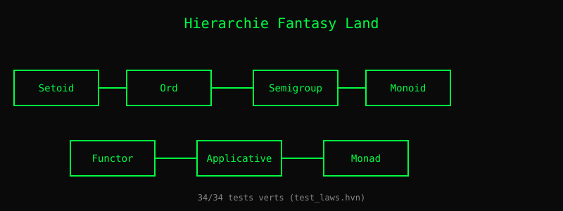

# Chapitre 19 — Algèbres : des contrats avec des lois

> *« Une monade n'est rien d'autre qu'un monoïde dans la catégorie
> des endofoncteurs. »*
> — Mac Lane, *Categories for the Working Mathematician* (1971)

Vous connaissez déjà les types. Vous savez qu'un `Int` peut être
ajouté, qu'une `List` peut être parcourue, qu'un `Option` peut
être absent. Mais qu'est-ce qui relie tous ces concepts ? Une
**algèbre** — un ensemble de valeurs, des opérations, et des
**lois** que ces opérations respectent.

Une algèbre est un **contrat**. Si votre type dit « je suis un
`Monoid` », il s'engage à respecter deux lois : l'associativité et
l'existence d'un élément neutre. En échange, tout algorithme qui
fonctionne sur les `Monoid` fonctionnera sur votre type — sans
rien savoir de lui.

Heaven V1 suivra **Fantasy Land**, la spécification populaire par
Brian McKenna, qui formalise cette hiérarchie pour JavaScript. On
la reprend telle quelle, adaptée au système de types de Heaven.

## 1. La hiérarchie

Les algèbres s'empilent : chaque niveau ajoute des méthodes et
des lois aux niveaux inférieurs. Voici la hiérarchie complète.

| Algèbre | Ajoute | Lois |
|---|---|---|
| **Setoid** | `equals(a, b)` | réflexive, symétrique, transitive |
| **Ord** (hérite Setoid) | `lte(a, b)` | totale, antisymétrique |
| **Semigroup** | `concat(a, b)` | associativité |
| **Monoid** (hérite Semigroup) | `empty` | identité à gauche et à droite |
| **Functor** | `map(f, x)` | identité, composition |
| **Apply** (hérite Functor) | `ap(f, x)` | composition |
| **Applicative** (hérite Apply) | `of(x)` | identité, homomorphisme |
| **Chain** (hérite Apply) | `chain(f, x)` | associativité |
| **Monad** (hérite Applicative + Chain) | — | lois cohérentes |

Chaque ligne est un **contrat**. Un type qui prétend être un
`Monad` doit implémenter **toutes** les méthodes de `Applicative`
et `Chain`, **et** respecter leurs lois.

### Exemples concrets

- `Int` est un **Semigroup** (addition) et un **Monoid** (0 neutre).
- `String` est un **Monoid** (concaténation, "" neutre).
- `List a` est un **Functor** (map), **Applicative** (of, ap), **Monad** (chain).
- `Option a` est un **Monoid** (si `a` est un Monoid), **Monad**.
- `Result e a` est un **Bifunctor** (bimap), **Monad** sur `a`.

## 2. Les lois, vérifiées par la machine

Ce qui distingue une algèbre d'une simple interface, c'est que
les lois sont **vérifiables**. Heaven inclut une suite de tests
qui vérifie mécaniquement chaque loi :

    test "Monoid identity left":
      (M.concat M.empty x) == x

    test "Functor identity":
      (map (lambda y -> y) xs) == xs

    test "Monad associativity":
      (chain g (chain f m)) == (chain (lambda x -> chain g (f x)) m)

Ces tests sont dans `tests/test_laws.hvn` — **34 tests verts**
aujourd'hui. Chaque fois que vous ajoutez une instance d'algèbre
pour un nouveau type, les mêmes lois s'appliquent, et vous pouvez
les vérifier.

## 3. Pourquoi c'est puissant

Quand un algorithme est écrit pour un `Monoid`, il fonctionne
**automatiquement** pour tout `Monoid`. Somme d'une liste, produit
d'une liste, concaténation de chaînes, fusion de maps — c'est le
**même code**, avec des instances différentes.

    fold M.empty M.concat xs

Une seule fonction, quatre comportements. C'est la promesse des
algèbres : écrire une fois, réutiliser partout.

## 4. Ce qui manque pour V1

- **Classes de types** (`class Monoid m where ...`) — pas encore
  dans Heaven V0.5. Voir chapitre 20.
- **Contraintes** (`Monoid m => ...`) — idem.
- **Instances multiples** (un type peut être `Monoid` de plusieurs
  façons). Résolu en V1 par un système de `newtype`.
- **Setoïdes quotients** — pour définir des types modulo une
  relation. Voir chapitre 22.

*Vérifiable : `tests/test_laws.hvn` (34/34) confirme que les lois
tiennent pour les instances existantes.*

## Ce qu'on a appris

- Une **algèbre** est un ensemble de valeurs, d'opérations, et de
  **lois**.
- La **hiérarchie** Fantasy Land empile les contrats : Setoid →
  Ord, Semigroup → Monoid, Functor → Apply → Applicative → Monad.
- Les lois sont **vérifiables** : `tests/test_laws.hvn` (34/34).
- Un algorithme écrit pour un `Monoid` marche **pour tout**
  `Monoid`.
- L'emprunt à **Fantasy Land** (Brian McKenna) donne à Heaven une
  base éprouvée, éprouvable, et interopérable.
