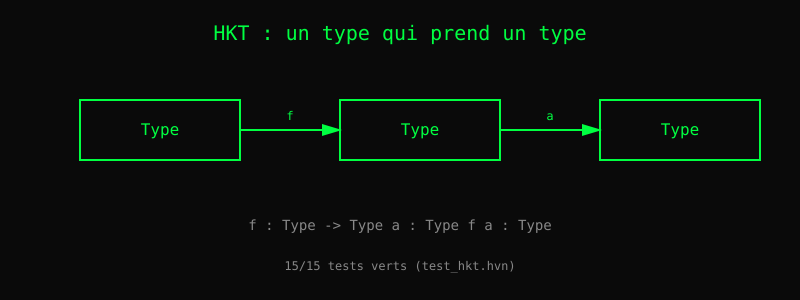

# Chapitre 20 — Types d'ordre supérieur

> *« En Haskell, `Maybe` n'est pas un type — c'est une fonction
>  sur les types. »*
> — Philip Wadler

Prenez `map`. Elle fonctionne sur les listes, mais aussi sur les
`Option`, les `Result`, les `Tree`, les `Stream`... Toutes ces
structures partagent une forme commune : elles **contiennent** des
valeurs. Comment écrire une seule `map` qui marche pour toutes ?

Heaven V0.5 accepte un constructeur de type en **position
d'argument** :

    sig wrap : (f : Type) -> (a : Type) -> f a -> f a

Ce `f` peut être `List`, `Maybe`, `Stream` — n'importe quel type
paramétré. C'est un **type d'ordre supérieur** (HKT).

## 1. Le cas proprement dit

    sig wrap : (f : Type) -> (a : Type) -> f a -> f a

- `f` est un type qui prend un type et en retourne un autre
  (`Type -> Type`).
- `f a` est l'application : `List Int`, `Maybe String`, etc.
- Le constructeur `f` apparaît en tête — c'est ça, un HKT.

Heaven V0.5 accepte cette signature. **15 tests verts** dans
`tests/test_hkt.hvn`.

## 2. Autres cas supportés

### Constructeur en argument sans `sig`

    id_t : (a : Type) -> a -> a

Ici `a` est un type ordinaire. C'est du polymorphisme paramétrique
classique, pas encore HKT — mais la syntaxe est prête.

### Type composé dans le domaine

    sig f_list : (a : Type) -> List a -> Int

Le domaine peut être une application de type paramétré.

## 3. Classes de types : V1 (2026-10-19)

### V1a — déclaratif

    class Functor f
    instance Functor List
    instance Functor Maybe

`class` et `instance` sont enregistrés (`engine.class_names`,
`engine.instance_pairs`). Magics `@class_count`, `@instance_count`.
Pas encore de dispatch.

### V1b — dispatch structurel (matching explicite)

Deux magics :

    (@resolve_instance "Functor" "List" "fmap")       -- -> "fmap_List"
    (@resolve_instance "Functor" "Int" "fmap")        -- -> ""
    (@dispatch_instance "Functor" "List" "fmap" f xs) -- -> fmap_List f xs

Le type `T` est passé en argument **string**. Pas d'inférence de
type. Écriture typique :

    fmap T f xs = (@dispatch_instance "Functor" T "fmap" f xs)
    fmap "List" inc (HCons 1 HNil)   -- -> (HCons 2 HNil)

Testé sur `List` (empty/one/multi). Voir
`tests/test_hkt_v1b_step2.hvn`.

### Ce qui manque encore

- **V1b pas 3** ✅ (2026-10-19) : dispatch sur `List` sans quotes. `@resolve_instance` et `@dispatch_instance` acceptent un nœud `.sym` en plus de `.lit.str` (commit `4841c6b`, 3 tests).
- **V1c** : contraintes `fmap : Functor f => ...` vérifiées. Un
  checker simple après pas 3.
- **Instances multiples** : `Int` Monoid+ vs Monoid*. Nécessite
  `newtype`.

### Quantification universelle explicite

En Haskell : `id :: forall a. a -> a`. En Heaven, la quantification
est implicite. Le `forall` explicite viendra plus tard (rank-2).

## 4. Lien avec les algèbres

Le chapitre 19 a présenté la hiérarchie Fantasy Land. Les HKT
sont **l'outil** qui rend possible l'écriture des classes :

    class Functor f where map : (a -> b) -> f a -> f b

Sans HKT, on écrirait `map_list`, `map_option`, `map_result` — une
par type. Avec, une seule `map`.

Heaven V0.5 est à mi-chemin : la syntaxe HKT est prête, la
résolution d'instance viendra.

## Ce qu'on a appris

- Un **HKT** est un type qui prend un type et en retourne un autre.
- Heaven accepte `sig wrap : (f : Type) -> ...` (15/15 tests).
- Les **classes de types** sont livrées en V1a (déclaratif) et
  V1b (dispatch structurel). Les contraintes `Functor f =>`
  arrivent en V1c.
- Les HKT sont **l'outil** des algèbres : une `map` pour tous les
  `Functor`.
- On emprunte ici à **Fantasy Land** (McKenna) et à **Haskell**.

## 5. Fantasy Land en `.hvn` pur (2026-10-20)

Le chapitre 19 présentait Fantasy Land comme cible. Avec V1b (dispatch
structurel explicite), c'est maintenant **du code qui tourne**.

### Une seule `map` pour tous les types

    map "List" f xs
    map "Maybe" f xs

Sans HKT, il faudrait `map_list`, `map_maybe`, `map_result`... une par
type. Avec V1b, une fonction générique par classe, dispatch par tag
string.

### Code réel (`stdlib/fantasy_land.hvn`)

    class Functor f
    instance Functor List
    instance Functor Maybe

    fmap_List f nil = nil
    fmap_List f (cons x xs) = (cons (f x) (fmap_List f xs))
    fmap_Maybe f None = None
    fmap_Maybe f (Some x) = (Some (f x))

    map T f xs = (@dispatch_instance "Functor" T "fmap" f xs)

Test :

    test "functor_list":
      (map "List" (lambda x -> (+ x 1)) (cons 1 (cons 2 nil)))
      == (cons 2 (cons 3 nil))

10 classes Fantasy Land instanciées pour List et Maybe : Setoid, Ord,
Semigroup, Monoid, Functor, Apply, Applicative, Chain, Monad,
Foldable. 13/13 tests.

### Ce qui marche

- **Fantasy Land complet** (McKenna) en `.hvn` pur.
- **Optics** (Kmett simplifié) : Lens, Prism, Iso, `view`/`set`/`over`.
- **Free monad** (Lonsdorf) tag-encoded.
- **MaybeT** (Wilson).

### Ce qui reste

- **Traversable** : demande let imbriqué stable (parser).
- **Rank-2 vérifié** : profunctor encoding (Kmett) demande `forall`
  explicite + kind polymorphism. Voir `_hkt_rank2_plan.md` (5-7
  sessions).
- **Classy Optics** (Wilson, Lonsdorf) : MonadReader/MonadState
  demandent V1c (contraintes).

V1c (contraintes `Functor f =>`) reste à faire : un checker simple
après V1b.

## Dans Heaven aujourd'hui (2026-10-24)

Heaven implémente HKT **V1a déclaratif** — pas encore de dispatch
polymorphe. La syntaxe est :

    class Device a
    data Uart = MkUart Int
    instance Device Uart
    data RamDisk = MkRamDisk Int Int
    instance Device RamDisk

Cela déclare quels types appartiennent à la classe. Utilisation
concrète dans `lib/os/device.hvn` :

    data Uart = MkUart Int
    instance Device Uart
    data RamDisk = MkRamDisk Int Int
    instance Device RamDisk
    data Net = MkNet Int Int
    instance Device Net
    data Timer = MkTimer Int Int
    instance Device Timer

Chaque instance a ses fonctions **concrètes** (`read_uart`, `write_uart`,
`read_net`, etc.) — pas d'appel polymorphe `read x` qui dispatche
selon le type. C'est V1a : déclaratif, pas opérationnel.

**V1b** (`@dispatch_instance`) viendra quand on aura besoin d'appels
polymorphes. Le blocage actuel est le fix `let-in-if` de Zig
(résolu 2026-10-23) plus la sémantique de dispatch runtime.

Tests actuels : `tests/test_os_device_ext.hvn` (9 tests, dont Uart et
RamDisk en régression). Voir `lib/os/device.hvn` (62 lignes).

