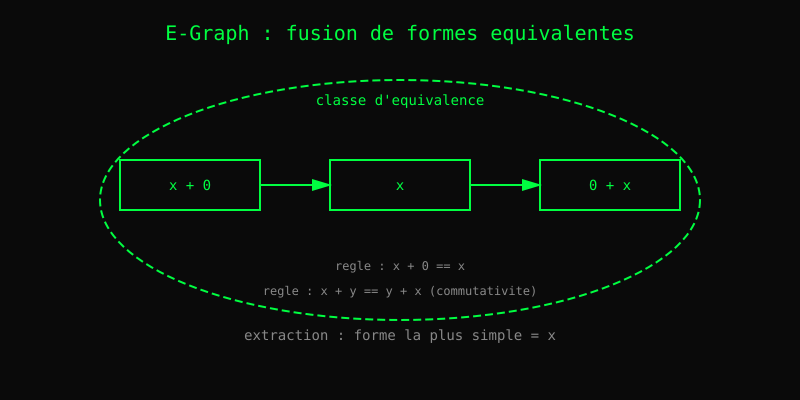

# Chapitre 21 — CAS et E-Graph

> *« L'égalité, c'est la plus puissante des simplifications. »*
> — Gary Larson

Heaven n'évalue pas seulement : il **simplifie**. Une expression
comme `(+ x 0)` devient `x`. `(* 1 y)` devient `y`. Et si on
pousse plus loin, on peut **démontrer** que `(a + b) + c == a + (b + c)`
— c'est l'associativité, une règle que le moteur applique.

C'est le rôle du **CAS** (Computer Algebra System) et de
l'**E-Graph** (Equality Graph). Deux moteurs travaillent ensemble :

- Le **simplifier** (`simplify_engine.zig`) applique des règles
  connues en un seul passage.
- Le **re-writer** (`egraph_rewriter.zig`) explore **toutes** les
  formes équivalentes d'une expression, en cherchant la plus
  simple.

## 1. Le E-Graph

Un **E-Graph** (equality graph) est une structure qui stocke
*plusieurs formes équivalentes d'une même expression*, et qui les
**unifie** quand on découvre qu'elles sont égales.

Prenons `x + 0`. Au départ, on a deux formes :

    Forme A : (+ x 0)
    Forme B : x

On **sait** que `(+ x 0) == x` (identité à droite pour l'addition).
Alors on **fusionne** les deux formes dans une seule **classe
d'équivalence**. Maintenant, toute règle qui s'applique à `(+ x 0)`
s'applique aussi à `x`.

Au fur et à mesure, l'E-Graph **sature** : il ajoute les
conséquences des règles jusqu'à ce qu'aucune nouvelle information
n'apparaisse.

## 2. La saturation

Le principe de **saturation** (ou *equality saturation*) vient de
la théorie de la réécriture. Au lieu de choisir une règle et de
l'appliquer une fois, on :

1. **Applique toutes les règles** à toutes les formes.
2. **Fusionne** les résultats dans l'E-Graph.
3. **Répète** jusqu'à ce qu'aucune nouvelle fusion n'apparaisse.

À la fin, l'E-Graph contient **toutes** les formes équivalentes à
l'expression initiale. On **extrait** alors la plus simple, selon
un critère (nombre de nœuds, coût, préférence).

C'est une approche popularisée en 2021 par Max Willsey et al. dans
*egg: Fast and Extensible Equality Saturation*. Heaven s'en inspire.

## 3. Les règles

Les règles sont dans `core/algebra_rules.hvn`. Quelques exemples :

    x + 0 = x            -- identité
    x * 1 = x            -- identité
    x + x = 2 * x        -- factorisation
    (a + b) + c = a + (b + c)  -- associativité

Chaque règle est une **équation**, et le moteur cherche à
l'appliquer dans les deux sens. C'est pour ça qu'un E-Graph est
plus puissant qu'un simple simplificateur : il ne choisit pas une
direction, il **explore toutes**.

## 4. Exemples

Au REPL :

    heaven> :simplify (+ x 0)
    x

    heaven> :simplify (* 1 (* 2 3))
    6

    heaven> :derive (* x (sin x))
    (+ (sin x) (* x (cos x)))

Le simplifier est **économe** : il applique les règles en un seul
passage. L'E-Graph est **exhaustif** : il explore toutes les
formes, mais coûte plus cher. Heaven utilise les deux : le
simplifier pour les cas courants, l'E-Graph pour les preuves.

## 5. Lien avec les preuves

L'E-Graph est aussi un **outil de preuve**. Si on peut montrer
que deux expressions sont dans la même classe d'équivalence, on a
une **preuve** qu'elles sont égales. C'est ce que fait `prove by
simplify` dans Heaven : il utilise l'E-Graph pour chercher un
chemin de réécriture entre les deux côtés de l'équation.

## Ce qu'on a appris

- Un **E-Graph** stocke plusieurs formes équivalentes et les
  fusionne.
- La **saturation** explore toutes les conséquences des règles.
- On peut **extraire** la forme la plus simple.
- Un E-Graph est aussi un **outil de preuve** : trouver un chemin
  d'équivalence = une preuve.
- Heaven combine **simplifier** (rapide) et **E-Graph** (exhaustif).
