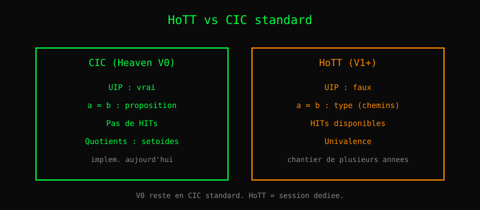

# Chapitre 22 — HoTT, HITs, Univalence

> *« L'égalité n'est pas une proposition, c'est un type. »*
> — Martin-Löf, *Intuitionistic Type Theory* (1984)

Le chapitre 8 a présenté les preuves. Un théorème affirme `a = b`,
et on le prouve par réécriture, induction, ou simplification. Mais
*qu'est-ce que* `a = b` ? Une proposition vraie ou fausse ? Ou
quelque chose de plus riche ?

La **théorie des types homotopiques** (HoTT) propose une réponse
radicale : **l'égalité est un type**. Une preuve de `a = b` est
un habitant du type `a = b`. Et entre deux preuves du même `a = b`,
il peut y avoir *plusieurs* habitants — qui sont eux-mêmes des
chemins, des homotopies.

## 1. Ce que Heaven V0 est vraiment

Heaven V0 est un **CIC standard** — Calcul des Constructions
Inductives, comme Coq, Agda, Lean. Pas HoTT.

Trois propriétés distinguent CIC de HoTT :

- **UIP** (Uniqueness of Identity Proofs) : deux preuves du même
  `a = b` sont identifiables. En HoTT, c'est faux.
- **Pas de types de chemins** : `a = b` est une proposition. En
  HoTT, c'est un type.
- **Pas de HITs** (Higher Inductive Types) : un `data` produit un
  inductif simple, sans constructeurs de chemin.

Ces trois propriétés sont **compatibles** avec CIC et
**incompatibles** avec HoTT.

## 2. Pourquoi V0 n'est PAS HoTT

Ce n'est pas un oubli : c'est un **choix**. HoTT demande une
refonte profonde du noyau, pour deux raisons.

**Raison 1 — Le kernel devrait changer de sémantique.** En CIC,
`a = b` est une proposition qu'on peut habiter par `refl`. En
HoTT, `a = b` est un type dont les habitants sont des chemins, et
ces chemins ont eux-mêmes une structure. C'est une autre théorie.

**Raison 2 — La complexité explose.** HoTT demande de gérer :
- les types de chemins (`a = b`)
- les chemins entre chemins (`p = q` où `p q : a = b`)
- l'univalence (`a ≃ b` → `a = b`)
- les HITs (types inductifs supérieurs)

C'est un **chantier de plusieurs années**, avec une expertise rare.

## 3. Deux voies pour aller vers HoTT

### Voie A — HoTT axiomatique

On ajoute des **axiomes** (univalence, functional extensionality).
Simple à implémenter, mais :
- On perd la **normalisation forte** (les preuves ne calculent plus).
- La cohérence n'est plus garantie par construction.

### Voie B — Cubical Type Theory

On **refond** le noyau avec une sémantique cubique (CCHM, 2016).
- Computationnel : les preuves calculent.
- Cohérence prouvée.
- Chantier de plusieurs années.

**Décision pour V0** : rester en CIC standard. Documenter HoTT
séparément. Voir `docs/spec/_hott.md` pour l'analyse complète.

## 4. Les quotients — un cas à part

Un **quotient** `A / R` est un type où on identifie les éléments
de `A` selon une relation `R`. Exemple : `ℤ / 2ℤ` identifie les
entiers pairs entre eux.

En HoTT, on peut définir les quotients comme des **HITs** — c'est
leur cas d'usage canonique.

En CIC standard, deux options :

1. **Setoïdes** : `Setoid A = (A, R)` avec `R` relation
   d'équivalence explicite. On transporte `R` partout où on
   utilise `A`. Fonctionne **immédiatement** en V0.
2. **Quotients par HITs** : nécessite HoTT. Chantier séparé.

**Recommandation** : commencer par les setoïdes. Ça débloque 90 %
des cas pratiques sans toucher au noyau.

    Setoid Int modulo 2 :
      A = Int
      R(a, b) = (a mod 2) == (b mod 2)

## Ce qu'on a appris

- Heaven V0 est **CIC standard**, pas HoTT.
- Trois propriétés distinguent : UIP, pas de chemins, pas de HITs.
- HoTT demande une **refonte du noyau** (Voie A : axiomes ;
  Voie B : cubical).
- Les **quotients** se font par **setoïdes** en V0, sans toucher
  au noyau.
- HoTT est un **chantier de plusieurs années** — pas un oubli.
