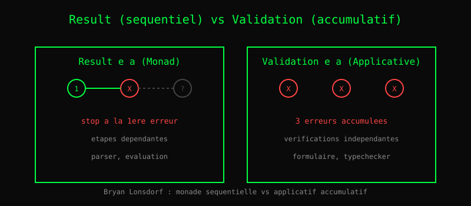

# Chapitre 23 — Validation : accumuler les erreurs

> *« Une monade s'arrête à la première erreur. Un applicatif les
>  accumule toutes. »*
> — Bryan Lonsdorf

Imaginez un formulaire avec 5 champs. L'utilisateur tape mal son
email, oublie son âge, et met un mot de passe trop court. Quelle
erreur afficher ?

**Option 1 — Séquentielle** : on arrête à la première erreur.
« Email invalide. » L'utilisateur corrige, retente, découvre
l'erreur suivante. Frustrant.

**Option 2 — Accumulative** : on vérifie tous les champs, on
collecte **toutes** les erreurs. « Email invalide, âge manquant,
mot de passe trop court. » L'utilisateur corrige tout d'un coup.

C'est la distinction entre **Monad** (séquentiel) et
**Applicative** (parallèle). Bryan Lonsdorf (Dr. Boolean,
auteur de *Mostly Adequate Guide to Functional Programming*) a
popularisé cette distinction.

## 1. Result : la monade séquentielle

    Result e a = Ok a | Err e

Avec `chain`, on enchaîne :

    parse_email(s) : Result String Email
    parse_age(s)   : Result String Int
    validate(p) :
      parse_email(p.email) |> chain (lambda email ->
        parse_age(p.age) |> chain (lambda age ->
          Ok (Pair email age)))

Dès la première `Err`, on s'arrête. Les étapes suivantes ne
tournent pas.

## 2. Validation : l'applicatif accumulatif

    Validation e a = Valid a | Invalid (List e)

Avec `ap`, on **combine** :

    validate(p) :
      ap (ap (ap (Valid (lambda e a -> Pair e a))
                  (parse_email(p.email)))
                  (parse_age(p.age)))
                  (parse_password(p.password))

Les trois parsers tournent. Si l'un échoue, son erreur est
**ajoutée** à la liste. Si deux échouent, on a deux erreurs.

## 3. Quand utiliser quoi

| Cas | Utiliser |
|---|---|
| Chaîne d'opérations dépendantes | `Result` (Monad) |
| Vérifications indépendantes | `Validation` (Applicative) |
| Parseur qui compose | `Result` |
| Formulaire utilisateur | `Validation` |
| Typechecker | `Validation` (accumuler toutes les erreurs) |
| Évaluation d'AST | `Result` (s'arrêter à la première) |

**Règle** : si les étapes sont **indépendantes**, utilisez
`Validation`. Si elles sont **dépendantes**, utilisez `Result`.

## 4. Impact sur Heaven

Heaven utilise cette distinction :

- Le **parser** renvoie `Result` : première erreur de syntaxe,
  on s'arrête.
- Le **typechecker** utilisera `Validation` : accumuler toutes
  les erreurs de type d'un module.
- Le **proof checker** est `Result` : premier but échoué, on
  arrête.

C'est un choix d'ergonomie. L'utilisateur d'un formulaire veut
**toutes** ses erreurs. L'utilisateur d'un parseur veut **la**
première, pour corriger au plus tôt.

## Ce qu'on a appris

- **Result** (Monad) est **séquentiel** : première erreur, stop.
- **Validation** (Applicative) est **accumulatif** : toutes les
  erreurs en un coup.
- Les deux ont leur place : parser → Result, formulaire → Validation.
- Cette distinction vient de **Bryan Lonsdorf** et de la
  communauté Fantasy Land.
- Heaven utilise `Result` pour le parser et `Validation` pour le
  futur typechecker.

## Cinq outils de test, tous en Heaven pur (2026-10-28)

Heaven fournit cinq outils complémentaires, zéro Zig. Chacun a un
rôle distinct — aucun ne remplace l'autre.

| Outil | Rôle | Fichier |
|---|---|---|
| **mocker** | DI minimale (`fixed v`) | `core/std/mocker.hvn` |
| **smocker** | Vrai spy (record + verify + seq) | `core/std/smocker.hvn` |
| **quickcheck** | Property testing (points) | `core/std/quickcheck.hvn` |
| **fuzzer** | Fuzz (trajectoires de msgs) | `core/std/fuzzer.hvn` |
| **loadtest** | Charge in-process (N itérations) | `core/std/loadtest.hvn` |

### mocker — injection simple

    fixed value = lambda _ -> value
    const_fn value = lambda _ -> value

Usage : passer un stub à une fonction qui prend son effet en argument.
Ne **tracke pas** les appels — c'est le rôle de smocker.

### smocker — vrai spy

    mock value = (pair nil value)
    call (pair calls value) arg = (pair (cons arg calls) value)
    result (pair _ value) = value
    count (pair cs _) = ...     -- nombre d'appels
    verify (pair cs _) expected = (= cs expected)  -- LIFO

    seq returns = (pair nil (pair "INIT" returns))
    call_seq (pair calls (pair _ (cons v rest))) arg = ...
    result_seq (pair _ (pair pending _)) = pending

Le state est **threadé explicitement** via `let many`. Usage :

    (let many s0 = (S.mock "FAKE") in
     (let many s1 = (S.call s0 "url1") in
      (and (= (S.result s1) "FAKE")
           (S.verify s1 (cons "url1" nil)))))

### quickcheck — propriétés sur points

    Q.next seed                              -- PRNG déterministe
    Q.gen_int s                              -- entier ≥ 0
    Q.gen_range lo hi s                      -- dans [lo, hi]
    Q.check prop gen n                       -- vérifie n fois

Usage typique :

    test "add_comm":
      (Q.check
        (lambda x -> (= (+ x 1) (+ 1 x)))
        (lambda s -> (Q.gen_int s))
        100) == true

### fuzzer — propriétés sur trajectoires

Génère des **séquences** de messages (pas juste des points isolés),
applique à un composant, vérifie un invariant sur l'état final.

    F.gen_msg seed                   -- "inc" | "dec" | "unknown"
    F.gen_msg_list seed n            -- séquence de N msgs
    F.fuzz_apply_list apply_fn init seed  -- une trajectoire

Usage : `Q.check` sur `fuzz_apply_list` :

    test "counter_bounded":
      (Q.check
        (lambda seed ->
          (bounded_1000 (F.fuzz_apply_list counter_apply 0 seed)))
        (lambda s -> s)
        100) == true

Note : `fuzz_run` (récursion manuelle 5 params) retiré —
`let`/`seq` cassent le TCO (Phase 7). `fuzz_apply_list` + `Q.check`
couvre le même besoin sans récursion.

### loadtest — charge in-process

    L.loadtest_run fn state n        -- n applications, état final
    L.loadtest_iter fn state n       -- compte les itérations

Contrairement à fuzzer (variété), loadtest **répète** la même
transition. But : détecter fuites, régressions de perf, crashes
après épuisement.

    test "1000_incs":
      (let many comp = (C.counter unit) in
       (L.loadtest_run inc_step 0 1000)) == 1000

**Limite** : 50 iters max (TCO let-in non supporté). Pour >50, scripts
bash ou Phase 7 (fix TCO).

### Couverture combinée — Hab counter

`hab/tests/test_component.hvn` (24 tests) combine les 5 outils :

- **5 directs** : counter_init/update/view (unit)
- **8 via component** : mk_component, apply_one, apply_msgs
- **3 quickcheck** : update déterministe, inc/dec identité, N incs
- **2 purity** : view_pure, view_ignores_effects (smocker)
- **4 fuzzer** : gen_msg valide, bounded sur 100/500 trajectoires
- **4 loadtest** : 1/10/50 incs, inc/dec balance

Zéro Zig, zéro framework de test externe. Tout en Heaven.
