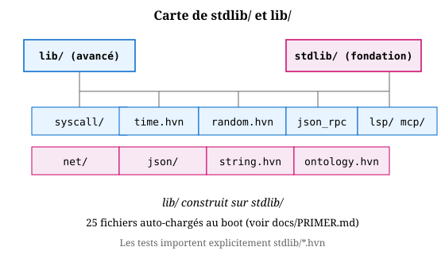

# Stdlib — HTTP, réseau, FS

Ce chapitre montre ce qui **marche aujourd'hui** (testé en CI)
et ce qui est **la cible** (streams + effets algébriques).

État au 2026-10-19 : parsers HTTP testés 7/7, `http_get` (le vrai
fetch) cassé par le bug B3 (let-chain dans helper), serveur HTTP
idem. Voir §6.

## 1. Parsing HTTP (testé)

`stdlib/net/http_client.hvn` fournit trois fonctions testables
sans réseau :

    http_parse_status raw      -- "HTTP/1.1 200 OK" -> 200
    http_parse_body raw        -- "...\r\n\r\nhello" -> "hello"
    http_build_get host path   -- construit la requête GET

Exemple :

    test "parse_200": (http_parse_status "HTTP/1.1 200 OK") == 200
    test "parse_404": (http_parse_status "HTTP/1.1 404 Not Found") == 404
    test "body_hello": (http_parse_body "HTTP/1.1 200 OK\r\n\r\nhello") == "hello"

Côté serveur, `stdlib/net/http.hvn` fournit :

    parse_request raw          -- -> (pair method (pair path nil))
    req_method req / req_path req
    format_response (pair 200 (pair body nil))

      -- -> "HTTP/1.1 200 OK\r\nContent-Length: N\r\n\r\n<body>"

Les deux parsers sont utilisés dans `tests/test_http_client.hvn`
(7/7).

## 2. Client HTTP

`http_get` : récupérer une URL.

    http_get : Url -> (NetCap) -> Response
    http_get url cap =
      let conn = connect (host url) (port url) cap in
        let req  = build_get (path url) (host url) in
          let _    = write conn req cap in
            let resp = read conn cap in
              let _    = close conn cap in
                resp

`http_get` utilise `net_connect`, `net_write`, `net_read`,
`net_close` de `stdlib/net/tcp.hvn` — les mêmes magics que le
serveur. Pas de framework caché.

### Utilisation

    let resp = http_get "http://example.com/" (acquire "net:client") in
      let status = parse_status resp in
        let body   = parse_body resp in
          (handle_response status body)

L'accès à `net_connect` est une **capability** : sans
`cap_acquire "net:client"`, l'appel échoue. C'est volontaire — le
réseau est un effet, il doit être autorisé.

## 3. Serveur HTTP

Le serveur repose sur deux briques : `net_accept` (écoute, bloque
jusqu'à une connexion) et `handle_rec` (intercepte chaque
connexion, laisse le handler décider quoi faire).

### Forme cible (handle_rec)

    serve : (NetCap) -> (Stream Request)
    serve cap =
      handle_rec
        (lambda _ -> perform (Accept cap) unit)
        (lambda fd k ->
          let req  = read fd cap in
            let resp = handle req in
              let _    = write fd (format_response resp) cap in
                k (serve cap))
        0

Chaque `perform (Accept cap) unit` remonte au handler, qui reçoit
le `fd` client. Il traite, écrit, puis `k` relance la boucle. Le
serveur est **une stream paresseuse de requêtes** — pas une boucle
`while true`, une co-routine qui rend la main à chaque étape.

### Réponse unique

    respond_once : (NetCap) -> Int -> Body -> Response
    respond_once cap port body =
      let listen_fd = listen port cap in
        let client    = accept listen_fd cap in
          let req     = read client cap in
            let _     = write client (format_response (Pair 200 (Pair body nil))) cap in
              let _   = close client cap in
                close listen_fd cap

C'est la version la plus simple — un client, une réponse, fin.
Utile pour tester `curl localhost:8080` sans boucle.

### Les magics sous-jacents

| magic | rôle |
|---|---|
| `@net_listen cap port` | fd serveur, écoute sur `port` |
| `@net_accept cap fd` | fd client, bloque jusqu'à connexion |
| `@net_read cap fd` | lit jusqu'à 4096 octets |
| `@net_write cap fd body` | écrit, retourne 0 |
| `@net_close cap fd` | ferme |
| `@net_http_respond cap fd port body` | listen+accept+read+write+close en un |

Tous testés en isolation (`@net_listen` retourne fd=4). Voir §6
pour l'état actuel des formes `let ... in` et du pattern `_`.

### Encart — état de compilation au 2026-10-19

Les formes `http_get` et `serve` ci-dessus sont la **cible
syntaxique** (infixe, `let ... in`, `handle_rec`). Elles ne
compilent pas encore :

- `http_get` : `let ... in` chaîné dans un helper (B3 #2).
- `serve` : `perform` natif (`perform (Accept cap)` plutôt que
  `perform "accept" cap`) est spécifié mais pas implémenté.

Ce qui **compile** aujourd'hui (workaround documenté) :
- `@net_listen`/`@net_accept`/`@net_write`/`@net_close` en
  `fn`/`seq`, voir `docs/tutorials/no_let_chain.md`.
- `handle_rec` en S-expr, testé 4/4
  (`tests/test_effects_rec.hvn`).

Ces workarounds **ne sont pas** la cible. La cible est ci-dessus.
Voir ch. 06 (§8-9) pour `handle_rec` en syntaxe cible.

## 4. FS (`stdlib/fs.hvn`)

API minimale (8 l.) :

    fs_read  cap path          -- -> string
    fs_write cap path content  -- -> 0
    fs_read_public path        -- = fs_read cap ("src/vessel/public/" ++ path)

`fs_read_public` est **restreint** à `src/vessel/public/` — c'est
une capability : si le chemin sort de ce préfixe, l'appel échoue.
C'est intentionnel (sandbox Vessel).

Exemple (testé dans `stdlib/http_body.hvn`) :

    test "read_index": (> (string_length (fs_read_public "index.html")) 100)

Pour lire hors de `src/vessel/public/`, acquérir la capability
correspondante :

    let cap = (cap_acquire "fs:read:/tmp/*") in
    (fs_read cap "/tmp/file.txt")

Note : `fs_write` n'a **pas** de variante `_public` (pas d'écriture
publique par défaut, volontairement).

## 5. La cible — streams + effets algébriques (`handle_rec`)

### Streams (chapitre 7)

`delay expr` et `force t` sont les briques de base (voir
chapitre 7). Une stream est une suite paresseuse :

    stream_nats = (cons 0 (delay stream_nats_from_1))
    -- accès : (take 3 stream_nats)

Ce mécanisme n'est **pas** couplé au réseau aujourd'hui. La cible
est de faire un serveur qui produit une stream de requêtes :

    serve stream =
      let client = (delay (@net_accept cap listen_fd)) in
      (cons (handle_one (force client)) (delay (serve stream)))

### Effets algébriques : `handle_rec`

Syntaxe réelle (testée 4/4 dans `tests/test_effects_rec.hvn`) :

    (handle_rec thunk handler init)

    -- thunk     : la computation, paramétrée par l'état
    -- handler   : (lambda val k -> ...), k = continuation
    -- init      : état initial

Exemple (compteur d'effets) :

    test "handle_rec countdown 5":
      (handle_rec
        (lambda s -> (if (= s 0) 0 (perform "tick" s)))
        (lambda v k -> (if (= v 0) 0 (k (- v 1))))
        5) == 0

Le handler reçoit `(v, k)` : la valeur de `perform` et la
continuation. S'il n'appelle pas `k`, c'est un one-shot (abandon
du reste). C'est la base des **effects**. Voir aussi :

    perform "label" val        -- émettre un signal
    @prompt_depth              -- profondeur de handlers ouverts
    @prompt / @throw           -- continuations délimitées

### Serveur cible (sketch)

    serve listen_fd = (delay (serve_step listen_fd))

    serve_step listen_fd =
      (handle_rec
        (lambda _ -> (perform "accept" ()))
        (lambda _ k ->
          (let client = (@net_accept cap listen_fd) in
            (k (@net_read cap client))))
        ())

**Ce sketch ne marche pas** aujourd'hui (let dans handler, B3 #3,
et `k` comme continuation pas câblée). C'est la cible.

## 6. Bug B3 — let-chain et pattern `_`

Trois bugs séparés, voir `docs/spec/_let_chain_bug.md` :

1. **Fixé** (`66f0b32`) : `heaven run script.hvn` avec let-chain
   top-level.
2. **Fixé 2026-10-23** (`1672ce8`) : let-chain dans helper `.hvn`.
   `f _ = let a = 1 in let b = 2 in a + b` -> `3` OK.
3. **Fixé 2026-10-23** (`1672ce8`) : pattern `_` + appel. `helper _ = 42`
   puis `(helper 0)` -> `42` OK. Débloque E4b (serveur HTTP en `.hvn`).

**Toujours cassé** : `let` en argument de S-expr
(`(+ (let a 1 in a) (let b 2 in b))`).

### Workarounds (testés)

- **`fn` + `seq`** : `fn f _ = (seq e1 (seq e2 e3))` — voir
  `docs/tutorials/no_let_chain.md`.
- **S-expr nested** : `(let a 1 (let b 2 body))` au lieu de
  `let a = 1 in let b = 2 in body`.
- **Éviter `\r\n` dans les strings** : utiliser `@net_http_respond`
  qui formate côté Zig.

### Référence

- `docs/tutorials/no_let_chain.md` — tuto workaround complet.
- `docs/spec/_let_chain_bug.md` — diagnostic détaillé.
- `docs/spec/_handle_rec_status.md` — état effects.

## 3bis. `http_server.hvn` v0 — serveur en Heaven pur (2026-10-19)

Serveur multi-client en `.hvn`, livré (commit `2c35724`), testé
avec `curl` × 3 (`hi` sur chaque requête).

    -- http_server.hvn (extrait)
    do_respond client _ =
      seq (@net_read unit client)
        seq (@net_write unit client "HTTP/1.1 200 OK\r\nContent-Length: 2\r\n\r\nhi")
          seq (@net_close unit client) 0

    do_one listen_fd _ = (do_respond (@net_accept unit listen_fd) 0)

    serve listen_fd = (seq (do_one listen_fd 0) (serve listen_fd))

    serve_listen port =
      seq (print (string_concat "heaven http: http://127.0.0.1:" (int_to_string port)))
        (serve (@net_listen unit port))

    (serve_listen 8080)

Lancement : `./zig-out/bin/heaven run http_server.hvn`
Test : `curl http://127.0.0.1:8080/` → `hi`

C'est la preuve concrète que la cible du §3 (`handle_rec` +
stream) est faisable en Heaven pur, version récursive au lieu de
`handle_rec` (qui viendra après `effects-consolidation`).

**Routing (v1) en cours** : voir `_http_fullstack_plan.md` section
"E4-D2bis". Contrainte : pas de `string_eq` en condition d'`if`
dans un helper local (SIGSEGV), utiliser `==` infixe.

NB : GitHub Pages n'utilise PAS ce serveur (hébergement statique).
C'est pour déploiement local/VPS.

## 3ter. Serveur natif `--http-serve` (2026-10-27)

Variante validée en `E4/3.2a`, qui charge le serveur depuis
`core/http_server.hvn` (Heaven pur) sans passer par `startVesselServer`.

    ./zig-out/bin/heaven --http-serve 18080

Dans `src/main.zig`, le flag instancie un `Heaven` dédié et appelle
`runHttpServer(18080)`, qui :

1. lit `core/http_server.hvn` (2488 o) ;
2. le découpe en 14 statements via `splitStatements`, évalue chacun ;
3. arme le fuel (`@set_fuel 0`, infini) ;
4. évalue `(hvn_http_serve_v2 18080)`.

`hvn_http_serve_v2` :

    hvn_http_serve_v2 port =
      let cap = (cap_acquire (string_concat "net:listen:" (int_to_string port))) in
      let listen_fd = (net_listen cap port) in
      let _ = (print (string_concat "🌌 Heaven HTTP on http://127.0.0.1:" (int_to_string port))) in
      (server_loop cap listen_fd)

    server_loop cap listen_fd =
      (if (@exiting) unit (server_loop_step cap listen_fd))

`@exiting` (flag atomique dans `src/core/exiting.zig`) sera levé par
le futur `@signalfd` (Phase B, Linux) / `kernel32` (Windows). Aujourd'hui
`Ctrl-C` tue le process brutalement ; le shutdown propre est **dette
Phase B**.

**Mesures validées** (Linux x86_64, Debug) :

| Route              | Code | Taille  | Content-Type        |
|--------------------|------|---------|---------------------|
| `/repl.html`       | 200  | 38261 o | `text/html`         |
| `/heaven.wasm`     | 200  | 584755o | `application/wasm`  |

3 requêtes successives + un `HEAD` sur le wasm → 5 `@net_accept`,
process VIVANT, pas de fuite mémoire observée.

**Pré-requis Debug** : `HEAVEN_NO_LEAK_CHECK=1`, à cause d'un
`assert(!gop.found_existing)` préexistant (heap corruption, voir
`docs/spec/_http_debug_crash.md`). En ReleaseFast, non requis.

**Dette** : `hvn_http_serve_v2` est encore récursif manuel (pas de
scheduler/acteurs/`handle_rec`). Réécriture prévue en 3.3a.
