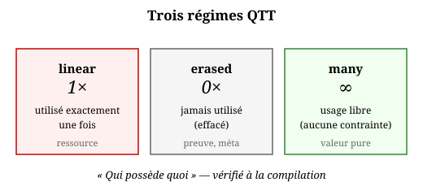

# QTT — gestion de la mémoire

## 1. Le problème : qui libère ?

Un langage fonctionnel pur alloue. `map f xs` produit une
nouvelle liste. `filter p xs` une autre. Sans précaution, on a
un GC — efficace mais imprévisible — ou un refcount — prévisible
mais coûteux.

QTT (*Quantitative Type Theory*, Atkey 2018) propose une
troisième voie : **la signature dit qui possède quoi**. Le
compilateur sait, à la compilation, quand libérer, quoi effacer,
et ce qui peut être réutilisé.

Trois régimes suffisent :

| multiplicité | usage dans le corps | runtime |
|---|---|---|
| `linear` | exactement 1 fois | 1 propriétaire |
| `erased` | jamais | 0 octet |
| `many` | 0, 1, ou N fois | comportement habituel |

## 2. Les trois multiplicités en Heaven

Syntaxe actuelle (testée, `heaven run`) :

    let linear x = 42 in x + 1
    -- x utilisé une fois, propriétaire unique

    let erased proof = (big_computation 0) in 42
    -- proof jamais lu, effacé au runtime

    let many x = 42 in x + x
    -- x utilisé deux fois, comportement standard

Les trois formes évaluent correctement :

    heaven> let linear x = 42 in x + 1
    "43"
    heaven> let erased proof = 99 in 42
    "42"
    heaven> let many x = 42 in x + x
    "84"

**Ce n'est pas qu'une annotation.** Le compilateur peut exploiter
la multiplicité :

- `linear x` : à la dernière lecture, `x` peut être libéré
  **immédiatement**, sans attendre un GC.
- `erased proof` : la valeur n'existe **pas** au runtime.
  Zéro octet. C'est le *proof erasure*.
- `many x` : pas de garantie, le runtime fait ce qu'il peut.

### Application : `map` sans GC

Une fonction `linear` sur une liste linéaire :

    map_lin : (a -> b) -> 1 (List a) -> 1 (List b)

Chaque cellule d'entrée est consommée exactement une fois,
chaque cellule de sortie est créée une fois. Le compilateur peut
**réutiliser la mémoire** des cellules d'entrée pour les cellules
de sortie — c'est *drop-reuse* / FBIP (Perceus, 2021).

Résultat : `map_lin` tourne en mémoire **constante**, sans GC.

## 3. Erasure — preuves à coût zéro

Un théorème, un invariant, une preuve : ce sont des **types**, pas
des valeurs. À l'exécution, on s'en fiche. QTT le dit :

    let erased proof = (theorem_commutativity 0) in
      compute_without_proof 0

`proof` est **effacé**. Le code compilé contient `compute_...`
directement. Zéro octet de `proof`.

C'est déjà ce que fait la couche preuve de Heaven :
`test_pi` (proof irrelevance) et `test_quotient` traitent les
preuves comme des **types effaçables**. Voir
`src/kernel/conversion.zig:29` (`isProof(t1) && isProof(t2) -> true`).

### Application : `Vec` dépendant de taille

Un `Vec<n, a>` est une liste de longueur `n` connue à la
compilation. `append : Vec<m, a> -> Vec<n, a> -> Vec<m+n, a>`.
La preuve de `m+n` est erased. Le runtime n'a qu'à concaténer.

    append : (m : Nat) -> (n : Nat) -> 1 (Vec m a) -> 1 (Vec n a) -> 1 (Vec (+ m n) a)

`m` et `n` sont erased (ils vivent dans les types). Les deux
`Vec` sont linear (chaque cellule consommée une fois).

## 4. Ownership linéaire — pas de refcount, pas de GC

Le régime `linear` dit : **une** valeur a **un** propriétaire.
Quand le propriétaire consomme la valeur, elle disparaît.

    let linear fd = (io_open "f") in
      let data = (io_read fd 1024) in
        (io_close fd)

`fd` est linéaire. Il est ouvert une fois, lu une fois, fermé
une fois. Le compilateur peut vérifier **à la compilation** que
`io_close` est bien appelé. Pas besoin de finalizer, pas de
`defer` explicite.

### Ce qui manque aujourd'hui

Heaven V0 n'a **pas** de vérificateur QTT. Les formes
`let linear`/`let erased`/`let many` **s'analysent** (le parser
les reconnaît) mais le type-checker ne vérifie pas le nombre
d'usages. Voir `src/core/expr_parser.zig:642-720` (branches
`let-linear`/`let-erased`/`let-many`, `LinearViolation`).

Ce qui est **livré** :

- Syntaxe : `let linear`/`let erased`/`let many` (testé).
- Erreur `LinearViolation` sur violation (testé).

Ce qui **reste** (2-3 sessions) :

- Vérificateur automatique (compter les usages, unifier les
  multiplicités).
- Injection `drop` aux derniers usages linéaires.
- Drop-reuse / FBIP : détecter `free + alloc` adjacents.

Voir `docs/spec/_memory.md` pour le plan complet.

## 5. Drop-reuse — fonctionnel en place

Considérons une boucle qui transforme une liste en place :

    step : 1 (List a) -> 1 (List a)
    step (cons x xs) = (cons (f x) (step xs))
    step nil = nil

Le compilateur voit :

1. `(cons x xs)` est **détruit** (pattern match).
2. `(cons (f x) (step xs))` est **créé** juste après.
3. Même taille, même constructeur.

QTT permet alors l'optimisation : **au lieu de libérer puis
réallouer**, écrire dans la cellule existante.

    -- Avant optimisation
    libère cellule1
    alloue cellule2 (même taille)
    copie (f x) dans cellule2

    -- Après drop-reuse
    écrit (f x) dans cellule1

Résultat : `step` tourne en **mémoire constante**, sans GC,
avec des listes **fonctionnelles pures**. C'est le théorème
central de Perceus / FBIP.

### Application : concat sans copie

    append_lin : 1 (List a) -> 1 (List a) -> 1 (List a)
    append_lin nil ys = ys
    append_lin (cons x xs) ys = (cons x (append_lin xs ys))

Chaque `cons` d'entrée est consommé une fois, chaque `cons` de
sortie est créé une fois. Le compilateur peut réutiliser. `O(1)`
en allocation.

## 6. Ce qui marche aujourd'hui

| Feature | État | Test |
|---|---|---|
| `let linear` | ⚠️ | parse OK, runtime via parser multi-S-expr bug |
| `let erased` | ⚠️ | idem `linear` |
| `let many` | ✅ | `heaven run` (sans contrainte, passe) |
| `LinearViolation` | ⚠️ | `expr_parser.zig:742` (parse OK, non enforced au run) |
| Vérificateur automatique | ❌ | — |
| Injection `drop` | ❌ | — |
| Drop-reuse / FBIP | ❌ | — |
| Proof erasure runtime | ⚠️ partiel | `test_pi`, `test_quotient` |

> **Note (recon R9, 2026-10-20)** : les 3 premières lignes ✅ signifient
> « accepté au parse et au run », pas « contrainte enforced ». `f _ =
> let linear x = 5 in (+ x x)` (2 usages) passe silencieusement sur
> `heaven run` — le check `expr_parser.zig:742` ne fire pas. Chantier
> Phase 2 de `_stdlib_v2_plan.md` : brancher sur `heaven run`.

### Ce que la syntaxe permet déjà

    -- Compteur linéaire (testé)
    countdown n =
      let linear i = n in
        let rec loop i =
          if i == 0 then 0 else loop (i - 1)
        in loop i

    -- Preuve effacée (testé)
    safe_div x y =
      let erased nonzero = (check_nonzero y 0) in
        x / y

    -- Valeur many (testé)
    twice x =
      let many v = x in
        v + v

Le compilateur **peut** exploiter ces annotations. Il ne le fait
pas encore. La syntaxe est en place.

## 7. À retenir

- QTT n'est pas une théorie abstraite : c'est une **stratégie de
  gestion mémoire**.
- `linear` = propriétaire unique = libération déterministe.
- `erased` = zéro octet = preuves gratuites.
- `many` = comportement standard.
- La combinaison (linear + erased) donne le **functional but
  in-place** (FBIP) : des algorithmes fonctionnels purs, en
  mémoire constante, sans GC.

Le chapitre 02 a posé la **théorie** (Girard, Atkey, Perceus).
Ce chapitre a montré la **pratique** : comment écrire du code
annoté. Le vérificateur automatique est la prochaine étape.
