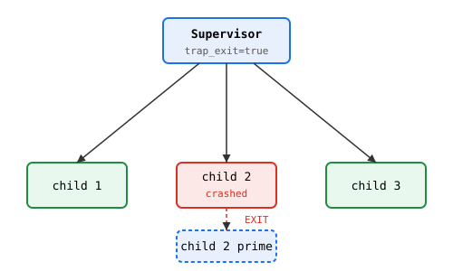
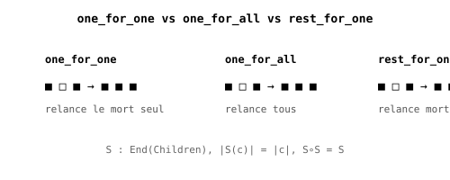

# OTP — Superviseurs en Heaven pur

> Portage OTP (Erlang/Elixir) dans Heaven, sur le runtime acteur existant.

## Pourquoi OTP

Un acteur seul ne survit pas aux pannes. OTP (1998) résout ça avec
trois briques : GenServer (protocole standard), links (les acteurs
meurent ensemble ou pas), superviseurs (restart automatique des
enfants morts).

Heaven porte ces briques **nativement**, sur le même niveau que les
effets algébriques.

## GenServer — protocole standard

    fn gen_server_step(state, msg) = msg state
    gen_server_spawn init       = spawn gen_server_step init
    gen_server_cast pid f       = tell pid f
    gen_server_call pid f       = let _ = tell pid f in run pid

Exemple — un compteur :

    inc x = x + 1
    same x = x

    test "compteur":
      (let many p = (gen_server_spawn 0) in
       (let many _ = (gen_server_cast p inc) in
        (let many _ = (gen_server_cast p inc) in
         (gen_server_call p same)))) == 2

## Links et trap_exit

Un lien est bidirectionnel. trap_exit(pid, true) casse la propagation :
pid reçoit "EXIT" dans sa mailbox au lieu de mourir. Base du superviseur.

## Trois stratégies

| Stratégie    | Comportement                    |
|--------------|---------------------------------|
| one_for_one  | relance le mort seul            |
| one_for_all  | relance tous                    |
| rest_for_one | relance le mort + les suivants  |

## Théorèmes prouvés (par tests)

1. HKT : Strategy : ∀h. (h, Children) → Children (uniforme en h)
2. Endofunctor : S : End(Children)
3. Préservation : |S(c)| = |c|
4. Idempotence : S ∘ S = S
5. Optique : fst/snd = Lens(State, Children)
6. Dualité MPST : ?Exit. !Restart* (chapitre 29)

## Limites

Préemption SIGALRM ~10 ms → tests longs dépassent le seuil, état local
perdu. Voir captureCont (3a-3b) dans la spec scheduler.

Voir docs/spec/_otp.md pour la spec complète (O1 → O3).
