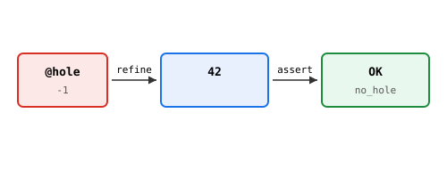

# TDD — Type Driven Development

> Holes, refine, case : construire par étapes.

## Hole

Le trou est créé par la primitive @hole (sentinelle -1). La détection
se fait par @is_hole.

    test "hole_detect":
      (@is_hole (@hole)) == true

Note : ? en Heaven est réservé aux **types** (optional_type,
query_expr), pas aux termes.

## Refine

(refine hole actual) = actual. Discipline d'écriture.

    test "refine_fills":
      (refine (@hole) 42) == 42

## Assert

(@assert_no_hole v) — erreur UnfilledHole si v est un hole.

    test "assert_ok":
      (@assert_no_hole 42) == 42

## Roadmap

- case runtime (aujourd'hui elab-only, pour preuves).
- refine AST (vraie substitution, pas identity).
- Holes typés (? : Int).
- ?goal (contexte Lean-like).

## Pourquoi runtime ?

Cohérent avec QTT, effects, MPST runtime. On vérifie ce qui se passe,
pas ce qui pourrait se passer.

Voir core/std/tdd.hvn + src/core/hole.zig + src/core/hole_runtime.zig.
