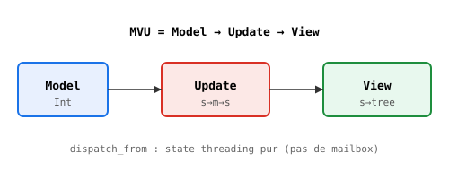

# Hab — MVU avec optiques

> Composants réactifs en Heaven pur, sur le runtime existant.

## L'idée Hab

Hab (Heaven App Builder) applique l'architecture MVU (Model-Update-View)
d'Elm au runtime acteur Heaven. Trois pièces :

- **Model** : l'état (n'importe quelle valeur Heaven)
- **Update** : `state -> msg -> state` (fonction pure)
- **View** : `state -> tree` (arbre de rendu pur, pas de DOM)

`hab/component.hvn` fournit `mk_component init update view`,
`component_init`, `component_update`, `component_view`, `apply_msgs`.

## Optique Lens(State, Model)

`hab/component_actor.hvn` définit un lens pour isoler le modèle
dans un état composite :

    lens_mvu_get s     = (snd s)                       -- view
    lens_mvu_set v s   = (pair (fst s) v)              -- set
    lens_mvu_over f s  = (pair (fst s) (f (snd s)))    -- over

Trois lois :

1. `view(set(v, s)) = v`
2. `set(view(s), s) = s`
3. `over(f) = set(f(view(s)))`

Testées dans `tests/o4_lens_*.hvn`.

## dispatch_from — state threading pur

Le runtime acteur a trois dettes (STATUS.md:303) : `run` multi-message
perd des messages, thunks top-level invisibles, `(f a b)` ne curryfie
pas. Contournement : `dispatch_from` thread l'état **côté appelant**,
sans mailbox.

    dispatch_from update_fn model msg =
      (let many u = (force update_fn) in
       (u model msg))

`dispatch_list` itère sur N messages. `force` déballe la curryfiée.
C'est l'API canonique Hab tant que le runtime n'est pas fixé.

## Exemple — compteur

    counter_update s m = (s + m)
    test "3 msgs":
      (A.dispatch_list counter_update 0 (cons 1 (cons 2 (cons 3 nil)))) == 6

## Vision — supervision (O4.2)

Prochaine étape : un parent supervise n enfants, chaque enfant étant
un composant MVU indépendant. Utilise :

- `dispatch_from` par enfant (état local)
- Lens composés (`parent ∘ child`) pour l'état global
- `sup_spawn_v2` d'OTP pour le restart

Voir `docs/spec/_runtime_gaps.md` pour les dettes runtime.
