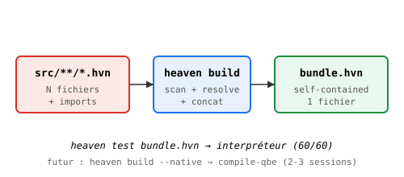

# heaven build — Bundler

> Résoudre les imports une fois, distribuer 1 fichier.

## Le problème

Un projet Heaven = N fichiers `.hvn` avec des `import`. Sans bundler,
chaque `heaven test` résout les imports runtime (lent, répétitif).

## La solution

    heaven build <dir|file> -o <out.hvn>

Produit un `.hvn` self-contained : tous les imports résolus sont
inlinés dans l'ordre topologique.

## Algorithme

1. Scan récursif des `.hvn`
2. Extraction `import "X"` ligne par ligne
3. Résolution récursive (préfixes core/, hab/, tests/, examples/)
4. Concat avec marqueurs `-- ═══ path ═══`
5. Écriture bundle

## Exemple

    heaven build hab/ -o /tmp/hab.bundle.hvn
    → 8 scannés, 13 résolus, 18KB

    heaven build /tmp/test_hab.hvn -o /tmp/th.hvn
    → 4 résolus, 6KB
    heaven test /tmp/th.hvn
    → 60/60 ✓

## Limites (2026-10-29)

- Pas de compilateur natif (compile-qbe/wasm cassés)
- Bundle interprété par `heaven test` uniquement
- Pas de cache incrémental (rebuild à chaque invocation)
- `runTestFile` exit 0 même sur échec (bug séparé)

## Vision

À terme : `heaven build --native <dir>` = bundle + compile-qbe → binaire
autonome. Débloque l'auto-hébergement E1.
