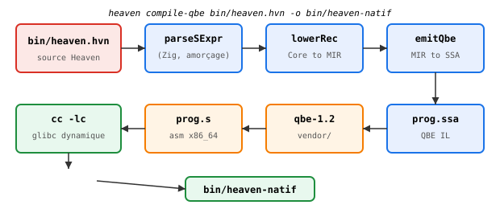
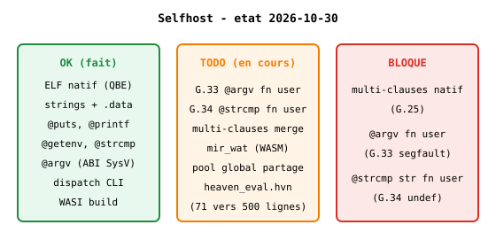
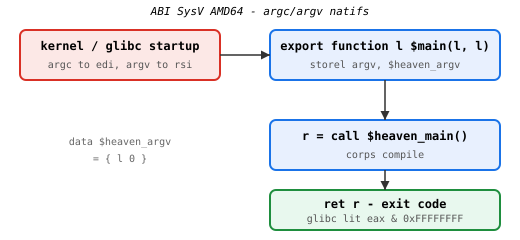
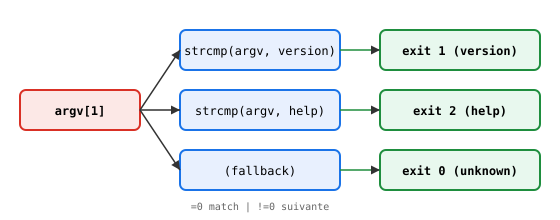

# Self-hosting — de Zig à Heaven

> **État au 2026-10-30.** `bin/heaven.hvn` → ELF x86_64 produit par
> QBE, exécuté nativement, **zéro Zig au runtime**. Voir annexe G
> (G.25 → G.34) pour les 11 pièges rencontrés.

## Pipeline selfhost



    bin/heaven.hvn
      -> parse.Parser.parseSExpr    (Zig, amorçage)
      -> store.lowerRec             (Core -> MIR)
      -> mir_qbe.emitQbe            (MIR -> QBE SSA)
      -> qbe-1.2 (vendor)           (SSA -> asm x86_64)
      -> cc -lc                     (asm -> ELF)

`heaven compile-qbe bin/heaven.hvn -o bin/heaven-natif` produit un
ELF 18 Ko, dynamiquement linké à glibc.

## Matrice : ce qui marche



| Composant | État | Tag |
|---|---|---|
| ELF natif produit par QBE | OK | `selfhost-v0` |
| Exit code = valeur | OK | `selfhost-v0.1` |
| Strings littérales (`const_str`) | OK | `selfhost-str-v0` |
| `@puts`, `@printf`, `@getenv` | OK | `selfhost-puts-v0.1` |
| Strings avec espaces (G.30) | OK | `selfhost-strings-space-v0` |
| `@argv N` (ABI SysV) | OK | `selfhost-argv-v0` |
| Dispatch CLI via `@strcmp` | OK | `selfhost-dispatch-v0` |
| WASI build débloqué | OK | `wasm-wasi-v1` |
| Multi-clauses | G.25 | — |
| `@argv` fn user | G.33 | — |
| `@strcmp "str"` fn user | G.34 | — |
| WASM selfhost (`mir_wat`) | TODO | — |
| `heaven_eval.hvn` complet | TODO | — |

## ABI SysV : wrapper `$main`



Le wrapper `$main` émise par `emitQbeLoop` :

```qbe
export function l $main(l %argc, l %argv) {
@start
    storel %argv, $heaven_argv
    %r =l call $heaven_main()
    %r2 =l call $printf(l $fmt, l %r)
    ret %r
}
data $fmt = { b "%ld\n", b 0 }
data $heaven_argv = { l 0 }
```

- `argc` en `%edi`, `argv` en `%rsi` (SysV AMD64).
- Retour dans `%eax` (glibc lit `eax & 0xFFFFFFFF`).
- Si `@argv` inutilisé, wrapper `l $main()` sans args.

## Dispatch CLI via `@strcmp`



```hvn
-- bin/heaven.hvn V0.6
main = (if (= (@strcmp (@argv 1) "version") 0) 1
        (if (= (@strcmp (@argv 1) "help") 0) 2 0))
```

```bash
./bin/heaven-natif version   # exit 1
./bin/heaven-natif help      # exit 2
./bin/heaven-natif foo       # exit 0
```

`@strcmp` = `extern_call strcmp(a, b)` → glibc link direct.
Multi-clauses (G.25) contournées par cascade `if`.

## Pièges à connaître

| Piège | Résumé | Fix |
|---|---|---|
| **G.25** | `precompileUserFns` exclut multi-clauses | skip (V0.1) |
| **G.26** | `$main` void → exit code ignoré | `l $main()` + `ret %r` |
| **G.27** | eval string pollue warnings | cosmétique |
| **G.28** | string binding non inliné | `substituteStrings` |
| **G.29** | `@nom` rejeté par `heaven parse` | compile-qbe OK |
| **G.30** | strings splittées sur espaces | `in_string` tracking |
| **G.31** | `str_pool` fn_defs non émis | skip fn_defs (workaround) |
| **G.32** | `@argv` ABI SysV | wrapper `l $main(l, l)` |
| **G.32-bis** | `@strcmp` déjà fonctionnel | (aucun fix) |
| **G.33** | `@argv` fn user → segfault | propag. argv_sym |
| **G.34** | `@strcmp "str"` fn user → undef | pool global partagé |

Détails : [Annexe G — Pièges runtime](G-pieges.md).

## Roadmap selfhost

| Étape | Statut | Effort |
|---|---|---|
| 1. ELF natif + strings + puts | OK | fait |
| 2. `@argv` + dispatch `@strcmp` | OK | fait |
| 3. G.33 `@argv` fn user | TODO | 30 min |
| 4. G.34 `@strcmp` fn user | TODO | 45 min |
| 5. Multi-clauses merge | TODO | 30 min (après 3-4) |
| 6. WASM selfhost (`mir_wat`) | TODO | 1h |
| 7. `heaven_eval.hvn` 71→500 | TODO | 2-3 sessions |
| 8. `bin/heaven.hvn` V1.0 (vrai dispatch) | TODO | après 5 |

**Après #8** : parallélisme, OTP, HKT, HoTT sécrivent
## Voir aussi

- [Backend QBE](34-backend-qbe.md) — `const_str`, `@argv`, wrapper
- [Backend WASM](35-backend-wasm.md) — WASI build débloqué
- [Annexe G](G-pieges.md) — G.25 → G.34
- [Spec selfhosting](../spec/_selfhosting_roadmap.md) — roadmap détaillée
