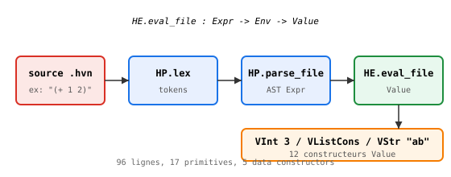

# heaven_eval — évaluateur métacirculaire

> **État au 2026-10-30.** `lib/heaven_eval.hvn` évalue un AST `Expr`
> produit par `lib/heaven_parse.hvn`. 96 lignes, 17 primitives, 5
> constructeurs de données. V0.4.

## Pipeline



    source .hvn
      -> HP.lex         (lib/heaven_parse.hvn)
      -> HP.parse_file  (AST Expr)
      -> HE.eval_file   (Env -> Value)

## Architecture

`Value` (12 constructeurs) :

| Tag | Contenu | Rôle |
|---|---|---|
| `VInt` / `VStr` | littéral | Int, Str |
| `VCon` | nom | constructeur partiel (`nil`, `cons`) |
| `VClosure` / `VRecClosure` | param, body, env | lambda (non-)récursive |
| `VPrim` / `VPrim1` / `VPrim1V` | op, (arg1) | primitive currifiée |
| `VListNil` / `VListCons` | (head, tail) | listes |
| `VIf1` / `VIf2` | expr | if en 2 étapes (curryfication) |
| `VErr` | msg | erreur runtime |

`Env` = liste d'association persistante (`EnvNil`, `EnvCons nom value
env`). Les closures capturent l'env, donc pas de mutation.

## Primitives (17)

| Catégorie | Primitives |
|---|---|
| Arithmétique | `+`, `-`, `*` |
| Comparaison | `=`, `<`, `==`, `!=`, `>`, `<=`, `>=` |
| Listes | `cons`, `head`, `tail` |
| Pairs | `pair`, `fst`, `snd` (alias listes) |
| Strings | `string_concat` |
| Contrôle | `if` |

**Littéraux réservés** : `nil` → `VListNil`, `true` → `VInt 1`,
`false` → `VInt 0`.

## Limitations (parser HP)

Trois pièges limitent l'usage via `.hvn` source :

| Piège | Symptôme | Contournement |
|---|---|---|
| **G.37** | token unique (`nil` bare) → `ENil` | contexte multi-token |
| **G.38** | `HP.parse_file` sur `let`/`lambda` → `ArityMismatch` | AST hardcodé |
| **G.39** | `λ`/`fn` dans string `.hvn` → `ArityMismatch` (tree-sitter) | AST hardcodé |

`HP.lex` et `HP.parse_file` **marchent** sur ces mots (testé via
`HP.lex "(λ x x)"` → tokens corrects) ; c'est le parser **hôte** (le
`.hvn` qui contient la string de test) qui intercepte `λ`/`fn`.


## Exemple

```hvn
import "lib/heaven_parse.hvn" as HP
import "lib/heaven_eval.hvn" as HE
HE.eval_file (HP.parse_file (HP.lex "(+ 1 2)")) HE.EnvNil
-- → (VInt 3)
```

## Roadmap

| Étape | Statut |
|---|---|
| listes, pairs, booléens | OK (v0.2) |
| `string_concat` | OK (v0.3) |
| `λ`/`fn` via AST | OK (v0.4) |
| `let` désucré | TODO |
| parser fix (G.37/G.38/G.39) | TODO (1 session) |
| TCO, `@magic`, imports | TODO |

## Voir aussi

- [Self-hosting](39-selfhosting.md) — backend QBE/WASM
- [Annexe G](G-pieges.md) — G.37, G.38, G.39
- [Spec métacircularité](../spec/_metacircularite_chantier.md)
